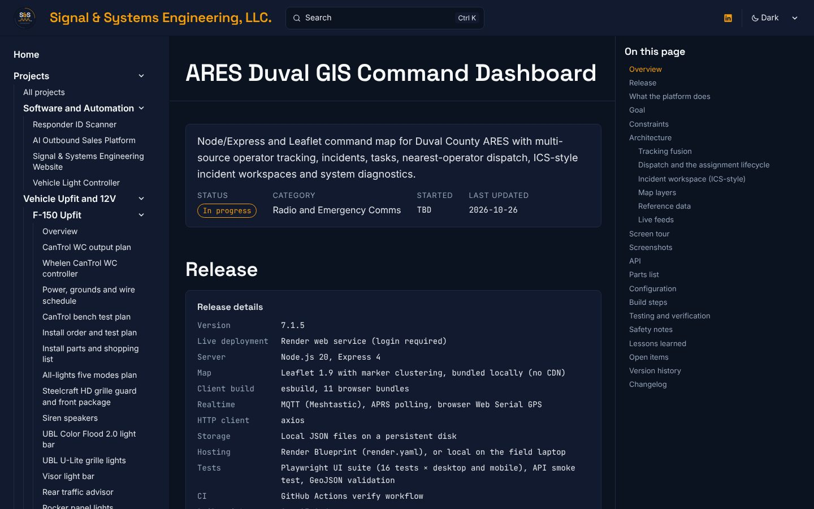

import SpecBox from '../../../components/SpecBox.astro';
import Callout from '../../../components/Callout.astro';
import Gallery from '../../../components/Gallery.astro';
import Changelog from '../../../components/Changelog.astro';
import gisPage from '../../../assets/log/codex-projects/gis-page-dark.jpg';
import gisTesting from '../../../assets/log/codex-projects/gis-testing-light.jpg';
import gisShots from '../../../assets/log/codex-projects/gis-screenshots-dark.jpg';
import fieldPage from '../../../assets/log/codex-projects/field-dashboard-dark.jpg';
import fieldModules from '../../../assets/log/codex-projects/field-modules-light.jpg';
import lightPage from '../../../assets/log/codex-projects/light-controller-dark.jpg';
import lightApi from '../../../assets/log/codex-projects/light-controller-api-light.jpg';
import fieldHome from '../../../assets/ares-field/01-home.jpg';
import fieldDash from '../../../assets/ares-field/02-dashboard.jpg';
import fieldChecks from '../../../assets/ares-field/03-checklists.jpg';
import fieldCom from '../../../assets/ares-field/04-com-usb.jpg';
import lcOff from '../../../assets/light-controller/01-dashboard-all-off.jpg';
import lcFull from '../../../assets/light-controller/02-dashboard-full.jpg';
import lcParked from '../../../assets/light-controller/03-parked-incident-active.jpg';
import gisDay from '../../../assets/ares-gis/desktop-map-day.webp';
import gisNight from '../../../assets/ares-gis/desktop-map-night.webp';
import gisOps from '../../../assets/ares-gis/desktop-operators-drawer.webp';
import gisDispatch from '../../../assets/ares-gis/desktop-dispatch-drawer.webp';
import gisTasks from '../../../assets/ares-gis/desktop-tasks-drawer.webp';
import gisLayers from '../../../assets/ares-gis/desktop-layers-drawer.webp';
import gisDiag from '../../../assets/ares-gis/desktop-diagnostics-drawer.webp';
import gisMobile from '../../../assets/ares-gis/mobile-map-day.webp';

**Date:** 2026-10-26 (all times below are UTC; US Eastern is UTC minus 4 hours)\
**Projects:** [ARES CF-33 Field Dashboard](/projects/ares-field-dashboard/), [ARES Duval GIS Command Dashboard](/projects/ares-gis-dashboard/), [ARES Vehicle Light Controller](/projects/vehicle-light-controller/)\
**Pull requests:** [#6](https://github.com/signsys90/signal-and-systems/pull/6), [#16](https://github.com/signsys90/signal-and-systems/pull/16), [#23](https://github.com/signsys90/signal-and-systems/pull/23)



This entry is the full record of how three emergency communications tools I built with OpenAI Codex got onto this site. It covers where the source material came from, every pull request, the test results and what caused the GIS dashboard's failing tests, how the screenshots were made without exposing anyone's data, what was left off on purpose, and what is still open. Every number here comes from the project files, the pull requests or the test runs. Anything I could not confirm is marked as unverified.

<SpecBox
	title="At a glance (as of 2026-10-27)"
	specs={[
		['Projects documented', '3: CF-33 Field Dashboard, Duval GIS Command Dashboard, Vehicle Light Controller'],
		['Built with', 'OpenAI Codex, on my Panasonic Toughbook CF-33'],
		['Source location', 'My Codex folder on the CF-33, read through folder access'],
		['Pull requests', '3 (#6, #16, #23), all merged on 26 Oct'],
		['Screenshots published', '15 app screenshots: 4 field dashboard, 3 light controller, 8 GIS (demo data only)'],
		['Light controller tests', '14 of 14 passed (simulation, Linux, Python 3.13)'],
		['GIS UI tests, Windows', '16 passed, 14 skipped by design, 2 visual-baseline checks failed'],
		['GIS API smoke test and GeoJSON validation', 'Passed (Linux, 26 Oct). API smoke also passed on Windows'],
		['Live GIS deployment', 'Render web service, login required. /healthz 200, / 401'],
		['Hardware bench tested', 'None yet'],
		['Status on the site', 'All three In progress, start dates TBD'],
	]}
	source={{ label: 'GitHub pull requests #6, #16 and #23, and the three project pages', href: 'https://github.com/signsys90/signal-and-systems/pull/16' }}
/>

## Contents

1. [Summary](#summary)
2. [The three tools](#the-three-tools)
3. [Where the material came from](#where-the-material-came-from)
4. [Timeline](#timeline)
5. [Every pull request](#every-pull-request)
6. [ARES CF-33 Field Dashboard](#ares-cf-33-field-dashboard)
7. [ARES Duval GIS Command Dashboard](#ares-duval-gis-command-dashboard)
8. [ARES Vehicle Light Controller](#ares-vehicle-light-controller)
9. [The GIS test failures, solved](#the-gis-test-failures-solved)
10. [Screenshots and how they were made](#screenshots-and-how-they-were-made)
11. [Privacy rules and what was left off](#privacy-rules-and-what-was-left-off)
12. [Problems hit and how they were solved](#problems-hit-and-how-they-were-solved)
13. [Testing and verification](#testing-and-verification)
14. [How these tools fit together](#how-these-tools-fit-together)
15. [What I learned](#what-i-learned)
16. [Open items](#open-items)
17. [Next step](#next-step)

## Summary

### What I did

I documented three emergency communications tools I built with OpenAI Codex, each on the site's standard 12-section project template:

- **ARES CF-33 Field Dashboard:** an offline Electron app that turns my Toughbook into an organized field laptop, with 109 launchers in 22 modules, Mission Ops, PACE plans and an operator log.
- **ARES Duval GIS Command Dashboard:** a Node and Leaflet command map that fuses APRS, Meshtastic, DMR, manual check-ins and opt-in browser GPS for Duval County ARES, with incidents, tasks, nearest-operator dispatch and ICS-style incident workspaces.
- **ARES Vehicle Light Controller:** a local-only FastAPI dashboard that sends low-current trigger commands to a USB relay board, with a watchdog and a fail-safe ALL OFF.

The first pages went live in PR #6 at 05:08. PR #16 rewrote all three in much more depth, found and recorded why the GIS dashboard's browser tests had been failing, re-ran them on the CF-33, and added eight demo-data GIS screenshots. PR #23 added screenshots for the field dashboard and the light controller later in the day. PR #6 also expanded the About page with my executive bio.

### What I learned

The GIS dashboard's 32 "failing" tests were never a code problem. The test browser had never been installed on the laptop. Once it was, the real picture was 16 passed, 14 skipped by design and 2 visual checks failed, and those two failures pointed at two real bugs that a green suite would have hidden. The full lessons are [below](#what-i-learned).

<Gallery photos={[
	{ src: fieldPage, alt: 'The ARES CF-33 Field Dashboard project page in dark mode, with the Mission Readiness screenshot as its header image and the In progress status.', caption: 'The Field Dashboard page today, with the Mission Readiness screen from PR #23 as its header.' },
	{ src: lightPage, alt: 'The ARES Vehicle Light Controller project page in dark mode, with the ALL OFF dashboard screenshot as its header image.', caption: 'The Light Controller page today, with the all-channels-off dashboard (Simulation Mode) as its header.' },
	{ src: gisPage, alt: 'The ARES Duval GIS Command Dashboard project page in dark mode with its release details.', caption: 'The GIS Command Dashboard page today. Release 7.1.5, with the hosted v3.7.2 build noted separately.' },
]} />

## The three tools

| | CF-33 Field Dashboard | Duval GIS Command Dashboard | Vehicle Light Controller |
| --- | --- | --- | --- |
| Category on this site | Radio and Emergency Comms | Radio and Emergency Comms | Software and Automation |
| Version documented | 0.1.0 | 7.1.5 (local); hosted build labeled v3.7.2 Development | 0.1.0 |
| Stack | Electron, React, TypeScript, Vite; Electron Builder NSIS installer | Node.js 20, Express 4, Leaflet 1.9 bundled locally, esbuild (11 bundles), MQTT, axios | Python 3.12+, FastAPI, Uvicorn, Jinja2, Pydantic, pySerial |
| Runs on | Windows 11 on the CF-33 | Render web service with a 10 GB persistent disk, or locally on the field laptop | Windows 11, bound to 127.0.0.1:8765 |
| Storage | Local JSON in the Windows profile | Plain JSON on a persistent disk | Config files plus JSON Lines command and fault logs |
| Network | None required | Live feeds when reachable, validated local data when not | None. Local only |
| Tests | Health audit (109 launchers, 0 issues); no automated UI tests | Playwright UI suite (16 tests, desktop and mobile), API smoke test, GeoJSON validation, GitHub Actions verify workflow | pytest, 14 tests |
| Hard safety line | Never transmits, never keys PTT, never controls vehicle hardware on its own | Behind a login; every write needs an admin token | Low current only; no siren, red or blue features; ALL OFF always visible |
| Repository | Not public | Not public | Not public |

## Where the material came from

| Source | What it gave | How it was read |
| --- | --- | --- |
| My Codex folder on the CF-33 | Each project's README, package or pyproject file, default config, release notes, source code and tests | Folder access from the cloud session to the CF-33, granted on 26 Oct. The Drive zip of the same folder could not be downloaded from the cloud container |
| A Remote Control session on the CF-33 | The Windows Playwright run, the eight GIS screenshots and the live site status codes | Ran on the laptop itself, 06:13 to 06:38 |
| A second Remote Control session on the CF-33 | The field dashboard and light controller screenshots in PR #23 | Ran on the laptop on 26 Oct, before 16:23 |
| The GIS dashboard's own release note files | The version history from 6.5.1 to 7.1.5 | Folder access |
| The field dashboard's health audit report (dated 2026-05-20) | Catalog counts: 109 launchers, 52 folders, 8 checklists, 3 mission packs, 6 PACE rows, 11 hardware assets, 207 offline PDFs | Read from the report. Not re-run for the page |
| My hosted v3.7.2 feature overview | ERAT agency data, hazard overlays, the Operational Status Layer and offline-aware design | Sent by me during the build and checked against the source code |
| My LinkedIn rewrite and executive bio PDFs | The About page positioning statement, intro and third-person bio in PR #6 | Read in the cloud session. Metrics copied exactly |

## Timeline

| Time (UTC, 26 Oct) | What happened |
| --- | --- |
| 04:55 | I asked for the Codex projects in my Drive zip to be added to the site, along with my LinkedIn rewrite and executive bio for the About page. |
| 04:57 | The Drive download host was blocked from the cloud container, so the session connected to my Codex folder on the CF-33 instead. |
| 05:00 | Both PDFs read. Writing the three project pages started. |
| 05:03 | [PR #6](https://github.com/signsys90/signal-and-systems/pull/6) opened: three project pages, a build log entry, sidebar links and the expanded About page. The build passed with 20 pages, and the light controller's 14 pytest tests passed in simulation. |
| 05:04 | A sidebar merge conflict with pages merged minutes earlier was resolved, the executive search page was linked from About, and the site was rebuilt (24 pages). |
| 05:08 | I merged PR #6. The three pages went live. |
| 05:10 | I said "do all" to the follow-ups. This thread's part: fix the GIS dashboard's 32 failing browser tests and report honestly. |
| 05:15 | The session hit its usage limit and paused for about an hour. |
| 06:10 | I added the live Render deployment of the GIS dashboard and asked for screenshots and exhaustive detail. |
| 06:12 | The suite was reproduced in the cloud: all 16 functional tests passed on Linux. The laptop failures were traced to Playwright's browser never having been installed. A Remote Control session on the CF-33 was proposed. |
| 06:13 | I approved it. The laptop session started with strict rules: no code, test or baseline changes, a throwaway data folder for every run, no seed data, and no login to the live site. |
| 06:16 | The much longer GIS page was written from the source code: fusion, dispatch, the ICS-style incident workspace, 28 layers, feeds, API, root cause and version history. The field dashboard and light controller pages were expanded to the same depth. |
| 06:17 | I sent the v3.7.2 feature description. It went on the GIS page in full. The login, token and covering email that came with it did not. |
| 06:38 | The laptop run finished: 16 passed, 14 skipped, 2 visual checks failed. Two candidate screenshots were thrown out for showing real data. The live site's /healthz returned 200 and / returned 401. |
| 06:45 | [PR #16](https://github.com/signsys90/signal-and-systems/pull/16) opened with the expanded pages and the Windows results. |
| 06:53 | The screenshots were re-checked for personal data, stripped of metadata and added to PR #16 (eight on the GIS page). |
| 06:54 | I merged PR #16. |
| 16:23 | [PR #23](https://github.com/signsys90/signal-and-systems/pull/23) opened with screenshots captured on the CF-33: four of the field dashboard, three of the light controller and two of the Responder ID Scanner. |
| 16:50 | I merged PR #23. |
| 27 Oct, 00:24 | This entry was expanded into the full record. |

## Every pull request

| PR | Opened | Merged | What it changed |
| --- | --- | --- | --- |
| [#6](https://github.com/signsys90/signal-and-systems/pull/6) | 05:03 | 05:08 | Added the three project pages from each project's README, config and release notes, the first version of this log entry and the sidebar links. Expanded About with my positioning statement, an intro from my LinkedIn rewrite, a section tying AI automation and public-safety projects together, a third-person executive bio and a broader skills list. Build: 20 pages, then 24 after merging main. |
| [#16](https://github.com/signsys90/signal-and-systems/pull/16) | 06:45 | 06:54 | Rewrote the GIS page with the live deployment, the hosted v3.7.2 overview, tracking fusion, dispatch, the incident workspace, 28 layers, reference data, live feeds, the API, configuration, the test root cause, the Windows results and version history, plus eight demo-data screenshots. Added Mission Ops, all 22 launcher modules and local data to the field dashboard page. Added controller internals, the API table and all 14 tests to the light controller page. |
| [#23](https://github.com/signsys90/signal-and-systems/pull/23) | 16:23 | 16:50 | Added a header image and a captioned Screenshots gallery to the field dashboard (4 images) and the light controller (3 images), plus two Responder ID Scanner screenshots. All checked for personal data, stripped of metadata and resized to 1600 px max. Build: 39 pages. |

Two related PRs touched these pages' surroundings: [#8](https://github.com/signsys90/signal-and-systems/pull/8) added this entry to the Build Log index, where it had been missing, and [#7](https://github.com/signsys90/signal-and-systems/pull/7) (my headshot and personal bio) came out of the same working thread but is recorded in the [site launch entry](/log/2026-10-26-site-launch/).

## ARES CF-33 Field Dashboard

[Project page](/projects/ares-field-dashboard/). Version 0.1.0, Electron, React, TypeScript and Vite, packaged with Electron Builder.

**What it is.** One touch-first screen on the CF-33 that launches every tool an ARES operator needs during an activation and works with no internet. Every launcher shows Ready, Missing, Link or System, so the dashboard doubles as a readiness check.

**What went on the page:**

- **Constraints:** Windows 11 on the CF-33, gloves and sunlight (light, dark and high-contrast modes), no cloud, telemetry, account or paid service, and setup actions that only create missing folders and files, never delete or overwrite.
- **Safety line:** it never transmits, never keys PTT, never schedules or bridges traffic and never switches vehicle lighting on its own.
- **Architecture:** Electron main process and local JSON settings, a React renderer with the launcher catalog, Mission Ops, field checklists and system status (COM and USB ports, battery, network, clock). New default launchers merge into existing settings by a stable ID.
- **Mission Ops:** three mission packs (Duval ARES activation, degraded or offline communications, weather or hurricane watch), a PACE matrix, hardware staging, an operator log and a mission gap summary.
- **Launcher modules:** all 22, from ARES / Field Communications, Packet / APRS and Mesh / LoRa / AREDN to Storage Cleanup, Media / ISO / Recovery and Vehicle Systems, with search and quick filters.
- **Configuration:** eight launcher types, the in-app settings editor, the one-click field kit folder tree with CSV starters (PACE matrix, hardware inventory, operator log, tactical call sign roster) created only when missing, and three PowerShell helpers.
- **Testing:** the 20 May health audit on the CF-33 with zero duplicate or missing launchers, zero path mismatches and 207 valid offline PDFs, flagged as not re-run for the page. Type check, installer build and automated UI tests are listed as not done.

<Gallery photos={[
	{ src: fieldHome, alt: 'Mission Readiness screen of the CF-33 Field Dashboard with readiness tiles and the active Duval ARES Field Activation pack.', caption: 'Mission Ops, Mission Readiness. Fresh settings profile, 1400 x 900 window. PR #23.' },
	{ src: fieldDash, alt: 'Mission Modules launcher grid with category tabs and tool cards for Winlink Express, VARA FM, VarAC, CHIRP and APRS tools.', caption: 'The Mission Modules launcher grid with Ready and Link badges. PR #23.' },
	{ src: fieldChecks, alt: 'Field Activation Checklists screen with four unchecked checklist cards.', caption: 'Field Activation Checklists, all at 0 of 4. PR #23.' },
	{ src: fieldCom, alt: 'COM Ports and USB Devices screen listing five serial devices with note fields.', caption: 'COM Ports / USB Devices on the capture laptop. Device names only, no personal paths. PR #23.' },
	{ src: fieldModules, alt: 'The launcher modules table on the field dashboard project page in light mode.', caption: 'The page section listing all 22 launcher modules (PR #16).' },
]} />

## ARES Duval GIS Command Dashboard

[Project page](/projects/ares-gis-dashboard/). Local release 7.1.5. The hosted build on Render is labeled ARES Duval GIS v3.7.2 (Development), on a different numbering track.

**What it is.** A command map for a net control station or command post. It shows where operators are no matter which radio system they report through, which incidents and tasks are open, who is assigned to what, and how healthy each data feed is.

**What went on the page:**

- **Live deployment:** [ares-duval-gis-render-v2-1.onrender.com](https://ares-duval-gis-render-v2-1.onrender.com/), behind a login for authorized operators. The page says plainly that its screenshots come from a local copy with demo data, not the live site.
- **Hosted v3.7.2 feature overview:** City of Jacksonville ERAT agency layers with validated local fallback, flood zone and weather hazard overlays, ARES and SKYWARN references (frequencies not reproduced), the Operational Status Layer (Available, Monitoring or Unavailable, timestamped), an action-driven interface and offline-aware design.
- **Tracking fusion:** APRS, Meshtastic, DMR, manual check-ins and opt-in browser GPS merged by call sign, APRS call sign, Meshtastic node ID or DMR ID, with a 6-hour stale threshold and partial-success refresh cycles.
- **Dispatch:** nearest operators ranked by straight-line miles, eligibility by status, assignments written to the operator record first, and the full lifecycle from available to released.
- **ICS-style incident workspace:** incident record, operational period, communications plan, message log and activity log, each editable from the map.
- **28 map layers** in six categories, with validated local layers (16 fire stations, 15 hospitals, 9 repeaters, 9 shelters, 9 major bridges and more) loading first and live official layers added on top.
- **Reference data:** 100 records across 5 layers, 38 validated against official sources and 62 flagged for manual review.
- **Live feeds:** NOAA / NWS, OpenFEMA, FL511, the Florida Power Outages layer and NWS Jacksonville SKYWARN, under a "live-preferred" policy.
- **Screen tour, full API table, configuration rules, build steps, safety notes and a version history** from 6.5.1 to 7.1.5 taken from the release note files.

<Gallery photos={[
	{ src: gisDay, alt: 'ARES Duval Command View in day mode with clustered facility markers over Duval County.', caption: 'Day mode with the facility legend. Demo data, OpenStreetMap fallback tiles.' },
	{ src: gisNight, alt: 'The same command view in night mode on a dark basemap.', caption: 'Night mode.' },
	{ src: gisOps, alt: 'Operator Reachability drawer with live, aging and stale counts and a demo operator card.', caption: 'Operator Reachability with a DEMO operator.' },
	{ src: gisDispatch, alt: 'Dispatch and Assignment drawer recommending the nearest demo operator.', caption: 'Dispatch + Assignment: nearest available operator with distance.' },
	{ src: gisTasks, alt: 'Incident and Tasking panel with two demo incidents.', caption: 'Incident + Tasking with the two "Demo:" incidents.' },
	{ src: gisLayers, alt: 'Layer records drawer showing the Major Bridges reference layer.', caption: 'Layer records: validation status per record (Major Bridges).' },
	{ src: gisDiag, alt: 'System Diagnostics drawer, read-only without an admin token.', caption: 'System Diagnostics, read-only until a token is entered.' },
	{ src: gisMobile, alt: 'Mobile layout with the command card and dock but no map drawn.', caption: 'Mobile layout showing the 0 px map bug, published on purpose and labeled.' },
]} />

## ARES Vehicle Light Controller

[Project page](/projects/vehicle-light-controller/). Version 0.1.0, FastAPI, Uvicorn, Jinja2, Pydantic and pySerial, bound to 127.0.0.1:8765.

**What it is.** A touch dashboard on the field laptop that drives an 8-channel USB serial relay board, which in turn triggers a fused automotive relay and fuse box or a professional lighting controller. It never powers lights directly.

**What went on the page:**

- A safety callout above everything else: low-current triggers only, every load on a fused, relay-controlled, manually overrideable circuit with a physical kill switch, and no legal advice.
- **Constraints:** no siren tones, no red and blue, no police modes, offline, and ALL OFF attempted on startup, shutdown, disconnect, watchdog timeout and any command fault.
- **Controller internals:** one command at a time under a single lock, the FAULT path that tries ALL OFF immediately, an honest ALL OFF that shows FAULT if it cannot be confirmed, pulse, a 5-second watchdog, hex or ASCII command templates, raw byte logging and live WebSocket status.
- **Drivers:** simulation (mock), generic serial and KMTronic-style.
- **API:** 10 endpoint groups including `/api/health` for a parent dashboard tile and `WS /ws/status`. JSON Lines command and fault logs.
- **Default channels:** Rear, Side and Front Warning, Scene Left and Right, Rear Scene, Brake Override (only through a compliant controller) and Spare, all off by default. Six profiles from Parked Incident to All Off.
- **Testing:** all 14 tests listed by name and grouped (config, mock driver, controller, API), passing in simulation. Windows scripts, the relay board and any vehicle install are listed as not tested.
- **How it relates to the F-150:** a separate project. It is not part of the CanTrol output plan and does not change the truck's install configuration.

<Gallery photos={[
	{ src: lcOff, alt: 'Light controller dashboard with ALL OFF, status tiles and all relay channels off.', caption: 'All channels off. Simulation Mode, mock relay driver, no hardware connected. PR #23.' },
	{ src: lcFull, alt: 'Full controller page with eight relay channels, five profiles and the event log.', caption: 'Eight channels, the operating-mode profiles and the event log. PR #23.' },
	{ src: lcParked, alt: 'Controller after Parked Incident Mode with Rear and Side Warning on.', caption: 'Parked Incident Mode applied: 5 channel changes logged. PR #23.' },
	{ src: lightApi, alt: 'The API table on the light controller project page in light mode.', caption: 'The page section with the API table (PR #16).' },
]} />

## The GIS test failures, solved

The first version of the GIS page (PR #6) said the dashboard's browser test suite was failing: the last run on the CF-33, in May 2026, showed **all 32 runs failed**. I asked for those failures to be fixed. This is what happened.

1. **Read the first error before touching code.** Every one of the 32 runs had stopped with "Executable doesn't exist" for Playwright's Chromium. No test body had run at all. The browser had simply never been installed on the laptop.
2. **Reproduce somewhere clean.** In the cloud container, on Linux with Chromium, the suite gave 16 passed and 14 skipped by design (desktop-only or mobile-only tests). The 2 visual-baseline tests could not be compared, because their reference images exist only for Windows. The API smoke test and GeoJSON validation both passed.
3. **Re-run on the real laptop, without changing anything.** The Remote Control session installed Chromium with `npx playwright install chromium` and ran `npm run test:verify` against a throwaway data folder. No source, test, config or baseline file was edited, `--update-snapshots` was not used, seed data was not run, and my real data folder was not touched.
4. **Read the two real failures.** Windows, Node 24.15, Playwright 1.59.1: 16 passed, 14 skipped, 2 failed, and the API smoke check passed.

| Failing check | Measured | What it really means |
| --- | --- | --- |
| Desktop day map, visual baseline | 742,589 pixels differed (54%, against a 3% limit) | The Carto basemap now returns a normal success response with a small "API key required" placeholder tile. Nothing errors, so the app never falls back to OpenStreetMap. The day and night Carto styles both do it, so the hosted site is likely affected too |
| Mobile day map, visual baseline | 26,068 pixels differed (8%) | On a Pixel 7-sized screen the map area is 0 pixels wide. The stored Windows baseline for this test was itself an app error screen, so it was never a valid baseline |

Neither failure comes from the app's own logic, and both are real bugs worth fixing. They are open items on the GIS page and below. Fixing them would mean changing the dashboard's code and refreshing its baselines, which was deliberately out of scope for a documentation pull request.

<Gallery photos={[
	{ src: gisTesting, alt: 'The Testing and verification table on the GIS project page in light mode, showing the May local run, the cloud run and the Windows run.', caption: 'The GIS page testing table as published: every run, what it found and what was not verified.' },
	{ src: gisShots, alt: 'The Screenshots section of the GIS project page in dark mode, explaining the demo data and the two discarded shots.', caption: 'The screenshots note on the GIS page: demo data only, and two candidates thrown out.' },
]} />

## Screenshots and how they were made

| Page | Count | Captured | How |
| --- | --- | --- | --- |
| GIS Command Dashboard | 8 | 26 Oct, by the Remote Control session on the CF-33 | A local copy of 7.1.5 on port 3130 with throwaway demo credentials, APRS, Meshtastic, DMR and GPS turned off, and a fresh temp data folder. Demo data was created through the API: operators DEMO1 to DEMO3, two "Demo:" incidents in Jacksonville and two demo tasks, with one operator dispatched. Headless Chromium at 1440 x 960 and a Pixel 7 viewport. Carto tile requests were blocked so the built-in OpenStreetMap fallback drew the map |
| CF-33 Field Dashboard | 4 | 26 Oct, on the CF-33 | The built Electron app with an empty settings profile in a 1400 x 900 window. The only identifier on screen is my public call sign |
| Vehicle Light Controller | 3 | 26 Oct, on the CF-33 | Simulation Mode with the mock relay driver. No relay board or lights connected, and the captions say so |

Every image was opened and checked for real names, call sign lists, phone numbers, addresses, credentials, tokens and file paths before it was published, then re-encoded with metadata stripped. Two GIS candidates were thrown out: one showed real repeater call signs and one showed hospital contact details. The live Render site was never logged into and never screenshotted. The only live check was the HTTP status of `/` and `/healthz`.

The page screenshots on this log entry were taken from a local production build of this site on 27 Oct.

## Privacy rules and what was left off

- **GIS login and admin token:** never published. They were sent to the build session to view the dashboard and were not used for the screenshots, which came from a local copy instead.
- **Roster and contact data:** no operator names, call sign lists, phone numbers or addresses. Adding a real roster is a future step that would only happen with the group's approval and with contact details kept off any public view.
- **Frequencies and operational settings:** ARES and SKYWARN frequencies, tracked call sign lists, mesh channel settings, radio channel plans and COM ports are not on any page.
- **The covering email** that came with the v3.7.2 overview, and the name of the person it was addressed to, stayed out.
- **Local file paths** on the CF-33 are not published.
- **Two mockup scripts** in the Codex folder were left off because they name a real private person and a real local business. An anonymized security tabletop write-up was offered instead, and I have not asked for it.
- **Repositories** are not public, and the pages say so.

## Problems hit and how they were solved

| Problem | What caused it | How it was solved |
| --- | --- | --- |
| The Codex projects zip could not be downloaded | The cloud container blocks the Google Drive download host | The session read the same projects straight from my Codex folder on the CF-33 through folder access |
| All 32 GIS browser tests failed on the laptop | Playwright's Chromium had never been installed there | Diagnosed from the first error, confirmed by a clean cloud run, then fixed by installing the browser in a Remote Control session. No code changed |
| Two GIS visual checks still failed | Carto placeholder tiles that never trigger the fallback, and a 0-width mobile map whose stored baseline was an error screen | Recorded honestly on the page, with the numbers, and listed as open items instead of being hidden by refreshing baselines |
| The cloud container could not reach the Render site | Network policy | The laptop session checked the status codes only, without logging in |
| Screenshots risked exposing real data | The dashboard ships with real reference layers and is built for real operators | A local copy with demo operators, incidents and tasks, every shot checked by eye, and two candidates deleted |
| The local data folder could have been overwritten | `npm run seed:data` and the default data path write into the project's data folder | Every run used a fresh temp folder through `APP_DATA_ROOT`, seed data was never run, and the temp folders were deleted afterward |
| Sidebar merge conflict in PR #6 | Other threads had merged pages into the same sidebar list minutes earlier | Main was merged into the branch, the lists were combined and the site rebuilt (24 pages) before I merged |
| The session paused twice | Usage limits at 05:15 and 06:54 | The work resumed when the limit reset. Nothing was lost |
| The hosted and local version numbers don't match | The Render build is labeled v3.7.2 Development while the local release line is 7.1.x | Both are shown on the page as separate tracks, and reconciling them is an open item |

## Testing and verification

| Check | Result | Where |
| --- | --- | --- |
| Light controller pytest suite | **14 passed**, simulation mode | Linux, Python 3.13, 26 Oct (PR #6) |
| Light controller Windows install and run scripts | Not re-run | — |
| Light controller on a real relay board | **Not tested** | — |
| GIS Playwright UI suite, May 2026 | All 32 runs failed before any test body ran (browser missing) | CF-33, Windows |
| GIS Playwright UI suite, cloud | 16 passed, 14 skipped by design, 2 visual baselines not comparable | Linux, Chromium, 26 Oct |
| GIS Playwright UI suite, after installing the browser | **16 passed, 14 skipped, 2 failed** (visual baselines) | CF-33, Windows, Node 24.15, Playwright 1.59.1, 26 Oct |
| GIS API smoke test | Passed | Linux and Windows, 26 Oct |
| GIS GeoJSON validation | Passed, all layers | Linux, 26 Oct |
| GIS live deployment | `/healthz` 200, `/` 401 (login required, as designed) | 26 Oct |
| GIS GitHub Actions verify workflow | Present; latest result not recorded | — |
| GIS live APRS, Meshtastic and DMR feeds | Not verified (depend on credentials and upstream services) | — |
| Field dashboard health audit | 109 launchers, 0 duplicates, 0 missing, 0 path mismatches, 207 valid PDFs | CF-33, 20 May 2026. Not re-run for the page |
| Field dashboard type check, installer build, UI tests | Not done or not reported | — |
| Site build with the pages | Passed: 20 pages, then 24 (PR #6); 39 (PR #23) | Local production builds |

## How these tools fit together

```text
ARES CF-33 Field Dashboard  (offline launcher, Mission Ops, PACE, operator log)
   │
   ├── launches radio, Winlink, APRS, mesh, GPS, weather and ICS tools
   ├── opens the GIS Command Dashboard (local copy or the hosted build)
   └── opens the Vehicle Light Controller through an explicit launcher
            │
            └── /api/health feeds a compact status tile for a parent dashboard
```

The field dashboard is the front door on the laptop. The GIS dashboard is the shared picture for a net control station or command post. The light controller is a separate safety-bounded tool that the field dashboard can open but never drives on its own. None of the three transmits on amateur radio, and none of them is part of the [F-150 upfit](/projects/f150-upfit/), which runs on a Whelen CanTrol WC.

## What I learned

- **A failing suite is not always a failing app.** All 32 failures came from a missing browser. Reading the first error saved a day of chasing code that was fine.
- **Don't refresh baselines to get green.** The two visual failures were real: a basemap provider that quietly started serving placeholder tiles, and a mobile map that never drew. Refreshing the baselines would have buried both.
- **Silent success is the dangerous failure.** The Carto tiles return a normal response with the wrong content, so the fallback never fires. A placeholder tile should count as a failure.
- **A baseline can be wrong from day one.** The stored mobile baseline was an error screen, so that test had never been protecting anything.
- **Demo data makes honest screenshots possible.** A local copy with DEMO operators showed every workflow without a single real name or frequency.
- **Put the safety rules in the coding agent's instructions.** The light controller's limits (low current only, ALL OFF always visible, no siren features) were written into the project instructions for Codex, and every later change stayed inside them.
- **Readiness beats inventory.** Showing Ready or Missing on every field dashboard launcher means a missing tool is found at home, not at the incident.

## Open items

**GIS Command Dashboard**

- Make OpenStreetMap the primary basemap or add a Carto API key, and treat a placeholder tile as a failure so the fallback triggers. Then refresh the visual baselines.
- Fix the 0-width map in the mobile layout and capture a valid mobile baseline.
- Record a fully green Playwright run on Windows, including the visual baselines.
- Replace approximate station coordinates with authoritative county GIS data and work through the 62 manual-review records.
- Reconcile the hosted v3.7.2 Development label with the local 7.1.x release line.
- Record the latest GitHub Actions verify workflow result.
- Walk ARES Duval leadership through the platform and collect feedback.

**Vehicle Light Controller**

- Choose the relay board model and confirm its byte format from the manual.
- Bench test ALL OFF and the watchdog on the real board with no loads connected.
- Run the test suite on Windows with Python 3.12 and record the result.

**CF-33 Field Dashboard**

- Run and publish a type check and an installer build result for the next release.
- Re-run the health audit for the current catalog.

**Site housekeeping found while writing this entry**

- The field dashboard page still lists "Publish screenshots" as an open item, although PR #23 published four. Remove it.
- The field dashboard and light controller changelogs have only the original publish entry. Add rows for the PR #16 expansion and the PR #23 screenshots, as the GIS page already has.
- Set real start dates on all three pages (currently TBD).
- Decide whether any of the three repositories will be public.

## Next step

Fix the GIS basemap fallback and the mobile map, then get a fully green Windows run with valid baselines. In parallel, bench test the light controller's ALL OFF and watchdog on a real relay board with no lights connected.

## Changelog

<Changelog
	entries={[
		{ date: '2026-10-27', change: 'Expanded from a three-paragraph note into the full build record: sources, timeline, all three PRs, the GIS test root cause, screenshot method, privacy rules, problems, testing, lessons and open items, with seven page screenshots.', rollback: 'Revert the commit that expanded this entry.' },
		{ date: '2026-10-26', change: 'Entry published with PR #6.', rollback: 'Revert the commit that added this entry.' },
	]}
/>
