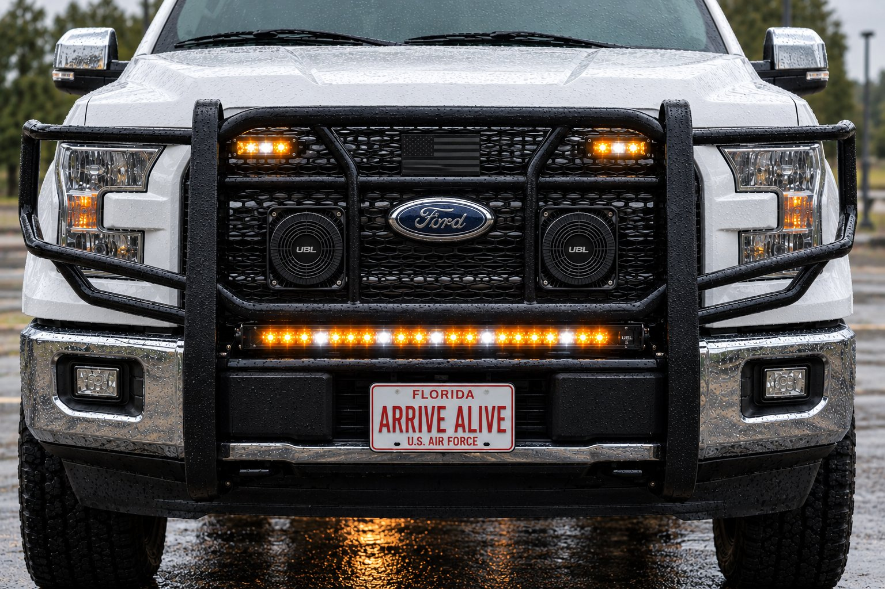

import SpecBox from '../../../components/SpecBox.astro';
import Callout from '../../../components/Callout.astro';
import Gallery from '../../../components/Gallery.astro';
import WiringTable from '../../../components/WiringTable.astro';
import Changelog from '../../../components/Changelog.astro';
import pageDark from '../../../assets/log/color-flood-wiring/page-dark.jpg';
import archLight from '../../../assets/log/color-flood-wiring/architecture-light.jpg';
import wiringDark from '../../../assets/log/color-flood-wiring/wiring-dark.jpg';
import progLight from '../../../assets/log/color-flood-wiring/programming-light.jpg';
import all295 from '../../../assets/f150/bench-colorflood-295.png';
import benchC from '../../../assets/f150/bench-c-floodbar.png';
import frontSetup from '../../../assets/f150/grille-guard-front-setup.jpg';
import tube from '../../../assets/f150/tube-0764.jpg';
import gap from '../../../assets/f150/tube-0766.jpg';

**Date:** 2026-10-26 (all times are UTC; US Eastern is UTC minus 4 hours)\
**Project:** [F-150 Emergency Lighting and 12V Upfit](/projects/f150-upfit/)\
**Component page:** [UBL Color Flood 2.0 grille light bar](/projects/f150-upfit/ubl-color-flood-light-bar/)\
**Pull requests:** [#8](https://github.com/signsys90/signal-and-systems/pull/8), later updated by [#28](https://github.com/signsys90/signal-and-systems/pull/28)



<Callout type="safety" title="Legal notice">
Emergency lighting and siren use is regulated by state law and permits. This entry documents a personal build and is not legal guidance.
</Callout>

This entry is the full record of the first component page in my F-150 upfit: the UBL Color Flood 2.0 20-inch amber/white light bar under the grille guard. It covers how the bar was chosen and where it went, the bench test that made it the right first page, every wire and CanTrol output, the Whelen Command settings, the change to the ground plan that writing it up caught, the build video that rode along in the same pull request, how the page changed in the 27 October rebuild, inconsistencies I found while writing this, and what is still open.

<SpecBox
	title="At a glance (as of 2026-10-27)"
	specs={[
		['Product', 'UBL Color Flood 2.0 20" Amber/White LED Light Bar, SKU UBL-CF-2120'],
		['Price paid', '$152.00'],
		['Location', 'Under the lower tube of the Steelcraft HD 50-1420C grille guard, above the plate'],
		['Wires', '8: red, brown, orange, white, blue, green, yellow, black'],
		['CanTrol outputs used', '7: J1-6, J1-1, LED 1, LED 2, LED 9, LED 10, LED 11'],
		['Relays', 'None'],
		['Power feed', 'J1-6 (10A), 16 AWG, bar in-line fuse; 5A blade allotted'],
		['Trigger wires', '18 AWG'],
		['Ground', 'Side of a steel frame rail, or the Ford SVE Q-231 point. Never battery negative'],
		['Max draw', '3.3A (108W), from my install proposal. Not yet measured'],
		['Bench test', '11 Oct 2026, 12V supply and a Whelen 295HFSA6 test unit'],
		['Status on the site', 'Bench-tested'],
		['Pull requests', '#8 (merged 26 Oct, 12:38), updated in #28 (27 Oct)'],
	]}
	source={{ label: 'UBL Color Flood 2.0 instructions v A.1, my project document, the 21 Oct CanTrol wiring research, Whelen guide 14580G and PR #8', href: 'https://github.com/signsys90/signal-and-systems/pull/8' }}
/>

## Contents

1. [Summary](#summary)
2. [Why this bar was the first page](#why-this-bar-was-the-first-page)
3. [How the bar got here](#how-the-bar-got-here)
4. [Timeline](#timeline)
5. [Every pull request](#every-pull-request)
6. [Sources](#sources)
7. [How the bar works](#how-the-bar-works)
8. [All eight wires](#all-eight-wires)
9. [CanTrol programming](#cantrol-programming)
10. [The ground rule change](#the-ground-rule-change)
11. [The 11 October bench test](#the-11-october-bench-test)
12. [Mounting](#mounting)
13. [The build video](#the-build-video)
14. [What changed in the 27 October rebuild](#what-changed-in-the-27-october-rebuild)
15. [Problems hit and how they were solved](#problems-hit-and-how-they-were-solved)
16. [Inconsistencies found while writing this](#inconsistencies-found-while-writing-this)
17. [Testing and verification](#testing-and-verification)
18. [What I learned](#what-i-learned)
19. [Open items](#open-items)
20. [Next step](#next-step)

## Summary

### What I did

I published the first component page for the F-150 upfit. It documents the UBL Color Flood 2.0 20" bar under the grille guard: a wire-by-wire table for all eight leads with the CanTrol pin and lead color, draw, fuse, gauge, termination and ground; the Whelen Command setting for each output; the 11 October bench results; and everything that has not been tested. The same pull request linked the page from the F-150 overview, added this entry to the Build Log and embedded my F-150 build video on the overview.

### What I learned

The bar is the only light in the build that had been bench-tested end to end, so it was the right one to document first. Writing it up also caught a change: the ground moves from "chassis near the guard" to the side of a steel frame rail, because the F-150 body is aluminum and Ford says not to add grounds to it, and its battery monitoring sensor has to see all the current.

<Gallery photos={[
	{ src: pageDark, alt: 'The UBL Color Flood 2.0 grille light bar page in dark mode, with its legal notice and goal.', caption: 'The component page today, Bench-tested, in the F-150 sidebar next to the other grille guard products.' },
	{ src: archLight, alt: 'The Architecture section of the Color Flood page in light mode with the CanTrol-to-bar wire diagram and the spec box.', caption: 'The architecture diagram: every CanTrol output and the button that drives it.' },
	{ src: wiringDark, alt: 'The wire-by-wire table on the Color Flood page in dark mode, showing CF1 red power on J1-6 through CF3 orange on J1-1.', caption: 'The wire-by-wire table, CF1 to CF8.' },
	{ src: progLight, alt: 'The CanTrol programming table on the Color Flood page in light mode.', caption: 'The Whelen Command settings for each output.' },
]} />

## Why this bar was the first page

When the F-150 overview went up at launch, every component was a row in a parts table. The first component page had to be the one I could document without guessing. The Color Flood bar was the only light that had been through a full bench test: every wire, every mode, both arrows and the pattern wire, on 11 October. It also has the most wires of anything in the build (eight, on seven CanTrol outputs), so getting it right first set the pattern for every component page after it.

## How the bar got here

The front warning light changed several times before the Color Flood bar was settled. This history is on the [decisions, revisions and sources](/projects/f150-upfit/decisions-and-sources/) page.

| When | Decision |
| --- | --- |
| Before 5 Oct | The front warning light was going to be an Alibaba LTDG9111 traffic advisor ($35 sample). Separately, the first light position was tube clamps on the top crossbar |
| 5 Oct | Grille guard install proposal: the front light on one 10A output, with an early fuse plan of 10A on 16 AWG for a 72W bar. The page's 3.3A, 10 to 30V and 20 x 1.625 x 3 in figures are attributed to this proposal |
| 6 Oct | Amber/white with a white flood chosen. Placed under the lower tube, above the plate. Lower tube estimated from photos at about 1-3/4 in |
| 7 Oct | Lower tube measured with a tape: 1.91 in OD, under 1/16 in gap to the punch plate. Too tight for tube clamps, so the bar hangs on its own L-brackets with stainless ties |
| 8 Oct | Project document revision 6: wire colors taken from UBL's instructions |
| 10 Oct | A JOUGU stainless tie passed behind the lower tube with plenty of room |
| 11 Oct | Full bench test on a 12V supply and a Whelen 295HFSA6. The CanTrol WC chosen as the truck's controller the same day |
| 16 Oct | Used CanTrol WC set bought |
| 21 Oct | CanTrol wiring research: no grounds on the battery negative post or the aluminum body |
| 23 Oct | CanTrol Gen 3 bench test guide written. Stage 4 is this bar |

## Timeline

| Time (UTC) | What happened |
| --- | --- |
| 26 Oct, 05:10 | The thread "Document first F-150 component wiring" started from the upfit project files. |
| 05:12 | Source files reviewed. The Color Flood bar picked as the only fully bench-tested component. |
| 05:15 | Page committed and [PR #8](https://github.com/signsys90/signal-and-systems/pull/8) opened. The session then hit its usage limit. |
| 06:13 | Work resumed. The Cloudflare preview build passed; a local build was blocked by the container's old Node. I got the PR link and the list of unconfirmed items. |
| 06:29 | PR #14 merged five more F-150 pages, including a "Component pages" table on the overview. |
| 11:21 | I asked for my build video to be added to the F-150 overview. |
| 11:22 | Main merged into the PR branch cleanly, with this page's row added to the new component table. |
| 11:23 | Video embed pushed to PR #8. I was asked to check it for a plate, VIN, house number or location and to turn off Drive downloads. |
| 11:24 | Preview build passed on the latest commit. |
| 12:38 | I merged PR #8. The page and the video went live. |
| 27 Oct, 00:21 | PR #28 merged the F-150 rebuild, which updated this page (see [below](#what-changed-in-the-27-october-rebuild)). |
| 27 Oct | This entry was expanded into the full record. |

## Every pull request

| PR | Opened | Merged | What it changed |
| --- | --- | --- | --- |
| [#8](https://github.com/signsys90/signal-and-systems/pull/8) | 26 Oct, 05:15 | 26 Oct, 12:38 | Added the component page on the 12-section template, the first version of this entry, the Build Log index lines (it also added the missing Codex entry), links from the F-150 overview, and the overview's embedded build video with a small `.ss-video` 16:9 style in `custom.css` and a plain link fallback. |
| [#28](https://github.com/signsys90/signal-and-systems/pull/28) | 27 Oct, 00:19 | 27 Oct, 00:21 | Added the 5A fuse allotted for the power feed, the 295HFSA6 all-features bench diagram, and moved the page to sidebar position 10 with the other grille guard products. |

[PR #14](https://github.com/signsys90/signal-and-systems/pull/14), merged at 06:29 the same day, added the overview's component table that this page's row joined, and its CanTrol pinout work is where the J4-15 color conflict was first flagged.

## Sources

| Source | What it gave |
| --- | --- |
| UBL Color Flood 2.0 instructions, SKU UBL-CF-2120, version A.1 | Wire colors and functions, the three modes, arrows, the built-in fuse, UBL's ground and safety notes |
| My F-150 project document | Gauges (16 AWG power, 18 AWG triggers), placement, the original ground note, the price paid |
| My 5 Oct grille guard install proposal | Draw (3.3A, 108W), voltage (10 to 30V) and size (20 x 1.625 x 3 in). Not a UBL document |
| My 21 Oct CanTrol wiring research | The ground rule (frame rail or Ford Q-231, never battery negative or the aluminum body) and the Whelen Command settings |
| Whelen CanTrol WC guide, form 14580G | CanTrol pins, lead colors, J1 fuse-slot polarity, J4 group fuse |
| CanTrol Gen 3 bench test guide (23 Oct) | Stage 4 tests 4.1 to 4.11 |
| My 11 Oct bench notes and diagram | Every bench result on the page |

The UBL product page could not be reached from the build environment, so the page has no manufacturer link yet.

## How the bar works

The bar has eight leads. Red is its power and needs its own feed. Brown, orange and white select one of three modes. Blue and green run the arrows. Yellow steps the pattern and color. Black is ground.

- **Red alone does nothing.** The bar lights only with red plus a mode or arrow wire, so J1-6 is on in every state that uses the bar.
- **Priority:** Mode 3 overrides Mode 2, Mode 2 overrides Mode 1, and the arrows override all three.
- **Memory:** each mode remembers its own pattern and color. Mode 3 is set to steady white, which makes it the flood.
- **Yellow:** a tap is the next pattern, a quick double tap switches amber and white, and a 2-second hold gives steady color.

```text
Whelen CanTrol WC (under driver-side rear seat)
  J1-6  (10A, BLU lead) ── bar in-line fuse ── RED     power            slide 2/3, SCENE, ←, →, ↔ FLASH
  J4-14 (LED 10, BLU)   ─────────────────────── BROWN   Mode 1 warning   slide 2/3
  J1-1  (10A, BRN lead) ─────────────────────── ORANGE  Mode 2 warning   slide 3
  J4-3  (LED 1, BRN)    ─────────────────────── WHITE   Mode 3 flood     SCENE (latched)
  J4-4  (LED 2, RED)    ─────────────────────── BLUE    right arrow      → and ↔ FLASH (latched)
  J4-15 (LED 11, check) ─────────────────────── GREEN   left arrow       ← and ↔ FLASH (latched)
  J4-13 (LED 9, GRN)    ─────────────────────── YELLOW  pattern/color    blank button 2 (momentary)
  Ground run ─────────────────────────────────── BLACK   to steel frame rail side (or Ford Q-231 point)
```

## All eight wires

This is the table as published today, after the 27 October update.

<WiringTable
	rows={[
		{ wire: 'CF1', color: 'Red', function: 'Power. Own feed only, never joined to a mode wire', source: 'J1-6 (10A, BLU lead), positive-switched', draw: '3.3A max (unverified)', fuse: 'Bar in-line fuse (rating not read yet; 5A blade allotted) + CanTrol internal', gauge: '16 AWG', termination: 'Bench: wire nut. Truck: TBD' },
		{ wire: 'CF2', color: 'Brown', function: 'Mode 1, warning pattern', source: 'J4-14 (LED 10, BLU lead)', draw: 'Signal only, not measured', fuse: 'CanTrol J4 group 20A', gauge: '18 AWG', termination: 'Bench: wire nut. Truck: TBD' },
		{ wire: 'CF3', color: 'Orange', function: 'Mode 2, warning pattern. Overrides Mode 1', source: 'J1-1 (10A, BRN lead)', draw: 'Signal only, not measured', fuse: 'CanTrol internal', gauge: '18 AWG', termination: 'Bench: wire nut. Truck: TBD' },
		{ wire: 'CF4', color: 'White', function: 'Mode 3, steady white flood. Overrides Modes 1 and 2', source: 'J4-3 (LED 1, BRN lead)', draw: 'Signal only, not measured', fuse: 'CanTrol J4 group 20A', gauge: '18 AWG', termination: 'Bench: wire nut. Truck: TBD' },
		{ wire: 'CF5', color: 'Blue', function: 'Right arrow, as seen facing the bar', source: 'J4-4 (LED 2, RED lead)', draw: 'Signal only, not measured', fuse: 'CanTrol J4 group 20A', gauge: '18 AWG', termination: 'Bench: wire nut. Truck: TBD' },
		{ wire: 'CF6', color: 'Green', function: 'Left arrow. Blue + green = center-out', source: 'J4-15 (LED 11, lead color CHECK)', draw: 'Signal only, not measured', fuse: 'CanTrol J4 group 20A', gauge: '18 AWG', termination: 'Bench: wire nut. Truck: TBD' },
		{ wire: 'CF7', color: 'Yellow', function: 'Pattern: tap, double tap, 2 s hold', source: 'J4-13 (LED 9, GRN lead), momentary', draw: 'Signal only, not measured', fuse: 'CanTrol J4 group 20A', gauge: '18 AWG', termination: 'Bench: wire nut. Truck: TBD' },
		{ wire: 'CF8', color: 'Black', function: 'Ground', source: '—', draw: 'Return for CF1', fuse: '—', gauge: '16 AWG', termination: 'Ring terminal, star washer, sealed', ground: 'Side of a steel frame rail, or the Ford SVE Q-231 point. Never battery negative' },
	]}
/>

No relay is used. Every bar wire lands directly on a CanTrol output.

<Callout type="unverified" title="Two CanTrol checks before connecting">
**J4-15 lead color:** Whelen guide 14580G shows LED Output 11 as violet on page 7 and orange on page 10. Identify that lead by pin number and with a meter. **J1-6 polarity:** J1 Outputs 5 to 8 can switch positive or ground depending on which fuse slot holds each output's fuse (guide p.8). This is a used module, so check the indicator (green for positive, amber for ground) before the bar goes on.
</Callout>

## CanTrol programming

The bar makes its own patterns, so every output feeding it is set to steady on/off in Whelen Command. These settings are inferred from how the bar works and have not been programmed yet.

| Output | Action | Switch type | Why |
| --- | --- | --- | --- |
| J1-6, J1-1, LED 10 | Turn On, steady | Follows slide position | No flash pattern and Low Power disabled, or the bar's inputs would toggle and the bar would flicker or restart its pattern |
| LED 1 (SCENE) | Turn On, steady | Press On / Press Off | Latched flood |
| LED 2, LED 11 (arrows) | Turn On, steady | Press On / Press Off | ↔ FLASH turns on both for center-out |
| LED 9 (blank button 2) | Turn On, steady | Press On / Release Off | Must be momentary. A held yellow reads as a 2-second hold and locks the bar to steady color |

## The ground rule change

| Item | Before | After |
| --- | --- | --- |
| Source | My project document ("bare chassis ground near the guard") and UBL's sheet (battery negative post) | Ford SVE Bulletin Q-231 and Ford body builder guidance, from my 21 Oct wiring research |
| Ground point | Chassis near the guard, or battery negative | Side of a steel frame rail, or the Ford Q-231 ground point |
| Why | — | The 2015+ F-150 measures charge with a sensor on the negative lead, and all negative current must pass through it. The body is aluminum, so no grounds on sheet metal either |
| Termination | Not specified | Ring terminal on bare metal with a star washer, sealed afterward |

This change was made on the page in PR #8 and called out in the PR as a change to my install config sheet. The same rule was later carried onto every wiring table in the F-150 section by PR #28.

## The 11 October bench test

Bench setup: a 12V supply, a 5A fuse in the holder, and a Whelen 295HFSA6 test amp (never going in the truck). Red alone on the red clip, each other wire capped separately and touched to +12V one at a time, then every feature on its own 295HFSA6 terminal.

| Check | Result |
| --- | --- |
| All eight wire colors match UBL's instructions and the label on the bar | Pass |
| Red alone | Does nothing. The bar needs red plus a mode or arrow wire |
| Brown, orange, white | Each runs its own pattern. With two on, the higher mode shows |
| Blue, green | Right arrow and left arrow as seen facing the bar. Both together give center-out |
| Arrows versus modes | Arrows override all three modes |
| Yellow tap | Next pattern |
| Yellow quick double tap | Switches amber and white (UBL's sheet says three taps) |
| Yellow 2-second hold | Steady color |
| Mode memory | Each mode keeps its own setting |

<Gallery photos={[
	{ src: all295, alt: 'Wiring diagram of the Color Flood bar on the Whelen 295HFSA6: red on T11, brown T1, orange T2, white T3, blue T6, green T7, yellow T15, black to supply negative, with a control table.', caption: 'Every feature on the 295HFSA6 bench unit, 11 Oct. Count screws from the far right facing the back. Don\'t press the 5th button: it turns T11 off and cuts the bar\'s power.' },
	{ src: benchC, alt: 'Bench setup C: each Color Flood wire mapped to its CanTrol output.', caption: 'Bench setup C from the CanTrol bench guide: the same eight wires mapped to CanTrol outputs for Stage 4.' },
]} />

## Mounting

Mounting decisions were made on 7 October and are recorded in full on the [grille guard page](/projects/f150-upfit/grille-guard/). In short:

1. The bar's own included L-brackets bolt to its rear slide-in channel about 6 in either side of center, with blue thread locker on the short leg.
2. The long slotted leg lies on top of the bar, curve turned inward, on a black rubber anti-vibration pad about 2 in square.
3. Two JOUGU black epoxy-coated 304 stainless ties per bracket go around the 1.91 in tube and through the bracket slot, buckles to the back.
4. The ties are tensioned and flush-cut with the ZOOSUNX tool, and the cut ends touched up in satin black.
5. Check plate clearance, and re-check the ties after the first few drives.

No drilling, welding or bending of the guard. From the front, only the bar and four thin black ties show.

<Gallery photos={[
	{ src: tube, alt: 'Tape measure on the punch plate where it meets the lower tube.', caption: 'Measuring the lower tube, 7 Oct: 1.91 in OD.' },
	{ src: gap, alt: 'The narrow gap between the lower tube and the punch plate.', caption: 'Under 1/16 in between tube and plate, too tight for any tube clamp.' },
	{ src: frontSetup, alt: 'The F-150 front setup with the bar lit amber and white under the lower tube.', caption: 'The front setup image used as the F-150 header since PR #27.' },
]} />

## The build video

PR #8 also embedded my F-150 build video on the overview, under Testing and verification, through Google Drive's preview player with a plain link fallback. The video is a 507 MB iPhone .MOV.

- It could not be watched from the build environment, so nobody but me has checked it for a plate, VIN, house number or location.
- iPhone originals usually carry GPS coordinates, and Drive lets viewers download the original unless downloads are turned off in the file's share settings. I was asked to turn that off.
- It still has no caption, because I haven't said what it shows.

## What changed in the 27 October rebuild

| Item | 26 Oct (PR #8) | 27 Oct (PR #28) |
| --- | --- | --- |
| Power feed fuse | "Bar in-line fuse (rating not read yet)" | Same, plus the 5A blade allotted for wire C1 in the parts list, matching the bench fuse and replacing an early plan of 10A on 16 AWG for a 72W bar |
| Bench diagram | None on the page | The 295HFSA6 all-features diagram |
| Sidebar | Near the top of the F-150 group | Position 10, with the other grille guard products |
| Updated date | 2026-10-26 | 2026-10-27 |
| Status | Bench-tested | Unchanged |

## Problems hit and how they were solved

| Problem | What caused it | How it was solved |
| --- | --- | --- |
| No local build | The container's Node 22.22 is below Astro's 22.23.4 minimum | The Cloudflare Pages preview build was the build check, and it passed on every commit |
| Draw, voltage, size, IP rating and fuse rating aren't on UBL's sheet | The instruction sheet doesn't list them | Draw, voltage and size are attributed to my proposal and marked unverified. IP and fuse rating are open items |
| No manufacturer link | UBL's site was unreachable from the build environment | No link yet; listed as an open item |
| Conflicting lead color for J4-15 | Whelen's own guide shows two colors on two pages | Flagged on the page: identify by pin and meter |
| Unknown J1-6 polarity | Used module; a previous owner may have moved the fuse slot | Flagged on the page with the indicator check |
| The overview had moved on | PR #14 added a component table while PR #8 was open | Main merged in cleanly and this page's row added |
| The session paused | Usage limit at 05:15 | Work resumed at 06:13 |
| The video couldn't be reviewed | 507 MB file, not viewable from the cloud | I was asked to check it myself and turn off Drive downloads before merging |

## Inconsistencies found while writing this

Reading every F-150 page side by side for this entry turned up three things that don't match. None of them changes the wiring, but each should be cleaned up.

| Where | What it says | What the Color Flood page says |
| --- | --- | --- |
| [CanTrol bench test plan](/projects/f150-upfit/cantrol-bench-test/), power budget | "3.3A max, UBL rating (confirmed)" | 3.3A comes from my install proposal, not UBL, and is unverified |
| [Power, grounds and wire schedule](/projects/f150-upfit/power-and-wiring/) | Wire IDs C1 to C8, in a different order (C5 is black, C8 is green) | Wire IDs CF1 to CF8 (CF8 is black, CF6 is green) |
| UBL's instruction sheet | Three taps on yellow change color; ground to battery negative | A double tap worked on the bench; ground to the frame rail |

The UBL items are deliberate: the bench result and Ford's rule win. The first two should be made consistent.

## Testing and verification

| Check | Status |
| --- | --- |
| Bar alone on 12V and the 295HFSA6: wires, modes, arrows, pattern wire | **Passed, 11 Oct 2026** |
| Bar driven by the CanTrol (Gen 3 bench guide Stage 4, tests 4.1 to 4.11) | Not yet |
| Mode memory after at least 10 seconds powered off (test 4.10) | Not yet |
| Measured current on red in Mode 2 and the white flood (test 4.11) | Not yet |
| Whelen Command outputs programmed | Not yet |
| Anything in the truck | Not yet |
| Page builds | Cloudflare preview passed on PR #8 and PR #28. A local production build of this entry passed on 27 Oct |

## What I learned

- **Document the tested thing first.** The first component page set the format for every component page that followed, and starting from bench results meant nothing on it had to be invented.
- **Red is power only.** Red alone does nothing, and joining it to a mode wire defeats the mode logic, so it needs its own output.
- **Trust the bench over the sheet.** A quick double tap changed color on my bar, not the three taps UBL lists.
- **Let the light do the patterns.** Because the bar handles its own priority, the CanTrol only needs steady outputs. Any flash pattern or Low Power on those outputs would make the bar flicker.
- **Writing it down catches mistakes.** The ground change came from writing every row of the table, not from a separate review.
- **A momentary button must stay momentary.** If blank button 2 is latched, the bar sees a held yellow and locks to steady color.

## Open items

- Measure the draw on the red wire (Mode 2 and the white flood), and read the in-line fuse's amp rating (5A planned for C1).
- Confirm the bar's IP rating with UBL, and add the manufacturer product link.
- Confirm J1-6 is in the positive-switching fuse slot.
- Identify the J4-15 lead by pin and meter.
- Find the ground point on the frame rail side, or match the Q-231 point to Ford's bulletin photo.
- Decide the truck terminations: crimp butt splice with adhesive heat shrink, or a sealed connector at the guard so it can come off.
- Optional: move orange (Mode 2) from J1-1 to a spare LED output to keep a 10A output free.
- The [all-lights five modes plan](/projects/f150-upfit/five-modes-plan/) may re-store this bar's mode memories (orange to steady amber). It needs no new wires.
- Match the wire IDs on the wire schedule (C1 to C8) and this page (CF1 to CF8).
- Correct the bench test plan's "UBL rating (confirmed)" note for the 3.3A draw.
- Check the build video for a plate, VIN, house number or location, confirm Drive downloads are off, and add a caption.

## Next step

Run Stage 4 of the CanTrol Gen 3 bench guide with the bar on the real controller, and measure its draw on the red wire.

## Changelog

<Changelog
	entries={[
		{ date: '2026-10-27', change: 'Expanded into the full build record: selection, placement history, timeline, both PRs, sources, all eight wires, programming, the ground change, bench results, mounting, the video, the 27 Oct update, problems, inconsistencies, lessons and open items, with four page screenshots.', rollback: 'Revert the commit that expanded this entry.' },
		{ date: '2026-10-26', change: 'Entry published with PR #8.', rollback: 'Revert the commit that added this entry.' },
	]}
/>
