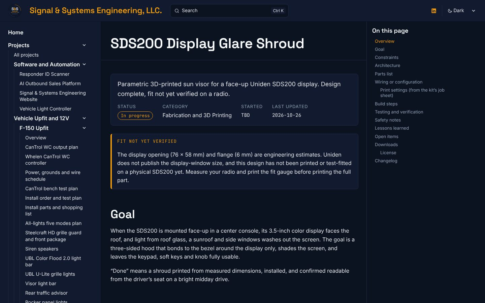

import SpecBox from '../../../components/SpecBox.astro';
import Callout from '../../../components/Callout.astro';
import Gallery from '../../../components/Gallery.astro';
import Changelog from '../../../components/Changelog.astro';
import DownloadCard from '../../../components/DownloadCard.astro';
import pageDark from '../../../assets/log/sds200-glare-shroud/page-dark.jpg';
import params from '../../../assets/log/sds200-glare-shroud/parameters-light.jpg';
import testing from '../../../assets/log/sds200-glare-shroud/testing-dark.jpg';
import downloads from '../../../assets/log/sds200-glare-shroud/downloads-light.jpg';
import isoNear from '../../../assets/sds200-glare-shroud/render-iso-near.png';
import isoFar from '../../../assets/sds200-glare-shroud/render-iso-far.png';
import side from '../../../assets/sds200-glare-shroud/render-side.png';
import drawing from '../../../assets/sds200-glare-shroud/dimension-drawing.png';

**Date:** 2026-10-26 (kit released 2026-10-24; times below are UTC, and US Eastern is UTC minus 4 hours)\
**Project:** [SDS200 Display Glare Shroud](/projects/sds200-glare-shroud/)\
**Pull requests:** [#10](https://github.com/signsys90/signal-and-systems/pull/10), [#12](https://github.com/signsys90/signal-and-systems/pull/12)

This entry is the full record of how my 3D-printed glare shroud for the Uniden SDS200 scanner went from a design kit to a public project page with free downloads. It covers the problem, the design and every parameter, every file in the kit, the licensing decision, both pull requests, exactly what has and has not been checked, and what has to happen before v1.1. Nothing has been printed yet, and this page does not pretend otherwise.

<SpecBox
	title="At a glance (as of 2026-10-27)"
	specs={[
		['Part', 'Three-sided wedge hood on a bonding flange, for a face-up SDS200 display'],
		['Kit version', 'v1.0, released 2026-10-24'],
		['Design method', 'Parametric OpenSCAD source plus a Python (trimesh) STL generator'],
		['Default opening', '76 x 58 mm (estimate)'],
		['Envelope', 'About 100 x 70 x 45 mm; STL bounding box 99.9 x 70.0 x 45.4 mm'],
		['Mass estimate', 'About 20 cm³, 25 to 30 g (shroud); about 5 g (fit gauge)'],
		['Material', 'ASA preferred, ABS or PETG minimum. Not PLA'],
		['Downloads', 'Kit zip (372 KB, 15 files) and a 12-page instructions PDF (231 KB)'],
		['License', 'CC BY-NC 4.0 (chosen 26 Oct)'],
		['Pull requests', '2 (#10, #12), both merged 26 Oct'],
		['Printed', 'Not yet'],
		['Fit on a radio', 'Not yet verified'],
		['Status on the site', 'In progress, Fabrication and 3D Printing, start date TBD'],
	]}
	source={{ label: 'Kit README, PRINT_SPEC.txt, CHANGELOG.txt and instructions PDF v1.0; PRs #10 and #12', href: 'https://github.com/signsys90/signal-and-systems/pull/10' }}
/>

## Contents

1. [Summary](#summary)
2. [The problem](#the-problem)
3. [The design](#the-design)
4. [What is in the kit](#what-is-in-the-kit)
5. [Timeline](#timeline)
6. [Every pull request](#every-pull-request)
7. [The license decision](#the-license-decision)
8. [How the page was built](#how-the-page-was-built)
9. [Problems hit and how they were solved](#problems-hit-and-how-they-were-solved)
10. [Testing and verification](#testing-and-verification)
11. [Inconsistencies found in the kit](#inconsistencies-found-in-the-kit)
12. [What I learned](#what-i-learned)
13. [The path to v1.1](#the-path-to-v11)
14. [Open items](#open-items)
15. [Next step](#next-step)

## Summary

### What I did

I published the v1.0 design kit for a 3D-printed glare shroud that shades a face-up Uniden SDS200 display in a vehicle center console. The [project page](/projects/sds200-glare-shroud/) follows the site's 12-section template and is the first entry in the Fabrication and 3D Printing group. It has the design rationale, a default-dimensions spec box, four CAD renders, a parts list, a full parameter table, the print settings, a nine-step build and install procedure, a testing table and the license. The kit zip and the instructions PDF are free downloads under CC BY-NC 4.0.

### What I learned

Uniden publishes the chassis size but not the display-window size, so the opening is an estimate. Making every dimension a parameter, plus a fit gauge that prints in about 15 to 20 minutes, keeps a wrong guess cheap: about 5 g of filament instead of a full part.

<Gallery photos={[
	{ src: params, alt: 'The parameter table on the SDS200 project page in light mode, listing win_w, win_h, flange, flange_t, wall_t, h_far, h_near, flare, near_lip and part with defaults and ranges.', caption: 'Every parameter, with its default, its allowed range and what it does.' },
	{ src: testing, alt: 'The Testing and verification table on the SDS200 project page in dark mode, with two Done rows and six Not yet rows.', caption: 'The testing table: two checks done, six marked Not yet.' },
	{ src: downloads, alt: 'The Downloads section of the SDS200 project page in light mode, with the kit zip and instructions PDF cards and the License section.', caption: 'The two download cards and the CC BY-NC 4.0 license section.' },
]} />

## The problem

With the SDS200 mounted face-up in a center console, its 3.5-inch color display faces the roof. Light from roof glass, a sunroof and the side windows washes the screen out. The fix had to:

- shade the display from overhead and side light,
- bond only to the bezel around the display, with nothing drilled into the radio,
- leave the keypad, soft keys and knob fully usable,
- survive a closed vehicle interior in summer,
- clear the console lid, shifter, cupholders and knees, and stay out of any airbag path.

"Done" is a shroud printed from measured dimensions, installed, and confirmed readable from the driver's seat on a bright midday drive.

## The design

A wedge-shaped hood on a thin bonding flange:

- **Far wall, 45 mm tall,** on the side away from the viewer, blocks the main overhead light path.
- **Side walls taper from 45 mm to 10 mm** toward the viewer, blocking side-window light while staying low near the driver.
- **12° outward flare** on each side wall keeps the off-axis viewing angle open.
- **Open near side** faces the viewer. An optional low lip (`near_lip`) can be added for stiffness.
- **6 x 2 mm flange** bonds to the bezel around the display with VHB, Dual Lock or Command strips.
- **2.4 mm walls,** which is six perimeters on a 0.4 mm nozzle, so the walls print solid.

| Parameter | Default | Range | Basis |
| --- | --- | --- | --- |
| `win_w` | 76 mm | 40 to 120 | Visible display width plus about 2 mm. **Estimate** |
| `win_h` | 58 mm | 30 to 100 | Visible display height plus about 2 mm. **Estimate** |
| `flange` | 6 mm | 3 to 10 | Narrowest flat bezel land minus 0.5 mm, max 8. **Estimate** |
| `flange_t` | 2.0 mm | 1.6 to 3 | Design choice |
| `wall_t` | 2.4 mm | 1.6 to 3.2 | Multiple of the nozzle width |
| `h_far` | 45 mm | 20 to 60 | Overhead clearance minus 5 mm, max 60 |
| `h_near` | 10 mm | 0 to 25 | Design choice |
| `flare` | 12° | 0 to 20 | Wider viewing angle as it grows |
| `near_lip` | 0 mm | 0 to 6 | 0 is fully open |
| `part` | `shroud` | `shroud` or `gauge` | Production part or 2 mm fit gauge |

The only published dimensions behind the design are the chassis (1.5x DIN-E, 180 x 75 mm) and the 3.5-inch display size, from the [Walcott Radio SDS200 listing](https://www.walcottradio.com/uniden-sds200-p-3190.html) cited in the kit. Tape and filament guidance is general practice, not manufacturer data.

<Gallery photos={[
	{ src: isoNear, alt: 'Isometric render of the glare shroud from the open viewer side.', caption: 'Isometric, viewer (open) side. CAD render.' },
	{ src: isoFar, alt: 'Isometric render of the glare shroud from the far side.', caption: 'Isometric, far side. CAD render.' },
	{ src: side, alt: 'Side profile render with the wall tapering from 45 mm to 10 mm.', caption: 'Side profile: 45 mm far wall tapering to 10 mm.' },
	{ src: drawing, alt: 'Dimension drawing with the 76 by 58 mm opening, 6 mm flange and 88 mm flange outer width, and the side profile.', caption: 'Dimension drawing at the default parameters. Opening and flange are estimates.' },
]} />

All four images are CAD renders, not photos of a printed part. Their PNG metadata was removed before publishing, both in `src/assets` and in the copies inside the zip.

## What is in the kit

The published zip, `SDS200_Glare_Shroud_Kit_v1.0.zip`, holds 15 files:

| File | Size | What it is |
| --- | --- | --- |
| `README.md` | 6.8 KB | Overview, viewing in OpenSCAD, design summary, quick start for the requester and the print shop, print and install summaries, safety, license |
| `SDS200_Glare_Shroud_Instructions.pdf` | 231 KB, 12 pages | Measuring, customizing, print spec, inspection, installation, troubleshooting, and a 1:1 cardboard mockup template (Appendix B) |
| `PRINT_SPEC.txt` | 2.2 KB | One-page job sheet for a print shop: parts, material, envelope, orientation, slicer settings, temperatures, quality checks, post-processing |
| `CHANGELOG.txt` | 0.6 KB | v1.0 notes and planned items |
| `LICENSE.txt` | 0.9 KB | CC BY-NC 4.0, added in PR #12 |
| `STL/sds200_glare_shroud_v1.0.stl` | 5.5 KB, 110 triangles | Production part at default dimensions |
| `STL/sds200_fit_gauge_v1.0.stl` | 1.6 KB, 32 triangles | 2 mm flat fit-test frame, about 88 x 70 x 2 mm. Print first |
| `STL/view_stl_in_openscad.scad` | 0.6 KB | Opens either STL in OpenSCAD (`show = "shroud"`, `"gauge"` or `"both"`) |
| `SOURCE/sds200_glare_shroud.scad` | 3.7 KB | The parametric source. Edit here |
| `SOURCE/generate_stl.py` | 3.2 KB | Python generator (trimesh, manifold3d, numpy) for anyone without OpenSCAD |
| `IMAGES/` (4 files) | 15 to 118 KB each | Dimension drawing and three renders |

Sizes are from the published zip. Triangle counts were read from the binary STL headers.

### Print settings from the job sheet

| Setting | Value |
| --- | --- |
| Material | ASA (preferred), ABS, PETG (minimum). Matte black. No PLA or PLA+ |
| Orientation | Flange flat on the bed, as modelled. No supports |
| Nozzle and layer | 0.4 mm and 0.20 mm |
| Perimeters | 6 (solid 2.4 mm walls) |
| Top and bottom | 5 and 5 layers |
| Infill | 25% gyroid |
| Brim | 5 mm for ASA and ABS |
| Seam | Aligned, far-wall outer face |
| Cooling | ASA and ABS 0 to 20%, PETG 40 to 60% |
| Enclosure | Required for ASA and ABS |
| Temperatures | Typical ranges only (ASA 240 to 260 °C nozzle, 90 to 110 °C bed; ABS 230 to 250 and 95 to 110; PETG 230 to 250 and 70 to 85). Follow the filament maker's data |

### Quality checks from the job sheet

- Flange flat within about 0.3 mm, with no warp at the corners.
- Opening within ±0.3 mm of target, measured with calipers.
- No layer splits at the wall-to-flange joints.
- Clean wall tops and no stringing inside the hood.
- Matte finish with no gloss on the inner faces.

<DownloadCard
	title="SDS200 Glare Shroud Kit v1.0 (zip)"
	href="/downloads/sds200-glare-shroud/SDS200_Glare_Shroud_Kit_v1.0.zip"
	description="Production and fit-gauge STLs, parametric OpenSCAD source, Python generator, print job sheet, instructions PDF, renders and license."
	meta="ZIP · 372 KB · v1.0 · CC BY-NC 4.0 · fit not yet verified"
/>

<DownloadCard
	title="Fabrication and installation instructions"
	href="/downloads/sds200-glare-shroud/SDS200_Glare_Shroud_Instructions.pdf"
	description="Measuring, customizing, print spec, inspection, installation, troubleshooting and a 1:1 cardboard mockup template."
	meta="PDF · 12 pages · 231 KB"
/>

## Timeline

| When | What happened |
| --- | --- |
| 24 Oct | Kit v1.0 assembled: STLs and source generated, the job sheet, changelog and instructions PDF written. The changelog records the opening and flange as estimates and fit as not verified. |
| 26 Oct, 05:14 | I dropped the kit into the project with "Here is a 3d print project." |
| 05:14 to 05:15 | The kit was unpacked and reviewed. Then the session hit its usage limit. |
| 05:16 and 06:11 | I asked it to try again, twice. The coordinator also nudged the thread. |
| 06:12 | Work resumed. The kit had already been reviewed, so the page was written straight from it. |
| 06:14 | [PR #10](https://github.com/signsys90/signal-and-systems/pull/10) opened. The Cloudflare preview deployed cleanly. |
| 06:15 | A decision card asked whether the downloads should stay public and under what terms. |
| 06:16:16 | I chose CC BY-NC 4.0. |
| 06:16:36 | I merged PR #10, eight seconds before the license commit landed on the branch. |
| 06:16:44 | The license commit was pushed, after the merge. |
| 06:17 | [PR #12](https://github.com/signsys90/signal-and-systems/pull/12) opened to carry the license onto main. |
| 06:18 | I merged PR #12. The page and the zip now carry CC BY-NC 4.0. |
| 20:33 | [PR #26](https://github.com/signsys90/signal-and-systems/pull/26) added this entry to the Build Log index, where it had been missing. |
| 27 Oct | This entry was expanded into the full record. |

## Every pull request

| PR | Opened | Merged | What it changed |
| --- | --- | --- | --- |
| [#10](https://github.com/signsys90/signal-and-systems/pull/10) | 06:14 | 06:16 | Added the project page on the 12-section template (category Fabrication and 3D Printing, status In progress), the first entry in that sidebar group, the first version of this log entry, the kit zip and instructions PDF in `public/downloads/sds200-glare-shroud/`, and the four renders in `src/assets/sds200-glare-shroud/`. 1 commit. |
| [#12](https://github.com/signsys90/signal-and-systems/pull/12) | 06:17 | 06:18 | Added `LICENSE.txt` to the zip and pointed the kit README's license section at it. Added the License section to the page and updated the download card text. 1 commit. Rollback: revert it, and the page and zip go back to the "as-is, personal fabrication" wording. |

## The license decision

The kit's original terms were one line: "Provided as-is for personal fabrication. No warranty." It never said whether anyone else could share or remix the design, and PR #10 was offering the whole kit, source included, as a free public download. I was given three choices:

| Option | What it would have meant |
| --- | --- |
| Keep as-is (recommended at the time) | Downloads stay up with the personal-fabrication wording |
| **Add CC BY-NC 4.0 (chosen)** | Anyone can print, share and remix it for non-commercial use, with credit and a note of changes, but nobody can sell the files or printed parts |
| Remove downloads | The page keeps the renders and specs, and the zip and PDF come out |

I chose CC BY-NC 4.0. The page now says so, with a link to the license and the full trademark and no-warranty notice: Uniden and SDS200 are trademarks of their owner, and this is an independent accessory design, not affiliated with or endorsed by Uniden.

## How the page was built

- **One source of truth.** Every number on the page comes from the kit: README, PRINT_SPEC.txt, CHANGELOG.txt and the instructions PDF. Nothing was added from memory.
- **Estimates labeled where they appear.** The opening and flange are flagged in a callout at the top, in the spec box, in the parameter table and in the testing table.
- **Renders labeled as renders.** The page says outright that the images are CAD renders, not photos of a print.
- **Downloads served as static files.** They live in `public/`, so Cloudflare serves them as-is with no processing.
- **Metadata stripped** from all four PNGs, on the page and in the zip.
- **The STLs were re-checked independently** when the page was built, not just trusted from the generator.

## Problems hit and how they were solved

| Problem | What caused it | How it was solved |
| --- | --- | --- |
| The work stalled for about an hour | The session hit its usage limit right after unpacking the kit | I asked it to try again, and it picked up from the finished review |
| The license landed after the merge | I merged PR #10 eight seconds before the license commit reached the branch | A follow-up, PR #12, carried the license onto main two minutes later |
| The kit's terms didn't cover sharing or remixing | The original line only mentioned personal fabrication | A decision card with three options, and I chose CC BY-NC 4.0 |
| The display-window size isn't published | Uniden only publishes the chassis and display size | Every dimension is a parameter, the defaults are labeled estimates, and the kit includes a fit gauge |
| Astro wouldn't build in the cloud container | Its Node 22.22 is below Astro's 22.23.4 minimum | The build ran by calling Astro's CLI directly past its version gate. Cloudflare builds on Node 24 |
| The entry was missing from the Build Log index | PR #10 added the entry but not the index line | PR #26 added it |

## Testing and verification

| Check | Status |
| --- | --- |
| Both STL meshes watertight (closed, manifold) | **Done.** Checked by the generator on export and re-import, and re-checked independently for PR #10: 0 open or non-manifold edges in either file |
| STL bounding boxes match the drawing | **Done.** Shroud 99.9 x 70.0 x 45.4 mm, gauge 88.0 x 70.0 x 2.0 mm |
| Site build with the page and downloads | **Done.** The page, this entry, both downloads and the Projects grid listing all resolved on a local static server, and the Cloudflare preview deployed |
| OpenSCAD source renders the same part as the STLs | **Not yet.** OpenSCAD was not run when the STLs were made |
| Display window and bezel measured on a real radio | **Not yet.** Defaults are estimates |
| Fit gauge printed and test-fitted | **Not yet** |
| Shroud printed | **Not yet.** No print results exist |
| Installed and checked for glare and clearance in a vehicle | **Not yet** |
| Adhesive bond in heat and rough driving | **Not yet** |

<Callout type="unverified" title="Fit not yet verified">
The 76 x 58 mm opening and 6 mm flange are engineering estimates. This design has not been printed or fitted on a physical SDS200. Measure the radio and print the fit gauge first.
</Callout>

## Inconsistencies found in the kit

Writing this entry meant reading every kit file side by side. Two small differences turned up between the README's print summary and the job sheet:

| Setting | README summary | PRINT_SPEC.txt and the project page |
| --- | --- | --- |
| Perimeters | 4 to 6 | 6 |
| Infill | 20 to 30% gyroid | 25% gyroid |

The job sheet is the more specific document, and the page uses it. The README ranges include the job sheet's values, so nothing is wrong, but v1.1 should make them match.

## What I learned

- **Design for the unknown dimension.** When the critical size isn't published, make it a parameter and add a cheap gauge. A wrong guess then costs a 15 to 20 minute print and about 5 g of filament.
- **Write the print-shop sheet as if you won't be there.** The one-page job sheet with quality checks means anyone with an enclosed printer can make it.
- **Decide the license before the files go public.** "Personal fabrication" says nothing about sharing. CC BY-NC 4.0 does.
- **Re-check generated geometry.** The STLs were verified watertight a second time, independently of the script that made them.
- **Say "not yet" in the testing table.** Six of eight checks are honestly not done, and the page says so.

## The path to v1.1

1. Measure the visible display width and height, the narrowest flat bezel land on all four sides, and the overhead clearance in the console, to 0.5 mm.
2. Optional: cut the 1:1 cardboard mockup from Appendix B of the PDF and try it on a bright drive.
3. Set `win_w`, `win_h` and `flange` from the measurements.
4. Print the fit gauge and confirm the display is fully visible and the flange sits flat without touching a button. Repeat until it fits.
5. Render the OpenSCAD source once and confirm it matches the Python output.
6. Print the shroud to the job sheet and record the material, settings, print time and mass.
7. Inspect it against the quality checks, post-process and install it.
8. Drive it at midday, add photos with metadata stripped, and release v1.1 with measured defaults.

## Open items

- Measure the display window, bezel land and console clearance on the physical radio.
- Print and test-fit the gauge, then update the defaults.
- Render the OpenSCAD source once and confirm it matches the STLs.
- Print the shroud and record actual material, settings, print time and mass.
- Install, test on a bright drive, and add photos (metadata stripped).
- Align the README's perimeter and infill summary with the job sheet.
- Set the project's start date on the page (currently TBD).
- Re-release as v1.1 once fit is verified.

## Next step

Measure the radio, print and test-fit the gauge, then update the defaults and release v1.1.

## Changelog

<Changelog
	entries={[
		{ date: '2026-10-27', change: 'Expanded into the full build record: design, every kit file, timeline, both PRs, the license decision, problems, testing, kit inconsistencies, lessons, the path to v1.1 and open items, with three page screenshots.', rollback: 'Revert the commit that expanded this entry.' },
		{ date: '2026-10-26', change: 'Entry published with PR #10.', rollback: 'Revert the commit that added this entry.' },
	]}
/>
