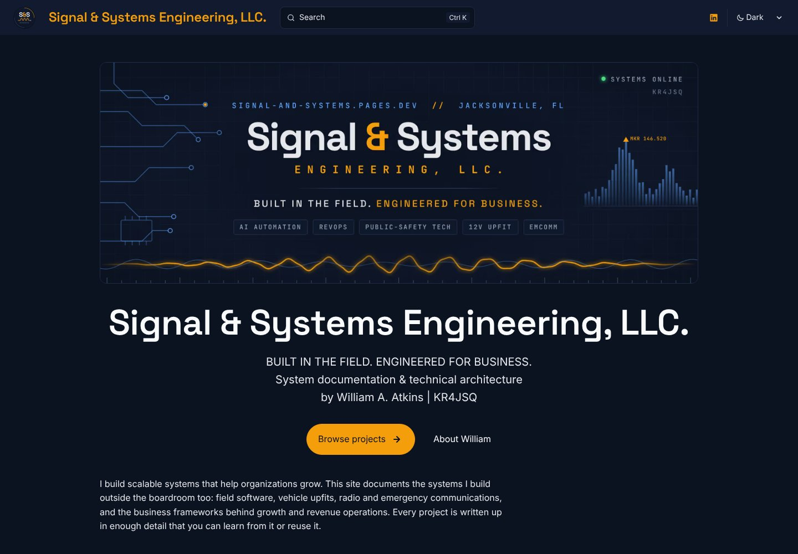

import SpecBox from '../../../components/SpecBox.astro';
import Callout from '../../../components/Callout.astro';
import Gallery from '../../../components/Gallery.astro';
import BeforeAfter from '../../../components/BeforeAfter.astro';
import Changelog from '../../../components/Changelog.astro';
import homeLight from '../../../assets/log/site-launch/home-desktop-light.jpg';
import homeMobile from '../../../assets/log/site-launch/home-mobile-dark.jpg';
import mobileMenu from '../../../assets/log/site-launch/mobile-menu-dark.jpg';
import projectsDark from '../../../assets/log/site-launch/projects-index-dark.jpg';
import buildLog from '../../../assets/log/site-launch/build-log-light.jpg';
import componentsRef from '../../../assets/log/site-launch/components-reference-dark.jpg';
import pageTemplate from '../../../assets/log/site-launch/page-template-light.jpg';
import privacyPage from '../../../assets/log/site-launch/privacy-light.jpg';
import search from '../../../assets/log/site-launch/search-dark.jpg';
import projectsLaunch from '../../../assets/log/site-launch/projects-light-launch.jpg';
import projectsNow from '../../../assets/log/site-launch/projects-light-now.jpg';
import f150Launch from '../../../assets/log/site-launch/f150-dark-launch.jpg';
import f150Now from '../../../assets/log/site-launch/f150-dark-now.jpg';
import portraitHome from '../../../assets/site/home.jpg';
import banner from '../../../assets/brand/cover-banner.png';
import logo from '../../../assets/brand/logo-circle.png';

**Date:** 2026-10-26 (first build started the evening of 25 Oct, US Eastern time)\
**Project:** [Signal & Systems Engineering Website](/projects/signal-and-systems-site/)\
**Live:** [signal-and-systems.pages.dev](https://signal-and-systems.pages.dev)\
**Source:** [github.com/signsys90/signal-and-systems](https://github.com/signsys90/signal-and-systems)

This entry is the full record of how this site was planned, built, launched and grown on its first day. It covers every decision, every pull request, the problems that came up and how each was solved, and what is still open. Every number on this page comes from the git history, the pull requests or the build output. Anything I could not confirm is marked as unverified.

<SpecBox
	title="Build at a glance (as of 2026-10-26, 20:30 UTC)"
	specs={[
		['Site name', 'Signal & Systems Engineering, LLC.'],
		['Address', 'signal-and-systems.pages.dev (free Cloudflare subdomain)'],
		['Framework', 'Astro 7.4.2'],
		['Docs theme', 'Starlight 0.42.7 (built-in Pagefind search)'],
		['Image pipeline', 'sharp 0.35.5 through astro:assets'],
		['Fonts', 'Space Grotesk, Inter, JetBrains Mono (Fontsource 5.3.0, self-hosted)'],
		['Hosting', 'Cloudflare Pages, free tier, Git-connected'],
		['Build', 'npm run build, output dist, NODE_VERSION=24'],
		['Budget', '$0 (nothing purchased)'],
		['Pull requests', '24 opened, 24 merged by William'],
		['Commits on main', '60 (32 change commits, 28 merge commits)'],
		['Pages built', '39 HTML pages plus search index and sitemap'],
		['Project pages', '18 top-level projects plus 7 F-150 component pages'],
		['Custom components', '12 (11 documentation components plus a Hero override)'],
		['Images in src/assets', '96 before this entry, 110 with it'],
	]}
	source={{ label: 'git log, GitHub pull requests #1 to #24, and the local production build', href: 'https://github.com/signsys90/signal-and-systems/pulls?q=is%3Apr' }}
/>

## Contents

1. [Summary](#summary)
2. [Timeline](#timeline)
3. [Every pull request](#every-pull-request)
4. [The plan](#the-plan)
5. [Naming and domain](#naming-and-domain)
6. [Stack, hosting and build](#stack-hosting-and-build)
7. [Repository layout](#repository-layout)
8. [Design system](#design-system)
9. [Components](#components)
10. [Page template and content model](#page-template-and-content-model)
11. [Navigation](#navigation)
12. [Every page and project](#every-page-and-project)
13. [Name and tagline changes](#name-and-tagline-changes)
14. [About page, portrait, bio and resume](#about-page-portrait-bio-and-resume)
15. [Banner, logo, icons and share image](#banner-logo-icons-and-share-image)
16. [Screenshots and photos](#screenshots-and-photos)
17. [Privacy rules and what was left off](#privacy-rules-and-what-was-left-off)
18. [How the work was done](#how-the-work-was-done)
19. [Problems hit and how they were solved](#problems-hit-and-how-they-were-solved)
20. [Testing and verification](#testing-and-verification)
21. [Launch day compared with today](#launch-day-compared-with-today)
22. [What I learned](#what-i-learned)
23. [Open items](#open-items)
24. [Next step](#next-step)

## Summary

### What I did

I wrote a plan for a public site where every project I build gets one home, written up in the same format, with an honest record of what has and has not been tested. Claude built the site from that plan on Astro with the Starlight documentation theme, and I launched it for $0 on Cloudflare Pages at signal-and-systems.pages.dev.

Launch (PR #1) shipped the design system (dark slate and signal amber), eleven reusable documentation components, a fixed 12-section page template, a filterable projects grid, the first four projects, the About, Contact and Privacy pages, a Reference section and a web edition of my resume with the phone and email removed.

Over the rest of the day, 23 more pull requests added 14 more projects and 7 F-150 component pages, renamed the site to Signal & Systems Engineering, LLC., replaced the tagline twice, added my portrait and bio, refreshed the resume, put photos and screenshots on nearly every page, and replaced the placeholder mark with the S&S banner and logo. Every change went through a pull request that I reviewed and merged myself.

## Timeline

Times are UTC as recorded by git and GitHub. US Eastern (EDT) is UTC minus 4 hours, so the first entries fall on the evening of 25 Oct in Jacksonville.

| Time (UTC, 26 Oct) | What happened |
| --- | --- |
| Before 02:07 | I wrote the 11-page site plan (dated 2026-10-25) and uploaded it to the project. |
| 02:07 | Claude read the plan and summarized the five decisions it asked for. |
| 02:11 | I chose the name "Signal & Systems" and asked for all five starting steps. |
| 02:19 | First commit: the Astro and Starlight scaffold, tokens, fonts, sidebar, components and launch pages. |
| 02:20 | First local production build passed with 14 pages. Dark, light and phone-width screenshots checked. WCAG AA contrast computed. |
| 02:41 | I sent the F-150 project files and my LinkedIn URL, and said GitHub was ready. |
| 02:43 | I chose the free pages.dev address instead of buying a domain. |
| 02:46 | Second commit: F-150 overview and CanTrol output plan from my project document, About from my resume, Contact, and a new Mobile Ham Radio project. The build passed with 16 pages. |
| 02:47 | Claude confirmed the connected Cloudflare tools cannot create or deploy a Pages site. |
| 02:58 | Third commit: web edition of the resume with the phone and email removed. |
| 02:59 | GitHub still showed no repository. I was asked to create the repo and install the Claude GitHub App. |
| 04:13 | I asked Claude to try again. |
| 04:14 | The repository was visible. An initial commit went to main and the repo was saved to the project. |
| 04:15 | PR #1 opened (38 files, 6,820 lines) and I merged it 44 seconds later. |
| 04:18 | I started the Cloudflare setup and landed on the newer Workers screen. Claude walked me to the Pages path. |
| 04:21 | Cloudflare Pages deployed the site. Claude checked the live home, F-150 and About pages and the resume link. |
| 04:23 | I enabled Cloudflare Web Analytics. |
| 04:26 to 05:08 | Five more PRs: the site's own project page, two SaniGLAZE map pages, the executive search page, start dates, and three Codex-built ARES tools with an expanded executive bio. |
| 06:13 to 06:54 | Ten more PRs: rename, SDS200 glare shroud and license, resume update, five F-150 component pages, the video end-slide tool, headshot, expanded ARES pages and four business and boat pages. |
| 11:20 to 12:46 | Six more PRs: visuals, the Duval Fan Apparel page, the new tagline (then split onto three lines), two case-study rewrites, and the first F-150 wiring page with the build video. |
| 16:50 | PR #23: screenshots captured on my Toughbook for three software pages. |
| 18:49 | PR #24: the cover banner and S&S logo became the home hero, header logo, favicon and share image. |
| 20:24 | This build log entry was expanded into the full record. |

## Every pull request

Every PR was opened by Claude on its own branch and merged by me. The merge time is when the change reached main, and Cloudflare deploys main automatically, usually within a minute or two.

| PR | Merged (UTC) | What it changed |
| --- | --- | --- |
| [#1](https://github.com/signsys90/signal-and-systems/pull/1) | 04:15 | Launched the site: design system, 11 components, page template, projects grid, F-150 overview and CanTrol output plan, Responder ID Scanner, AI Outbound Sales Platform, Mobile Ham Radio, Build Log, Reference, About, Contact, Privacy and the web resume. 38 files, 3 commits. |
| [#2](https://github.com/signsys90/signal-and-systems/pull/2) | 04:57 | Added a project page for this site. |
| [#3](https://github.com/signsys90/signal-and-systems/pull/3) | 04:59 | Added the SaniGLAZE Opportunity Map and Trade Show Map case studies. |
| [#4](https://github.com/signsys90/signal-and-systems/pull/4) | 05:02 | Added the AI-Assisted Executive Search page (method only). |
| [#5](https://github.com/signsys90/signal-and-systems/pull/5) | 05:03 | Set the two SaniGLAZE map start dates to Spring 2026. |
| [#6](https://github.com/signsys90/signal-and-systems/pull/6) | 05:08 | Added the ARES CF-33 Field Dashboard, ARES Duval GIS Command Dashboard and Vehicle Light Controller, and expanded the executive bio on About. |
| [#9](https://github.com/signsys90/signal-and-systems/pull/9) | 06:13 | Renamed the site to Signal & Systems Engineering, LLC (no period yet). |
| [#10](https://github.com/signsys90/signal-and-systems/pull/10) | 06:16 | Added the SDS200 Display Glare Shroud page with CAD renders and the v1.0 kit downloads. |
| [#11](https://github.com/signsys90/signal-and-systems/pull/11) | 06:18 | Added the period: Signal & Systems Engineering, LLC. |
| [#12](https://github.com/signsys90/signal-and-systems/pull/12) | 06:18 | Licensed the SDS200 kit under CC BY-NC 4.0. |
| [#13](https://github.com/signsys90/signal-and-systems/pull/13) | 06:29 | Replaced the resume with my latest two-page version, phone and email removed. |
| [#14](https://github.com/signsys90/signal-and-systems/pull/14) | 06:29 | Added five F-150 pages (CanTrol controller, bench test plan, five modes plan, grille guard, control head mount) and install photos on the ham radio page. |
| [#15](https://github.com/signsys90/signal-and-systems/pull/15) | 06:44 | Added the SaniGLAZE Video End-Slide Generator page. |
| [#7](https://github.com/signsys90/signal-and-systems/pull/7) | 06:45 | Added my headshot and personal bio to About and the home hero. |
| [#17](https://github.com/signsys90/signal-and-systems/pull/17) | 06:53 | Added Big Time Sandwich Co., Wicks Surplus, North FL Motorsports and the Quest Angler 10' upfit. |
| [#16](https://github.com/signsys90/signal-and-systems/pull/16) | 06:54 | Expanded the three ARES pages, recorded the GIS dashboard test results and added 8 demo-data GIS screenshots. |
| [#18](https://github.com/signsys90/signal-and-systems/pull/18) | 12:38 | Added photos and diagrams to four F-150 pages, screenshots of this site, and the Duval Fan Apparel (Project Panthera 16) page. |
| [#19](https://github.com/signsys90/signal-and-systems/pull/19) | 12:38 | Replaced the tagline with "BUILT IN THE FIELD. ENGINEERED FOR BUSINESS." |
| [#20](https://github.com/signsys90/signal-and-systems/pull/20) | 12:38 | Replaced the video end-slide page with my full case study. |
| [#21](https://github.com/signsys90/signal-and-systems/pull/21) | 12:38 | Replaced the executive search page with my full case study. |
| [#8](https://github.com/signsys90/signal-and-systems/pull/8) | 12:38 | Added the UBL Color Flood 2.0 grille light bar wiring page and embedded the F-150 build video. |
| [#22](https://github.com/signsys90/signal-and-systems/pull/22) | 12:46 | Put the byline on its own line, making the tagline three lines. |
| [#23](https://github.com/signsys90/signal-and-systems/pull/23) | 16:50 | Added screenshots to the field dashboard, light controller and ID scanner pages. |
| [#24](https://github.com/signsys90/signal-and-systems/pull/24) | 18:49 | Added the cover banner hero and the S&S logo as header logo, favicon, touch icon and share image. |

PRs #7 and #8 were opened early but merged later, which is why they appear out of number order.

## The plan

The site started as my own 11-page plan, dated 2026-10-25. It set:

- **Goal:** one public home for every project, written in a fixed format, that doubles as an executive and technical portfolio.
- **Stack and budget:** Astro with Starlight, a free GitHub repository and Cloudflare Pages (GitHub Pages as backup), launching on the free pages.dev address first. No paid tools without a decision.
- **Design:** dark slate with signal amber, a full token set for light and dark mode, and three self-hosted fonts.
- **Structure:** six menu items (Home, Projects, Build Log, Reference, About, Contact), five categories, six status badges and URLs in the form /projects/project/component/.
- **Components:** ten reusable documentation components.
- **Template:** 12 sections on every project and component page.
- **Privacy rules:** no addresses, phone, VIN, plate, permit numbers or overnight parking locations; EXIF stripped; synthetic IDs only for the scanner; no employer confidential data; no unpublished ARES or ESF-2 details; a standing legal notice on every lighting page.
- **Launch set:** the F-150 upfit, the Responder ID Scanner and the AI outbound platform.
- **Decisions it asked for:** the name and domain, whether to buy a custom domain, the editing workflow, the F-150 parts list against my latest install config sheet, and whether the scanner repository would be public.

The plan also said to avoid "Code 3", "Responder" and "911" style wording in the site name.

## Naming and domain

**Name.** The plan used "Signal & System" (singular), but the project was titled "Signal & Systems". Claude flagged the mismatch, and at 02:11 I chose **Signal & Systems**. Later that morning I renamed the display name to **Signal & Systems Engineering, LLC.** (see [Name and tagline changes](#name-and-tagline-changes)). The repository, the Cloudflare project and the address never changed.

**Domain check.** Claude checked the candidate names through public registry (RDAP) lookups on 2026-10-26. "No record" means the registry had nothing on file, which usually means available, but a registrar is the only real confirmation.

| Name | Result on 2026-10-26 |
| --- | --- |
| signalandsystems.com | Taken. Registered 2026-06-06, redirecting to a GoDaddy "for sale" page. |
| signal-and-systems.com | No record (likely available, not confirmed). |
| signalandsystems.net | No record (likely available, not confirmed). |
| signalandsystems.dev | The lookup gave no clear answer. Unconfirmed. |
| williamaatkins.com | No record (likely available, not confirmed). |
| signal-and-systems.pages.dev | No DNS entry, so the free address looked unclaimed. Confirmed when the Pages project was created. |

**Decision.** I first asked Claude to buy williamaatkins.com. Claude cannot buy domains, so it pointed me to Cloudflare Registrar instead. I then chose to keep the site free on **signal-and-systems.pages.dev** and buy nothing for now. A custom domain can be added later in the Cloudflare dashboard without changing the code beyond the `site` value in `astro.config.mjs`.

## Stack, hosting and build

| Piece | Version or setting | Why |
| --- | --- | --- |
| Astro | 7.4.2 | Static site framework. Every page is plain HTML at build time. |
| Starlight | 0.42.7 | Documentation theme: sidebar, dark and light mode, table of contents, code blocks with copy buttons, Pagefind search, sitemap. |
| sharp | 0.35.5 | Resizes and re-encodes images into AVIF and WebP at build time. |
| Fontsource | Inter 400 and 600, Space Grotesk 600, JetBrains Mono 400 (all 5.3.0) | Self-hosted fonts. No call to Google Fonts. |
| Node.js | 22.23.4 minimum (package.json engines), 24 recommended (.node-version) | Astro 7 requires it. |
| Cloudflare Pages | Free tier, Git-connected to main | Free static hosting with automatic deploys and per-PR previews. |
| Cloudflare Web Analytics | Enabled from the Pages dashboard, no script in the code | Cookie-free, aggregate page views only. |

**Cloudflare Pages settings** (entered by me in the dashboard): project name `signal-and-systems`, production branch `main`, framework preset Astro, build command `npm run build`, output directory `dist`, environment variable `NODE_VERSION` = `24`.

**Deploys.** Every merge to main publishes automatically. Every pull request also gets its own preview build at a branch address on pages.dev, and a passing preview build became the standard check before I merged.

**Building locally.** The cloud container Claude works in has Node 22.22, which is below Astro's minimum. Claude worked around it in three ways during the day: a Node 24 binary from the npm package node-linux-x64, running the build through Bun (`bun --bun ./node_modules/.bin/astro build`), or relying on Cloudflare's preview build when neither was set up. This entry was built locally with Bun: 39 pages in about 10 seconds, and Pagefind indexed 39 HTML files.

**Rolling back.** Every change is a git commit, so any change can be undone with `git revert` and a push. Cloudflare Pages can also roll back instantly to any earlier deployment from its Deployments tab.

## Repository layout

| Path | What it holds |
| --- | --- |
| `astro.config.mjs` | Site title, description, logo, favicon links, share-image tags, sidebar, fonts, LinkedIn link, Hero override. |
| `src/styles/custom.css` | Design tokens for dark and light mode, mapped onto Starlight's variables. |
| `src/content.config.ts` | Frontmatter fields, the six statuses and five categories, and the date transform. |
| `src/components/` | The 12 custom components. |
| `src/content/docs/` | Every page as MDX. |
| `src/content/docs/projects/_template.mdx` | Copy-ready starter for a new project or component page (not published). |
| `src/assets/` | Photos, screenshots, diagrams and brand images, optimized at build time. |
| `public/` | Files served as-is: favicons, touch icon, share image, resume PDF and the SDS200 kit downloads. |
| `README.md` | How to run, build, deploy, add a page and roll back. |

## Design system

The look is "command console meets engineering notebook": dark slate surfaces, signal-amber accents and monospaced spec data. Dark mode is the default. The tokens come straight from my plan.

| Token | Light mode | Dark mode | Used for |
| --- | --- | --- | --- |
| Background | `#F8FAFC` | `#0B1220` | Page background |
| Surface | `#FFFFFF` | `#111A2E` | Cards, spec boxes, callouts |
| Text | `#0F172A` | `#E5E7EB` | Body text |
| Muted | `#475569` | `#94A3B8` | Labels, captions |
| Accent | `#B45309` | `#F59E0B` | Links, buttons, current page, In progress badge |
| Info | `#1D4ED8` | `#60A5FA` | Open item callouts, Installed and Bench-tested badges |
| Success | `#15803D` | `#4ADE80` | Lesson callouts, Verified badge |
| Warning | `#B91C1C` | `#F87171` | Safety callouts and the lighting legal notice |
| Border | `#E2E8F0` | `#1F2A44` | Hairlines and table rules |

**Type.** Space Grotesk for headings, Inter for body text at 17px with a 1.6 line height and a 46rem content width (about 72 characters a line), and JetBrains Mono for specs, badges and code.

**Contrast.** At launch, Claude computed WCAG AA contrast for every token pairing in both modes. All passed, and the lowest was light-mode amber on the page background at 4.8:1. This has not been re-run since the banner and logo were added.

<Gallery photos={[
	{ src: homeLight, alt: 'Home page in light mode: the dark banner sits on a pale background with the site name and tagline below.', caption: 'Light mode. The banner stays dark in both themes.' },
	{ src: homeMobile, alt: 'Home page at phone width in dark mode, with the banner scaled down and the tagline wrapping.', caption: 'Phone width (390 px), dark mode. No horizontal scroll.' },
]} />

## Components

Eleven documentation components shipped at launch. The twelfth, the Hero override, came with the banner in PR #24. The [Components](/reference/components/) reference page shows each one with placeholder values.

| Component | What it does |
| --- | --- |
| ProjectHeader | Header card that reads summary, status, category, started and updated from the frontmatter, with an optional hero photo. |
| StatusBadge | Planned, In progress, Installed, Bench-tested, Verified or Retired. |
| SpecBox | Two-column monospaced spec grid with its source link. With no source it says "not yet linked (unverified)" in amber. |
| PartsTable | Part, SKU, price paid, key specs, source link and status. |
| WiringTable | Wire-by-wire table: color, function, source output, draw, fuse, gauge, termination and ground. |
| Callout | Safety, Unverified, Lesson learned and Open item boxes, each with its own color. |
| Changelog | Dated change history with a rollback note and an optional build-log link. |
| Gallery | Captioned photo grid served at 400 and 800 px. |
| BeforeAfter | Drag slider that compares two images of the same framing. |
| DownloadCard | A file to download, such as a config sheet, PDF or kit. |
| ProjectGrid | The filterable grid on [Projects](/projects/), filtered by category and status and sorted by last update. |
| Hero | Wraps Starlight's home hero to put the cover banner above the title and tagline. |

<Gallery photos={[
	{ src: componentsRef, alt: 'The Components reference page in dark mode showing the six status badges, a spec box and the start of a parts table.', caption: 'The Components reference page.' },
	{ src: pageTemplate, alt: 'The Project page template reference page in light mode listing the 12 sections.', caption: 'The 12-section page template.' },
]} />

## Page template and content model

Every project and component page uses the same 12 sections in the same order: header card, goal, constraints, architecture, parts list, wiring or configuration, build steps, testing and verification, safety notes, lessons learned, open items and changelog. Software pages add the release version, a test summary, packaging notes, a privacy statement and a repository link. Any spec that did not come from a manufacturer page or manual gets the amber Unverified callout.

The frontmatter adds six fields to Starlight's defaults: `status`, `category`, `started`, `updated`, `summary` and `project`. Setting `project: true` puts a page in the projects grid. Dates can be `YYYY-MM-DD` or text such as "TBD" or "Spring 2026".

The [publishing checklist](/reference/publishing-checklist/) runs before any page goes live: sources linked, unconfirmed specs flagged, nothing marked tested unless it was, no private data, alt text on every image, EXIF stripped, plates and house numbers blurred, and the legal notice on every lighting page.

## Navigation

The sidebar follows the plan: Home, Projects, Build Log, Reference, About, Contact and Privacy. Projects is grouped into the five categories, and the F-150 pages are generated automatically from their folder. The Build Log and Reference groups are generated the same way.

<Gallery photos={[
	{ src: projectsDark, alt: 'Projects index in dark mode with category and status filters and project cards in two columns.', caption: 'Projects index with category and status filters.' },
	{ src: mobileMenu, alt: 'The sidebar menu opened at phone width, listing the project categories and the F-150 component pages.', caption: 'The menu at phone width.' },
	{ src: search, alt: 'The search dialog showing 15 results for CanTrol across the bench test plan, controller and output plan pages.', caption: 'Built-in search: 15 results for "CanTrol".' },
	{ src: buildLog, alt: 'The Build Log index in light mode listing the dated entries.', caption: 'The Build Log index.' },
]} />

## Every page and project

Status is what each page's own frontmatter says today. "Launch" means the page shipped in PR #1.

| Page | Category | Status | Added in |
| --- | --- | --- | --- |
| [F-150 Emergency Lighting and 12V Upfit](/projects/f150-upfit/) | Vehicle Upfit and 12V | In progress | Launch, filled in from my project document |
| [CanTrol WC output plan](/projects/f150-upfit/cantrol-output-plan/) | Vehicle Upfit and 12V | In progress | Launch |
| [Whelen CanTrol WC controller](/projects/f150-upfit/cantrol-controller/) | Vehicle Upfit and 12V | In progress | PR #14 |
| [CanTrol bench test plan](/projects/f150-upfit/cantrol-bench-test/) | Vehicle Upfit and 12V | Planned | PR #14 |
| [All-lights five modes plan](/projects/f150-upfit/five-modes-plan/) | Vehicle Upfit and 12V | Planned | PR #14 |
| [Steelcraft HD grille guard and front package](/projects/f150-upfit/grille-guard/) | Vehicle Upfit and 12V | In progress | PR #14 |
| [Control head mount](/projects/f150-upfit/control-head-mount/) | Vehicle Upfit and 12V | In progress | PR #14 |
| [UBL Color Flood 2.0 grille light bar](/projects/f150-upfit/ubl-color-flood-light-bar/) | Vehicle Upfit and 12V | Bench-tested | PR #8 |
| [Quest Angler 10' Upfit](/projects/quest-angler-10-upfit/) | Vehicle Upfit and 12V | Planned | PR #17 |
| [Responder ID Scanner](/projects/responder-id-scanner/) | Software and Automation | In progress | Launch |
| [AI Outbound Sales Platform](/projects/ai-outbound-platform/) | Software and Automation | In progress | Launch |
| [Signal & Systems Engineering Website](/projects/signal-and-systems-site/) | Software and Automation | In progress | PR #2 |
| [Vehicle Light Controller](/projects/vehicle-light-controller/) | Software and Automation | In progress | PR #6 |
| [Mobile Ham Radio Install](/projects/mobile-ham-radio/) | Radio and Emergency Comms | Installed | Launch (added the same night) |
| [ARES CF-33 Field Dashboard](/projects/ares-field-dashboard/) | Radio and Emergency Comms | In progress | PR #6 |
| [ARES Duval GIS Command Dashboard](/projects/ares-gis-dashboard/) | Radio and Emergency Comms | In progress | PR #6 |
| [SaniGLAZE National Opportunity Map](/projects/saniglaze-opportunity-map/) | Business Systems | Installed | PR #3 |
| [SaniGLAZE 2026 Trade Show Map](/projects/saniglaze-trade-show-map/) | Business Systems | Installed | PR #3 |
| [SaniGLAZE Video End-Slide Generator](/projects/saniglaze-video-end-slide-tool/) | Business Systems | Not set | PR #15, rewritten in PR #20 |
| [AI-Assisted Executive Search](/projects/ai-assisted-executive-search/) | Business Systems | In progress | PR #4, rewritten in PR #21 |
| [Big Time Sandwich Co.](/projects/big-time-sandwich-co/) | Business Systems | In progress | PR #17 |
| [Wicks Surplus](/projects/wicks-surplus/) | Business Systems | In progress | PR #17 |
| [North FL Motorsports](/projects/north-fl-motorsports/) | Business Systems | In progress | PR #17 |
| [Duval Fan Apparel (Project Panthera 16)](/projects/duval-fan-apparel/) | Business Systems | Planned | PR #18 |
| [SDS200 Display Glare Shroud](/projects/sds200-glare-shroud/) | Fabrication and 3D Printing | In progress | PR #10 |

**Other pages:** Home, [Projects](/projects/), [Build Log](/log/) with four dated entries, [Reference](/reference/page-template/) (page template, components, publishing checklist), [About](/about/), [Contact](/contact/) and [Privacy](/privacy/).

**Downloads:** the [web resume](/downloads/William_Atkins_Resume.pdf), and the SDS200 glare shroud v1.0 kit (ZIP) and instructions (PDF), licensed CC BY-NC 4.0.

**Video:** the F-150 overview embeds my build video from Google Drive, with a backup link.

## Name and tagline changes

| When (UTC) | PR | Change |
| --- | --- | --- |
| 02:11 | Launch | Name chosen: "Signal & Systems". Plan tagline: "Systems built in the field and in the business." Byline: "Project documentation by William A. Atkins, KR4JSQ." |
| 06:13 | #9 | Renamed to "Signal & Systems Engineering, LLC" in the header, browser tab, search and share descriptions, home hero and page descriptions. The site's own project page became "Signal & Systems Engineering Website". |
| 06:18 | #11 | Added the trailing period: "Signal & Systems Engineering, LLC." |
| 12:38 | #19 | New tagline: "BUILT IN THE FIELD. ENGINEERED FOR BUSINESS." on one line and "System documentation & technical architecture by William A. Atkins \| KR4JSQ" on the next. |
| 12:46 | #22 | Split the byline onto its own line, so the home hero now reads on three lines. |

Today the home hero reads:

> BUILT IN THE FIELD. ENGINEERED FOR BUSINESS.\
> System documentation & technical architecture\
> by William A. Atkins | KR4JSQ

Search and share previews use the same words on one line, because those fields cannot hold a line break. One sentence on the About page was left alone because it is regular prose, not the tagline.

**Why the period took two PRs.** In PR #9, Claude left the period off "LLC." because it read like the end of a sentence, and said so. I re-sent the name with the period, so PR #11 added it everywhere.

## About page, portrait, bio and resume

- **Launch:** the About page used my resume wording and metrics only, nothing new or embellished, and LinkedIn was linked from the header and Contact page.
- **PR #6:** added my positioning statement, an intro based on my LinkedIn rewrite, a section tying my AI and public-safety projects together, and my third-person executive bio. All metrics were copied exactly from my own documents.
- **PR #7:** added my headshot, with all metadata removed, as the home hero and a round portrait on About, and merged my personal bio into the executive bio. The only edit to my text was a typo fix. Sentences that repeated what was already on the page were skipped.
- **PR #24:** the banner replaced the portrait on the home page. The portrait is still on About.
- **Resume:** the public PDF is my own resume with only the phone and email line removed. Nothing else was changed. Claude checked the PDF text afterwards and neither appears anywhere in it. PR #13 replaced it with my latest two-page version, redacted the same way.

The Contact page offers LinkedIn only. The site publishes no phone number, email address or street address.

## Banner, logo, icons and share image

At launch the header used a simple amber waveform mark. Separately, I had Claude design a Facebook profile image (1080 x 1080, S&S monogram in a dial ring) and a cover image (1702 x 630). Both were built as HTML and SVG with the site's fonts and rendered with Playwright, so they can be edited and re-rendered later. In PR #24 those two images became the site's branding:

- **Home hero:** the 1702 x 630 cover banner, full width, served as AVIF and WebP at 640, 960, 1280 and 1702 px. The site name, tagline and buttons stay as real text below it so they read well on phones and stay searchable.
- **Header logo:** the S&S circle logo, 160 px, transparent outside the dial.
- **Favicon:** `favicon.ico` at 16, 32 and 48 px plus 96 and 192 px PNGs, cropped tight on "S&S" and the wave so it reads at tab size.
- **Apple touch icon:** 180 px full logo. A 512 px icon is also included.
- **Share image:** `og-image.png`, a 1200 x 630 center crop of the banner, with Open Graph size and alt tags, a large Twitter/X card and a `theme-color` of `#0B1220`.
- **Removed:** the old `favicon.svg` and `mark.svg`.

<Gallery photos={[
	{ src: banner, alt: 'The Signal and Systems Engineering, LLC. cover banner with circuit traces, a waveform and tags for AI automation, RevOps, public-safety tech, 12V upfit and EmComm.', caption: 'The cover banner, now the home hero.' },
	{ src: logo, alt: 'The circular S&S logo with a small waveform.', caption: 'The S&S logo used in the header and icons.' },
	{ src: portraitHome, alt: 'An earlier version of the home page with the portrait as the hero image.', caption: 'Before PR #24: the portrait was the home hero.' },
]} />

## Screenshots and photos

My standing rule for this site is that every project page gets photos or screenshots, and as much detail as possible. Getting there took several routes:

- **From my files:** F-150 photos and wiring and head-layout diagrams came from my upfit project files. Ham radio photos came from my install. Each photo was re-encoded with its location data stripped, because photos embedded in my documents carried GPS data.
- **From draft sites:** Big Time, Wicks Surplus, North FL Motorsports and Duval Fan Apparel screenshots came from my draft site prototypes, with owner names, phone numbers, addresses, emails and prices hidden.
- **From the local build:** screenshots of this site, including every image in this entry, came from a local production build. That is the same build Cloudflare deploys.
- **From my Toughbook:** the ARES GIS dashboard, field dashboard, light controller and ID scanner screenshots were captured on my Panasonic CF-33 through a remote session. The GIS shots use made-up DEMO operators and incidents. The light controller shots are in simulation mode. The ID scanner shot uses the synthetic TEST DATA record with the date of birth masked. Two GIS shots were deleted before use because they showed real repeater call signs and hospital contact details.
- **Still without visuals:** the AI outbound platform (not on the laptop) and the executive search page (no app to screenshot). Workflow diagrams were offered instead.

## Privacy rules and what was left off

The site is public, and so is its repository, so even a draft branch counts as published. These rules held on every PR:

- No street address, phone number, personal email, VIN, plate, permit numbers or overnight parking location.
- Photos have location data stripped. Plates and house numbers are blurred.
- The Responder ID Scanner only ever shows synthetic sample IDs.
- No passwords, logins, tokens or private URLs, in the repo or on the site. Logins I shared so Claude could view a dashboard were used for viewing only.
- No employer confidential data. The SaniGLAZE pages describe what I built and how it works, without franchise, prospect or territory records, contacts or internal links.
- No unpublished ARES or ESF-2 operational details, frequencies, repeater lists or rosters. My callsign is public and fine to show.
- The executive search page shows the method only: no target companies, applications, contacts, pay or results.
- Partner and client businesses appear by name only where I approved it, and never with people's names, fees, prices, projections or contact details. The Quest Angler page leaves off the client's name, spend and photo.
- Every lighting page carries the legal notice that emergency lighting and siren use is regulated by state law and permits.

**Deliberately left off:**

- Certain in-cab equipment and storage, serial numbers, and the total spend on the F-150 build.
- The resume PDF as originally written, because it listed my phone and email.
- Speaker sticker designs that use a state seal and agency-style logos.
- Two prank and tabletop mockups from my Codex folder, because they name a real private person and a real local business.
- On the Duval Fan Apparel page, the startup capital scenarios and one sample print with an open likeness question.

<Gallery photos={[
	{ src: privacyPage, alt: 'The Privacy page in light mode describing analytics, cookies, photos and the emergency lighting notice.', caption: 'The public Privacy page.' },
]} />

## How the work was done

- **Plan first.** I wrote the plan, made the calls on name, domain, privacy and what to publish, and reviewed every PR.
- **Built with Claude.** Claude did the build in a Claude project with one thread per piece of work, so several pages moved forward in parallel: site build, project pages, SaniGLAZE dashboards, Codex projects, F-150 wiring, SDS200 shroud, rename and tagline, resume, video end-slide tool, Facebook images, every-project detail, and banner and logo.
- **Pull requests only.** Nothing went straight to main except the small initial commit (a .gitignore) that created the main branch. Each thread opened its own PR, watched Cloudflare's preview build, and fixed conflicts. I merged all 24 myself.
- **Decisions on cards.** When a choice changed what would be public, Claude stopped and asked: whether the job search should get a page, and how to show the partner businesses. I picked "portfolio-style page" and "named, no money or contacts".
- **My devices.** Where the cloud container could not reach something, Claude read my Codex folder through approved folder access and ran apps on my Toughbook through a remote session, without changing project code or data.

## Problems hit and how they were solved

| Problem | What caused it | How it was solved |
| --- | --- | --- |
| Claude could not push to GitHub at first | No repository existed yet and the Claude GitHub App was not installed on it | I created signsys90/signal-and-systems and installed the Claude GitHub App on all repositories. The retry at 04:13 worked. |
| Claude could not deploy to Cloudflare | The connected Cloudflare tools only cover databases and storage, not Pages. The newer Cloudflare plugin failed to connect. | I did the one-time Git connect in the Cloudflare dashboard with step-by-step settings from Claude. |
| The Cloudflare setup screen did not match the steps | Cloudflare now opens on its Workers flow | Claude walked me to "Continue to Pages", then Import an existing Git repository. |
| Name mismatch in the plan | The plan said "Signal & System", the project said "Signal & Systems" | I chose "Signal & Systems" before anything was built. |
| Buying a domain | Claude cannot buy domains | I chose the free pages.dev address. Nothing was bought. |
| Local builds failed in the cloud container | Its Node 22.22 is below Astro 7's 22.23.4 minimum | Node 24 from npm, Bun, or Cloudflare's preview build as the check. Cloudflare itself builds on Node 24. |
| Sidebar groups would not render | Starlight 0.39 and later need autogenerate inside an items list | Changed to the `{ label, items: [{ autogenerate }] }` form. |
| Frontmatter dates failed validation | YAML turns bare dates into Date objects | A union transform in `content.config.ts` keeps them as text, which also allows "TBD" and "Spring 2026". |
| Merge conflicts between parallel PRs | Several threads added pages to the same sidebar list in `astro.config.mjs` | Each PR merged main back in, combined the lists and rebuilt before I merged. |
| The SaniGLAZE dashboards were unreachable | The cloud environment's network policy blocked the dashboard host | I added the host to a new cloud environment's allowed domains, and the work moved to a thread on that environment. |
| The Codex projects zip would not download | The container cannot download from Google Drive | Claude read the same projects from my Codex folder on the Toughbook through folder access. |
| The live GIS dashboard was unreachable | The container's network blocks its host | Claude captured demo-data screenshots and ran its tests on my Toughbook. |
| Some PR preview links could not be opened from the container | Network policy | I checked previews on my phone. Cloudflare's build status still confirmed each build passed. |
| Toughbook screenshots could not be pushed | The laptop has no GitHub sign-in | The files were handed over another way and added in PR #23. |
| My photo was not live after I sent it | PR #7 had not been merged | Claude brought PR #7 up to date with main, it went green, and I merged it. |
| Project Panthera 16 could not be found | The source documents are titled "Duval Fan Apparel"; the codename is only inside | A full-text search found them, and the page went out in PR #18. |
| Photos in my documents carried GPS location | Phone cameras embed it | Every photo is re-encoded with metadata stripped before it is added. |
| The headshot looked soft at hero size | The original was only 270 px wide | It came off the home hero when the banner replaced it and stays on About. A larger original would still help. |
| Several threads paused for 55 minutes to 4 hours | Claude usage limits | Each thread picked up where it left off when the limit reset. No work was lost. |

## Testing and verification

| Check | Result |
| --- | --- |
| Production build | Passes. 14 pages at first build, 16 at PR #1, 24 by PR #6, 39 now. |
| Cloudflare preview builds | Passed on every PR that was checked before merging. |
| Live site after launch | Claude loaded the live home, F-150 and About pages and the resume link on 2026-10-26. Content was correct and no phone or email appeared. |
| Dark mode, light mode, phone width | Checked by screenshot at launch, again in PR #24, and again for this entry. |
| WCAG AA contrast | Computed for every token pairing at launch. All passed, lowest 4.8:1. Not re-run since PR #24. |
| Resume redaction | PDF text checked. No phone or email. |
| Share image tags | Present in the built HTML with no duplicates (PR #24). |
| Web Analytics | I enabled it in the Cloudflare dashboard. Claude has not seen the dashboard, so this is my report, not a check. |
| Share preview on Facebook, LinkedIn and X | Not checked yet. |
| Broken-link check on the live site | Not run yet. |
| Page-speed check on the live site | Not run yet. |
| Visual check of the live URL from the container | Not possible. Visual checks were done on local builds of the same code. |

<Callout type="unverified">
The domain availability results are registry lookups from 2026-10-26, not registrar quotes. The Web Analytics status comes from me, not from a check of the dashboard.
</Callout>

## Launch day compared with today

Drag the slider to compare the first build (02:20 UTC, before PR #1) with the site today.

<BeforeAfter before={projectsLaunch} after={projectsNow} alt="Projects index in light mode. At launch it had three project cards and a waveform mark; today it has the S&S logo, the new name and many more projects." caption="Projects index: three projects at the first build, eighteen today." />

<BeforeAfter before={f150Launch} after={f150Now} alt="F-150 upfit overview in dark mode. At launch it had a text header card; today it has the full sidebar and the new name and logo." caption="F-150 upfit overview: first build compared with today." />

## What I learned

- A fixed page template keeps every project honest about what has and has not been tested, because "not tested" has a place on every page.
- Writing the plan first made each later decision fast. Most choices during the build were already answered by the plan.
- Pull requests with preview builds made it safe to move quickly. Twenty-four changes went live in one day, each reviewed before it reached main and each easy to roll back.
- A public repository means drafts are public too, so privacy decisions have to come before the first push, not at merge time.
- Running work in parallel threads is fast but creates collisions in shared files like the sidebar. Merging main back in before each merge kept the site building.
- Access is the real bottleneck. Most delays came from network rules, missing sign-ins and tools that could not reach a service, not from writing pages.
- Assets I make for one channel, like the Facebook images, can become the site's brand if they are built from editable sources.

## Open items

<Callout type="open">
These are open as of 2026-10-26.
</Callout>

- Shorten or wrap the header name at phone width. At 390 px the header cuts off at "Signal & Systems Engineerir" (see the phone screenshot above).
- The Privacy page mentions a contact form, but the site has none. Contact is LinkedIn only. Either set up a form or update the Privacy page.
- The SaniGLAZE Video End-Slide Generator page has no status set, so it shows no badge and cannot be filtered by status.
- Check the share preview in the Facebook, LinkedIn and X debuggers.
- Run a broken-link check and a page-speed check on the live site.
- Re-run the WCAG contrast check after the banner and logo changes.
- Decide on a custom domain. Nothing has been bought.
- Add visuals for the AI Outbound Sales Platform and AI-Assisted Executive Search pages, such as workflow diagrams.
- Replace the 270 px headshot with a larger original.
- Add a caption for the F-150 build video, and confirm it shows no plate, house number or location and that Drive downloads are off.
- Confirm or rewrite the draft lessons learned on the SaniGLAZE map pages, and add their version history.
- Start dates are still "TBD" on several project pages.
- Two build log entries share the same sidebar order value, so their order in the sidebar is not guaranteed.

## Next step

Fix the phone-width header name and the Privacy page's contact form line, then run the live broken-link, page-speed and share-preview checks.

## Changelog

<Changelog
	entries={[
		{ date: '2026-10-26', change: 'Expanded this entry into the full build record, with a timeline, every PR, the design system, problems and fixes, open items and 14 new screenshots.', rollback: 'Revert the commit that expanded this page.' },
		{ date: '2026-10-26', change: 'First version of this entry published with the site launch.', rollback: 'Roll back to an earlier deployment in the Cloudflare Pages dashboard.' },
	]}
/>

## Sources

- My site plan PDF (2026-10-25, 11 pages, not public).
- The repository's [git history](https://github.com/signsys90/signal-and-systems/commits/main) and [pull requests #1 to #24](https://github.com/signsys90/signal-and-systems/pulls?q=is%3Apr).
- The project's launch notes and the Claude project threads for this site (not public).
- `package.json`, `astro.config.mjs`, `src/styles/custom.css`, `src/content.config.ts` and `README.md` in the repository.
- [Astro](https://astro.build/), [Starlight](https://starlight.astro.build/), [Fontsource](https://fontsource.org/) and [Cloudflare Pages](https://pages.cloudflare.com/).
