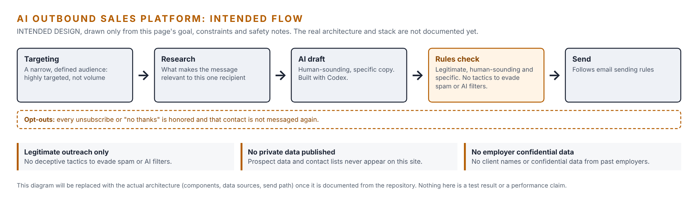

import ProjectHeader from '../../../../components/ProjectHeader.astro';
import Callout from '../../../../components/Callout.astro';
import Changelog from '../../../../components/Changelog.astro';
import flow from '../../../../assets/business/outbound-intended-flow.png';

<ProjectHeader hero={flow} heroAlt="Intended flow of the AI outbound sales platform: targeting, research, AI draft, rules check and send, with opt-outs always honored. Labelled as intended design, not documented architecture." />

<Callout type="open" title="Draft">
This page is a skeleton. The details below are filled in only from the project itself, so most sections are still open.
</Callout>

## Goal

Build an AI-powered outbound sales platform that runs legitimate, human-sounding and highly targeted outreach, and document the build publicly as evidence of how I apply AI automation to revenue operations.

## Constraints

- Outreach must be legitimate, human-sounding and highly targeted. No deceptive tactics to evade spam or AI filters.
- Built with Codex as the primary development tool.
- No client names or confidential data from past employers.

## Architecture

To be documented: the major components, data sources and how messages move from research to send.

Until then, this is the intended flow, drawn only from the goal, constraints and safety notes on this page. It is not the documented architecture and will be replaced once the repository is written up.

## Parts list

Software stack and services to be listed from the project.

## Configuration

Dependencies, configuration and build settings to be documented from the repository.

## Build steps

To be documented.

## Testing and verification

No results published yet.

## Safety notes

- Follow email sending rules and honor every opt-out.
- Never publish prospect data or real contact lists on this site.

## Lessons learned

None recorded yet.

## Open items

- Add the architecture overview and stack.
- Decide what parts of the repository are public, and add the link.
- Add the current version and test summary.
- Add the start date.

## Changelog

<Changelog
	entries={[{ date: '2026-10-26', change: 'Skeleton page published.', rollback: 'Revert the commit that added this page.' }]}
/>
