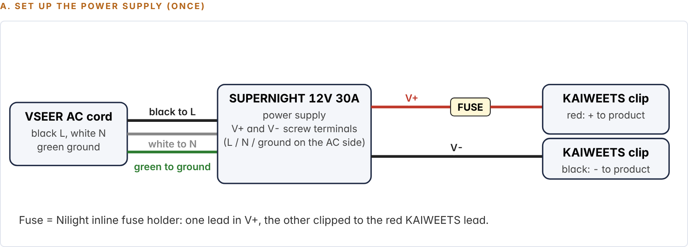
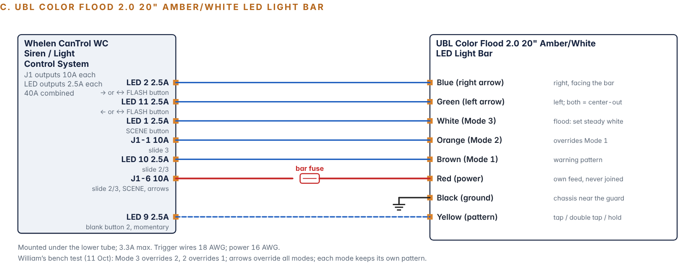
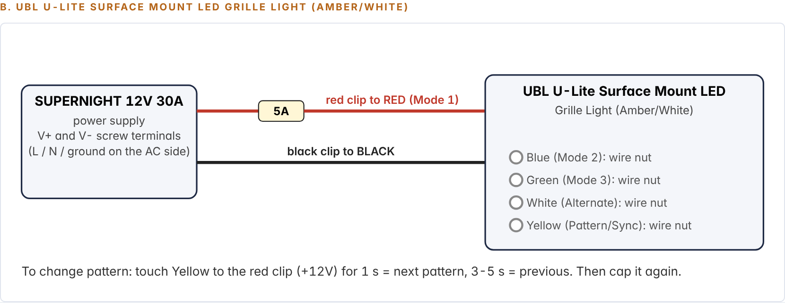

import ProjectHeader from '../../../../components/ProjectHeader.astro';
import Callout from '../../../../components/Callout.astro';
import Changelog from '../../../../components/Changelog.astro';
import Gallery from '../../../../components/Gallery.astro';
import kit from '../../../../assets/f150/cantrol-kit.jpg';
import top from '../../../../assets/f150/cantrol-module-top.jpg';
import conn from '../../../../assets/f150/cantrol-module-connectors.jpg';
import lit from '../../../../assets/f150/cantrol-head-lit.jpg';

<ProjectHeader hero={kit} heroAlt="The complete used Whelen CanTrol WC set on the bench: module with harness pigtails, 21-button control head, microphone and cables." />

<Callout type="safety" title="Legal notice">
Emergency lighting and siren use is regulated by state law and permits. This page documents a personal build and is not legal guidance.
</Callout>

<Callout type="unverified" title="Plan, not results">
This is version 1 of the bench guide, dated 23 October 2026. None of these stages has been run. Pinouts come from Whelen guide 14580G and stay inferred for my unit until the bench proves them. Results will be added to this page as each stage is done.
</Callout>

## Goal

Prove every part of the controller and every light that can be benched, the way it will be wired in the truck, before anything is drilled or permanently connected. By the end I'll know which lead is which on my harness, that every output does what the [output plan](/projects/f150-upfit/cantrol-output-plan/) says, what each light actually draws, and whether the siren and PA work.

## Why stages

The bench supply is a SUPERNIGHT 12V 30A unit. The siren alone may pull about 8A with one speaker and about 16A with two (inferred from the Whelen 295HFSA6 label, since Whelen doesn't publish the CanTrol's siren draw). Lights and siren together could approach 30A. So the siren is tested with the lights off, and the full-system run only happens once the measured light draws are added up.

## What gets tested, and where

| Product | Bench test? | Stage | CanTrol outputs |
| --- | --- | --- | --- |
| Whelen CanTrol WC (module, head, mic) | Yes | 1 to 3, 8, 10 | All |
| UBL Color Flood 2.0 20" amber/white light bar | Yes | 4 | J1-6, J1-1, LED 1, 2, 9, 10, 11 |
| 2x UBL U-Lite grille lights | Yes | 5 | J1-4 |
| 2x SpeedTech Lights Z-6 brake heads, amber/clear | Yes | 6 | LED 12, LED 13 |
| Putco 60" Work Blade with Wireless Remote Kit V3 | Yes | 7 | J1-5 plus a constant feed |
| 2x UBL 100W siren speakers | Yes | 8 | Speaker output |
| Whelen CC5K1 OBD-II CANport kit | Fit check only | 9 | OBD-II board |
| SpeedTech Raptor visor bar (via Grand Control Box) | Output only, by meter | 3 | J1-2 |
| BooYu rear traffic advisor | Output only, by meter | 3 | J1-3 |
| Speed Turtle EFM 3.0 | Output only, by meter | 3 | LED 4, LED 5 |
| UBL rocker panel bars | Output only (not bought yet) | 3 | LED 3 (relay coil) |

The visor bar, BooYu and EFM 3.0 are already installed on the truck, and the EFM only works plugged into the body control module. Pulling them out to bench them adds work and risk for no gain. On the bench I prove the output that will feed each one switches correctly. The devices themselves get tested on wiring day.

## Safety rules for every stage

1. Unplug the supply and pull the ignition fuse before touching any wire. Re-check at the start of every stage.
2. Fuses go in last. Whelen's guide says not to install them "until the wiring for the entire system has been completed."
3. Tape or cap every bare lead end that isn't in use. The harness has more than 40 leads, and most stay unused.
4. Keep J17-1 (horn ring, ground activated) away from V− and J17-2 (Park sense, positive) away from V+.
5. Never connect a siren speaker straight to 12V. Speakers only connect to the CanTrol speaker leads.
6. Siren tests outdoors or in an open garage, speakers pointed away, hearing protection on, one to two second bursts.
7. SpeedTech Lights says not to run its lights in Steady Burn for more than an hour. The bench never needs more than a minute.
8. Module on a non-metal surface with its vents and fans clear.
9. If anything smells hot, a fuse blows or the supply clicks off: unplug, stop, and note what was on.

## Bench kit

<Gallery photos={[
  { src: top, alt: 'Top of the CanTrol WC module.', caption: 'The CanTrol WC module that gets powered up in Stage 1.' },
  { src: conn, alt: 'CanTrol WC module connector end with the J-connectors.', caption: 'Connector end. Every output is proved with the meter at these pins in Stage 3.' },
  { src: lit, alt: 'The 21-button control head backlit on the bench.', caption: 'The control head lit on first power-up.' },
]} />

| Item | Have it? | Used for |
| --- | --- | --- |
| SUPERNIGHT 12V 30A 360W supply with VSEER 3-prong cord | Yes | All power |
| Nilight 50029R kit: 10 inline 14 AWG fuse holders, 5A to 30A fuses | Yes | Main A 20A, main B 20A, ignition 5A, fused jumper 5A, U-Lites 5A, Putco remote 5A |
| KAIWEETS 15A alligator test leads | Yes | Fused jumper for tapping pattern wires |
| Twist-on wire nuts, 22 to 18 AWG | Yes | Joining leads, capping unused wires |
| DOWELL wire stripper | Yes | About 3/8" strips |
| Panasonic Toughbook CF-33 and USB cable | Laptop yes, cable to check | Whelen Command. Module port may be USB Type-B or micro-USB |
| Digital multimeter with a 10A jack | To buy (about $13) | Identifying outputs and measuring draws |
| Hearing protection | To check | Stage 8 |
| Masking tape, marker, electrical tape | Household / to buy | Flagging each lead with its pin number |

<Callout type="safety" title="The fused jumper">
One fuse holder with a 5A fuse, one end under a V+ screw and the other clipped to the red test lead. Whenever a step says "tap to +12V," the wire touches this clip. Never tap with an unfused wire.
</Callout>

## Power budget

| Stage | What is on | Expected draw | Source |
| --- | --- | --- | --- |
| 1 to 3 | Module and head, no loads | About 0.08A plus head backlight | Guide 14580G p.3 (confirmed) |
| 4 | + Color Flood bar | 3.3A max | UBL rating (confirmed) |
| 5 | + 2 U-Lites | 0.70A for both | UBL rating (confirmed) |
| 6 | + 2 Z-6 heads | Under 1A for both | Manual G-TZTBL6 (confirmed) |
| 7 | + Putco bar and remote | Unknown. Stop if over 8A on J1-5 | Not published by Putco |
| 8 | Siren only, lights off | About 8A (one speaker), 16A (two) | 295HFSA6 label as a reference (inferred) |
| 10 | All bench lights + siren | Sum of measured draws + siren | Both speakers only if the total stays under 27A (90% of 30A) |

## Supply terminals

*Bench setup A from the project document: set up the power supply once.*

| Screw | What goes on it |
| --- | --- |
| V+ 1 | Main A fuse (20A) to CanTrol red, power plug pin 3 |
| V+ 2 | Main B fuse (20A) to CanTrol red, power plug pin 4 |
| V+ 3 | Ignition fuse (5A) to J17-7, fused jumper (5A), Putco remote feed (5A) |
| V− 1 | Both CanTrol blacks |
| V− 2 | Front lights: Color Flood black, both U-Lite blacks, meter black probe |
| V− 3 | Rear lights: both Z-6 blacks, Putco bar and remote blacks |

Both reds are fed. The CanTrol has two +12V pins, and with one left off part of the unit can stay dead and look like a fault. The truck uses 2 x 40A at the battery; the bench uses 20A because the supply tops out at 30A.

## Stage 1: first power-up

Wire the main power, ignition sense (J17-7 through its own 5A fuse, which acts as the "key"), the head cable and the mic. Tape every other lead.

| Step | Expect |
| --- | --- |
| Main fuses in, supply on, ignition fuse out | System off (POW LED off). Proves ignition sense is in control |
| Ignition fuse in ("key on") | POW steady, head buttons and slide light up |
| Read the diagnostic LEDs | USB off, ERR off, WC off or flashing |
| Press buttons, move the slide | The previous owner's program runs. Indicators may light with nothing connected |
| Ignition fuse out ("key off") | Record how long until it shuts down. That is the previous owner's shutdown delay |

**Pass:** POW on only with the ignition fuse in, head lights up, no fuse blows, no ERR fault.

## Stage 2: Whelen Command

1. Install Whelen Command on the CF-33 and its USB drivers (Help, About).
2. Connect USB. The module's USB LED should go steady.
3. Try Extract to save the previous owner's program as "F150_CanTrol_as_received." If it fails, that is expected for legacy configurations, not a fault.
4. New configuration: CanTrol, add the 21-button head with the slide switch, add CANport (Ford, 2017 F-150) and screenshot the signal list to confirm Brake and Park.
5. Advanced mode. Untick any preset that turns on lights; keep the siren presets.
6. Program every input in the table below with Turn On, the steady entry, Low Power disabled. Use Simulate to confirm.
7. Leave Save State off for every light button. Name each output (for example "CF Power," "Z6 Brake").
8. Shutdown delay to Instant for the bench. Set backlight and indicator intensity in Command.
9. Check WAIL, YELP and PIER each have a tone on the internal amplifier. No tone on slide position 3.
10. Save as "F150_CanTrol_BENCH_v1" and Transfer.

### The bench program

| Input | Outputs | Switch type | Purpose |
| --- | --- | --- | --- |
| Slide 1 | J1-2 | Turn On, steady | Visor Grand Control Box (meter only) |
| Slide 2 | J1-2, J1-3, J1-4, J1-5, J1-6, LED 10, LED 12 | Turn On, steady | Visor, BooYu, U-Lites, Putco, Color Flood power and Mode 1, Z-6 Mode 1 |
| Slide 3 | Slide 2 + J1-1, LED 3, LED 4 | Turn On, steady | Adds Color Flood Mode 2, rocker relay coil, EFM Input 1. No siren tone |
| SCENE | LED 1 + J1-6 | Press On / Press Off | Color Flood white flood |
| → | LED 2 + J1-6 | Press On / Press Off | Color Flood right arrow |
| ← | LED 11 + J1-6 | Press On / Press Off | Color Flood left arrow |
| ↔ FLASH | LED 2 + LED 11 + J1-6 | Press On / Press Off | Color Flood center-out |
| Blank 1 | LED 5 | Press On / Press Off | EFM 3.0 Input 2 (meter only) |
| Blank 2 | LED 9 | Press On / Release Off | Color Flood pattern wire: tap, double tap, 2 s hold |
| Blank 3 | LED 13 | Press On / Release Off | **Bench only.** Simulates the brake for the Z-6 heads. In the truck this comes from CANport |
| WAIL, YELP, PIER, MAN, HORN | Siren | Command presets | Tones |
| All other buttons | Nothing | Spare | RIGHT ALLEY, LEFT ALLEY, CORNER, Star of Life, TAKE DOWN, Blank 4 |

## Stage 3: prove every output with the meter

Nothing is connected to the outputs yet. Each input is switched on from the head and its lead is read with the meter. This finds the true lead for each output, catches the color conflicts in the guide, and checks the J1 fuse slots before any light is at risk.

1. Meter on DC volts, black probe on V− 2.
2. With everything off, read each lead and record the OFF voltage. Expect under 1V. LED 4 and LED 5 matter most, because the EFM 3.0 inputs accept any 5 to 17V signal, so a leaking output could look "on" to it.
3. Turn on each input and read its lead. Expect 12 to 13.8V, and confirm it drops when turned off.
4. For J1-5 and J1-6, the output's indicator must be **green** (positive switching). Amber means ground switching: unplug, move that output's 10A fuse to the Positive Switching slot, re-test.
5. Flag each lead with masking tape as it's proven. If an expected lead stays dead and another comes alive, the guide's color is wrong for this unit. Flag the live one.

**Pass:** every output reads about 12V only with its own input, and J1-5 and J1-6 show green.

## Stage 4: UBL Color Flood 2.0 light bar

*Bench setup C: Color Flood 2.0 wire map, confirmed on the bench by William on 11 Oct.*

| Bar wire | CanTrol lead | Turned on by |
| --- | --- | --- |
| Red (power, keeps its own in-line fuse) | J1-6 | Slide 2, 3, SCENE, arrows |
| White (Mode 3, flood) | LED 1 | SCENE |
| Blue (right arrow) | LED 2 | → and ↔ |
| Yellow (pattern) | LED 9 | Blank 2, momentary |
| Brown (Mode 1) | LED 10 | Slide 2 and 3 |
| Orange (Mode 2) | J1-1 | Slide 3 |
| Green (left arrow) | LED 11 (color to check) | ← and ↔ |
| Black | Supply V− 2 | |

Mode 3 overrides 2 overrides 1, and arrows override every mode. Red must never be joined to a mode wire.

| # | Do this | Expect |
| --- | --- | --- |
| 4.1 | Slide 2 | Mode 1 pattern |
| 4.2 | Slide 3 | Mode 2 takes over |
| 4.3 | Slide off, SCENE | Mode 3 white flood (hold Blank 2 for 2 s to set steady if needed) |
| 4.4 to 4.6 | →, then ←, then ↔ | Right arrow, left arrow, center-out |
| 4.7 | Slide 2, then → | Arrow overrides the pattern; release returns to it |
| 4.8 | Slide 2, tap Blank 2 | Next pattern |
| 4.9 | Slide 2, double tap Blank 2 | Amber/white color change (double tap worked on 11 Oct; the manual says three taps) |
| 4.10 | Set patterns, power down 10 s, back up | Each mode kept its pattern and color |
| 4.11 | Meter in series on red, slide 3 and SCENE | Up to 3.3A |

Blank 2 must be momentary. If the yellow wire is held on, the bar reads it as a 2 s hold and changes to steady color.

## Stage 5: two UBL U-Lite grille lights

*Bench setup B: UBL U-Lite grille light.*

Both reds and the left light's white join on one fuse from J1-4 (5A on the bench, 3A within 12" of the output in the truck). The two yellows join and get capped. Right white, both blues and both greens are capped separately.

| # | Do this | Expect |
| --- | --- | --- |
| 5.1 | Slide 2 | Both flash and alternate (left white on +12V gives alternate sync) |
| 5.2 | Hold the joined yellows to the fused jumper 3 s | Lights sync to the same pattern |
| 5.3 | Touch yellows 1 s | Both step to the next pattern together |
| 5.4 | Power down 10 s, up, slide 2 | Same pattern, still alternating |
| 5.5 | Slide 3 | Same as slide 2 |
| 5.6 | Meter in series on J1-4, slide 2 | About 0.70A |

## Stage 6: two SpeedTech Lights Z-6 brake heads

Both reds to LED 12, both greens to LED 13, greys (sync) joined, yellows (pattern) joined, browns and blues capped separately. Under 0.5A per head. Green overrides Modes 1 and 2.

| # | Do this | Expect |
| --- | --- | --- |
| 6.1 | Slide 2 | Both flash amber/clear in step |
| 6.2 | If out of step, power cycle once | In step |
| 6.3 | Tap the joined yellows | Next pattern. Don't hold 2 s (Steady Burn) or 3 s (auto-cycle) |
| 6.4 | Slide 2, hold Blank 3 | Both go steady red while held |
| 6.5 | Slide off, hold Blank 3 | Steady red with no warning mode on. Shows how brake pop will look |
| 6.6 | Power cycle, slide 2 | Same pattern kept |
| 6.7 | Meter on LED 12, then LED 13 | Under 1A for both |

These results also answer two open questions from the [five-modes plan](/projects/f150-upfit/five-modes-plan/): what the amber/clear heads show in Steady Burn, and whether any of their 24 patterns is amber-only.

## Stage 7: Putco Work Blade and wireless remote

| From | To |
| --- | --- |
| J1-5 (positive switching only) | Bar blue (+12V, runs the stored pattern) |
| Supply V+ 3 through 5A | Remote box red (constant feed, as in the truck) |
| Remote blue | Bar white (white override, button A) |
| Remote yellow | Bar orange (next pattern, button B) |
| Remote green and grey, bar red | Capped |
| Bar black, remote black | Supply V− 3 |

| # | Do this | Expect |
| --- | --- | --- |
| 7.1 | Everything off, meter on the remote red (mA) | Remote standby draw. Ford's limit for total key-off draw is 28 mA |
| 7.2 | Slide 2 | Stored pattern |
| 7.3 | Remote B | Next pattern. Step to an amber-only one and note it |
| 7.4 | Slide 2, remote A | White override |
| 7.5 | Slide off, remote A | Does white work with the bar blue off? Yes or no |
| 7.6 | Power cycle | Pattern kept |
| 7.7 | Meter on bar blue, slide 2 | Record. Stop if over 8A |
| 7.8 | Meter on remote red, white on | Record |

## Stage 8: siren and PA

Read each speaker's label first. The plan assumes 11 Ω each, so two in parallel make 5.5 Ω, Whelen's minimum. If a label says 8 Ω or less, stop. Lights off for this whole stage.

| # | Do this | Expect |
| --- | --- | --- |
| 8.1 | One speaker. WAIL, 1 to 2 s | Wail |
| 8.2 | YELP, then PIER | Yelp, piercer |
| 8.3 | Hold MAN | Manual tone rises while held |
| 8.4 | Hold HORN | Air horn while held |
| 8.5 | Key the mic | PA through the speaker. Set the PA pot from the middle |
| 8.6 | Add the second speaker, repeat 8.1 | Both sound, no distortion, supply stays on |
| 8.7 | Stand in front during a short WAIL | Loud and clean. Thin or hollow means one speaker is reversed |

If the supply clicks off with two speakers, that's the supply's limit, not a CanTrol fault. Not tested: HF (needs the horn ring input) and RAD (not used).

## Stage 9: CC5K1 fit check

With power off, offer the CC5K1's white 8-position plug to the small empty socket beside the USB port. It should seat with light pressure and latch. Photograph it seated and photograph the module's model label. If it doesn't fit, or there's no socket, the module may not have the CANport board. Brake pop itself can only be proven in the truck, because the signal comes from the truck's data bus.

## Stage 10: full-system run

1. Add up the measured draws from 4.11, 5.6, 6.7, 7.7 and 7.8.
2. If that total plus 16A is under 27A, run both speakers with the lights. If not, one speaker or no siren.
3. Slide 3: every light runs together. Then →, ←, ↔.
4. Hold Blank 3: the Z-6 heads go steady red while everything else keeps running.
5. Short WAIL with the lights on. Watch for any light flickering or restarting, which would point to a voltage dip.
6. Slide off, ignition fuse out. Everything shuts down.
7. Save the Command file again and copy it into the project files.

## Wiring day: tests only the truck can do

| Item | Test | Pass |
| --- | --- | --- |
| Visor bar (J1-2) | Slide 1, 2, 3 | Bar comes on, Grand Control Box buttons still work |
| BooYu (J1-3) | Slide 2, then its button | Runs. Needs its button each time power returns |
| EFM 3.0 (LED 4, LED 5) | Slide 3, Blank 1, both | Factory lamps flash as tabbed, nothing flashes with both off |
| Rocker bars (LED 3 relay) | After purchase, bench-measure first | Relay clicks on slide 3, bars run |
| Brake pop (CANport) | Ignition on, slide 2, brake pedal | Z-6 heads go steady red. Bench-only Blank 3 removed first |
| Ignition sense | Key off, key on | System follows the key |
| Grounds | Every ground | Ford ground point or side of a steel frame rail. Never the battery negative post, never aluminum |
| Key-off draw | Meter in series, everything asleep | 28 mA or less in total |
| Head backlight at night | Dark garage, headlamps on | Readable without the dimmer wire |
| Radio interference | Key the BaoFeng with lights and siren running | No CanTrol glitches |

## Troubleshooting

| Symptom | Likely cause | What to do |
| --- | --- | --- |
| Nothing on, POW off | Ignition fuse out, main fuse blown, supply off | Check fuses, 12V between J17-7 and V− |
| POW on, head dark | Head cable not seated | Reseat both ends |
| ERR steady | Controller bus set to OFF | Check the head selection in Command, re-Transfer |
| Indicator lights, device does nothing | Bad joint, device fuse, no ground, or ground-switching slot | Meter the lead, check the fuse slot |
| Light flashes by itself or keeps restarting | Flash pattern or Low Power on its output | Turn On, steady, Low Power disabled |
| Color Flood jumps to steady color | Blank 2 latched instead of momentary | Press On / Release Off |
| Z-6 heads out of step | Greys or yellows not joined | Join both, power cycle |
| Siren weak or hollow | Speakers out of phase | Swap one speaker's two wires |
| Supply clicks off on siren | 30A supply limit | One speaker, lights off |
| Command doesn't see the module | USB driver, cable, module off | Reinstall drivers, check USB LED |

## Results sheet

Every line below gets filled in on bench day and published here.

| Item | Result |
| --- | --- |
| Module model label (CANWCT2 / 2A / 3) | Pending |
| USB port type | Pending |
| Previous config extracted? | Pending |
| CANport: Brake and Park listed for 2017 F-150? | Pending |
| J1-5 / J1-6 indicator color | Pending |
| LED 11 / LED 12 lead colors on my unit | Pending |
| LED 4 / LED 5 OFF voltage | Pending |
| Color Flood draw (slide 3 / SCENE) | Pending |
| U-Lites draw | Pending |
| Z-6 draw (Mode 1 / brake), Steady Burn color | Pending |
| Putco bar draw, white override draw, remote standby draw | Pending |
| Putco amber-only pattern number, white with blue off? | Pending |
| Speaker label impedance | Pending |
| Siren with one speaker / two | Pending |
| PA works, pot setting | Pending |
| CC5K1 plug fits? | Pending |
| Previous shutdown delay | Pending |

## Changelog

<Changelog entries={[{ date: '2026-10-26', change: 'Bench test plan published from bench guide version 1 (23 October 2026). No stages run yet.', rollback: 'Revert the commit that added this page.' }]} />
