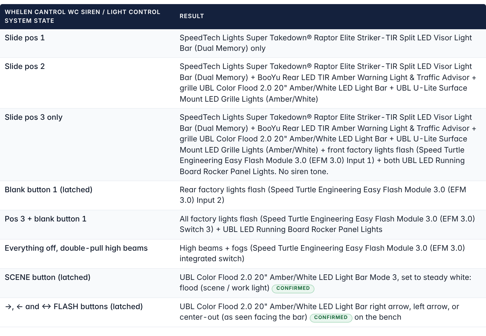

import ProjectHeader from '../../../../components/ProjectHeader.astro';
import Callout from '../../../../components/Callout.astro';
import Changelog from '../../../../components/Changelog.astro';
import conn from '../../../../assets/f150/cantrol-module-connectors.jpg';

<ProjectHeader hero={conn} heroAlt="Connector end of the Whelen CanTrol WC module, where the J1 and J4 outputs in this plan come out." />

<Callout type="safety" title="Legal notice">
Emergency lighting and siren use is regulated by state law and permits. This page documents a personal build and is not legal guidance.
</Callout>

Ratings and pinouts are from the Whelen CanTrol WC Installation/Operating Guide, form 14580G. Every output is set to steady on/off, because each light runs its own flash patterns. The light bar wire functions were confirmed on the bench on 2026-10-11. Nothing on this page has been tested in the truck yet.

<Callout type="unverified">
Guide 14580G shows two different colors for LED Outputs 11 and 12 on different pages. Identify those two leads by pin (J4-15 and J4-16) and with a meter, not by color.
</Callout>

## Outputs

*Example from the plan: how the Color Flood 2.0 bar's eight wires land on CanTrol outputs.*

| Output | Rating | Feeds | Turned on by |
| --- | --- | --- | --- |
| Siren amp | 5.5 Ω min | 2 x UBL 100W speakers in parallel (11 Ω each) | Siren tones on the head. No tone in slide position 3 |
| J1-1 (brown) | 10A | UBL Color Flood 2.0 orange wire, Mode 2 (signal only) | Slide 3 |
| J1-2 (red) | 10A | SpeedTech Grand Control Box, Raptor visor bar (under 2.4A) | Slide 1, 2, 3 |
| J1-3 (orange) | 10A | BooYu traffic advisor controller, about 10A in-line fuse | Slide 2, 3 |
| J1-4 (yellow) | 10A | 2 x UBL U-Lite red (Mode 1), 0.70A combined, 3A in-line fuse | Slide 2, 3 |
| J1-5 (green) | 10A | Putco Work Blade blue (+12V), positive-switched | Slide 2, 3 |
| J1-6 (blue) | 10A | UBL Color Flood 2.0 red (power) only, through its own fuse (3.3A max) | Slide 2, 3, SCENE, ←, →, ↔ FLASH |
| J1-7, J1-8 | 10A | Spare | — |
| LED 1 (J4-3) | 2.5A | Color Flood 2.0 white wire, Mode 3 (set to steady white flood) | SCENE, latched |
| LED 2 (J4-4) | 2.5A | Color Flood 2.0 blue wire, right arrow (as seen facing the bar) | → and ↔ FLASH, latched |
| LED 3 (J4-5) | 2.5A | 30A relay coil (pin 86) for both UBL rocker panel bars | Slide 3 |
| LED 4 (J4-6) | 2.5A | EFM 3.0 white wire (Input 1), signal only | Slide 3 |
| LED 5 (J4-7) | 2.5A | EFM 3.0 green wire (Input 2), signal only | Blank button 1, latched |
| LED 9 (J4-13) | 2.5A | Color Flood 2.0 yellow (pattern) wire | Blank button 2, momentary only |
| LED 10 (J4-14) | 2.5A | Color Flood 2.0 brown wire, Mode 1 | Slide 2, 3 |
| LED 11 (J4-15) | 2.5A | Color Flood 2.0 green wire, left arrow | ← and ↔ FLASH, latched |
| LED 12 (J4-16) | 2.5A | Both Z-6 heads, red wire (Mode 1) | Slide 2, 3 |
| LED 13 | 2.5A | Both Z-6 heads, green wire (red brake) | Brake signal over the CANport |
| LED 6–8, 14–32 | 2.5A | Spare (some reserved for future options) | — |
| Traffic Advisor (J10) | 20A fuse | Not used. The BooYu runs its own patterns | — |

## What each control does

*Section 3.2 of the project document (rev. 10): what each control state should do. Button assignments are proposed and can be reprogrammed.*

| Control | Result |
| --- | --- |
| Slide 1 | Visor bar only |
| Slide 2 | Visor bar, rear traffic advisor, grille light bar and grille lights |
| Slide 3 | Everything in slide 2, plus front factory lamps flashing (EFM Input 1) and both rocker panel bars. No siren tone |
| Blank button 1 | Rear factory lamps flash (EFM Input 2) |
| Slide 3 + blank button 1 | All factory lamps flash (EFM Switch 3) |
| SCENE | Grille light bar steady white flood |
| ←, →, ↔ FLASH | Grille light bar left arrow, right arrow or center-out |
| Double-pull high beams, everything else off | High beams and fogs flash (EFM integrated switch) |

Button assignments can be changed when the system is programmed. The ones above are the current plan.

## Power and inputs

- **Main input:** 80A max through two red leads, each fused 40A at the battery, and two black grounds. 12V DC ±20%, negative ground only.
- **Ignition sense:** J17-7 (red/white).
- **Left unconnected:** horn ring (J17-1), Park Sense (J17-2) and backlight (J17-5). Backlight brightness is set in Whelen Command instead.
- **Estimated load:** about 9A worst case with everything on, well under the 40A combined limit. This is an estimate, not a measurement.

## Open items

- Confirm the module model on its label.
- Confirm Whelen Command shows the brake and Park signals for the 2017 F-150 over the CANport.
- Check whether blank button 1 stays latched after a restart, and how long the system stays on after the key is off.

## Changelog

<Changelog entries={[{ date: '2026-10-26', change: 'Output plan published from the project document.', rollback: 'Revert the commit that added this page.' }]} />
