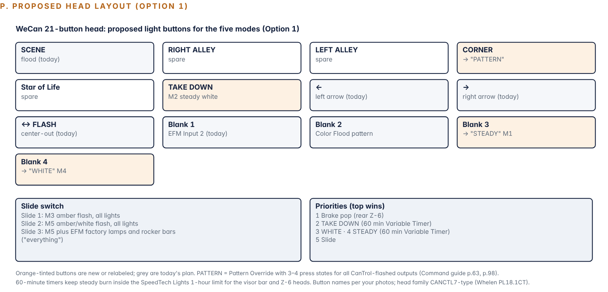
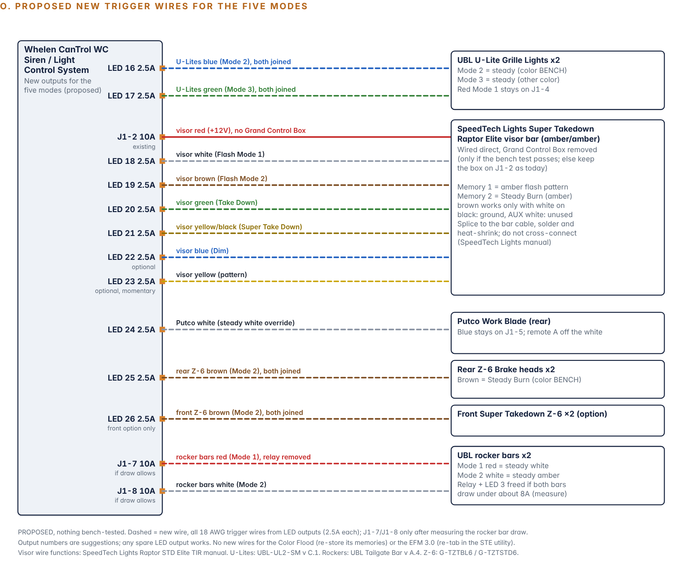

import ProjectHeader from '../../../../components/ProjectHeader.astro';
import Callout from '../../../../components/Callout.astro';
import Changelog from '../../../../components/Changelog.astro';
import kit from '../../../../assets/f150/cantrol-head-lit.jpg';

<ProjectHeader hero={kit} heroAlt="The 21-button WeCan control head lit up on the bench." />

<Callout type="safety" title="Legal notice">
Emergency lighting and siren use is regulated by state law and permits. This page documents a personal build and is not legal guidance.
</Callout>

<Callout type="unverified" title="Proposal">
Written 21 October 2026. Nothing here is tested, and the main project document still runs the baseline [output plan](/projects/f150-upfit/cantrol-output-plan/). Items marked **bench** must pass on the [bench](/projects/f150-upfit/cantrol-bench-test/) before they are relied on.
</Callout>

## The five modes

| Mode | Look |
| --- | --- |
| M1 | Steady burn, amber |
| M2 | Takedown / steady burn, white |
| M3 | Flash, amber |
| M4 | Flash, white |
| M5 | Flash, amber and white |

## How it works: two methods combined

**Method A, device memories.** Most of the lights store a pattern in each of their mode wires (two or three memories). The CanTrol just turns the right mode wire on.

**Method B, CanTrol flashing.** A light is parked on a steady color in one memory, and the CanTrol flashes that mode wire with a Whelen pattern. Steady amber pulsed is amber flash, steady white pulsed is white flash, and amber and white wires flashed at opposite phase give amber/white alternating. Whelen Command sets the pattern, phase and delay per output.

Method B is what gives real flexibility: every brand flashes in true sync, patterns are picked from the head, and one button can change the pattern for the whole truck. The risk is that no maker says their mode wires follow fast on/off switching, so every light has to pass a bench test. A light that fails falls back to Method A.

### The universal memory recipe

For any light with three memories:

- Memory 1 = its own amber/white flash pattern (gives M5 by Method A)
- Memory 2 = steady amber (M1, and M3 by Method B)
- Memory 3 = steady white (M2, and M4 by Method B)

Lights with two memories get steady amber and steady white, and the CanTrol makes all three flash modes.

## Limits that can't be programmed around

- **BooYu rear traffic advisor:** amber only, its own controller, and it needs its power button pressed each time power returns. It can only do amber flash (M3, and the amber part of M5).
- **SpeedTech Raptor visor bar:** mine is amber/amber (config code B-RTXE8). White exists only as the steady Takedown and Super Takedown functions. White flash is possible only by Method B on the takedown wire.
- **Speed Turtle EFM 3.0:** it flashes factory lamps but can't hold them steady. The factory high beams are the steady white from the factory lamps.
- **Z-6 brake heads:** the green wire is the red brake override, already used for brake pop. Whether any of their 24 patterns is amber-only or white-only isn't stated (bench).
- **Steady burn limit:** SpeedTech Lights says not to run Steady Burn more than an hour on the visor bar and Z-6 heads. The steady modes go on 60-minute timers.

## What each light can do

### UBL Color Flood 2.0 20" light bar

Three memories (brown Mode 1, orange Mode 2, white Mode 3). Mode 3 overrides 2 overrides 1, and each mode keeps its own pattern (proven on my bench 11 October).

| Wire | Stores |
| --- | --- |
| Brown | Own amber/white pattern |
| Orange | Steady amber (changes from "warning pattern 2" today) |
| White | Steady white (also the SCENE flood) |

M1 orange. M2 white. M3 CanTrol flashes orange (bench). M4 CanTrol flashes white (bench). M5 brown, or orange and white flashed at 0/180 degrees (bench). No new wires.

### Two UBL U-Lite grille lights

Three memories (red Mode 1, which is also power, blue Mode 2, green Mode 3). Patterns include single-color, dual-color, Steady 1, Steady 2, Brake 1 and Brake 2. The manual does not say each mode keeps its own pattern (bench). Plan: red = dual-color pattern, blue = Steady 1, green = Steady 2. New wires: both blues joined and both greens joined to two LED outputs. Whether blue or green work without red also on is a bench question.

### SpeedTech Raptor visor bar

Wires (confirmed from the SpeedTech manual): red +12V, black ground, white Flash Mode 1, brown Flash Mode 2 (only while Mode 1 is on), yellow pattern, green Take Down steady, yellow/black Super Take Down steady, blue Dim. Under 2.4A full, 0.8A dimmed. 34 patterns, dual memory.

The manual says patterns are "only functional when using in conjunction with STL Grand Control Box." Without the box the bar may run a fixed default pattern (bench). The preferred plan has the CanTrol drive the bar's wires directly. The fallback keeps the Grand Control Box, and the visor stays on the box's own buttons, outside the one-press modes. The blue Dim wire could follow the headlamps automatically through CANport (inferred).

### UBL rocker panel bars

Listing: three color modes and 120 patterns. Wires: red Mode 1, white Mode 2 (overrides Mode 1), blue and green arrows, yellow color/pattern, black ground. Two memories. Plan: red = steady white, white = steady amber.

<Callout type="lesson">
Method B can't go through the 30A relay, because a mechanical relay clicking at flash rate wears out fast (general knowledge). If each bar's mode wire measures under about 8A, red goes on J1-7 and white on J1-8 directly, and the relay comes out. If they draw more, one relay stays for steady white and the bars use Method A only.
</Callout>

### Putco 60" Work Blade

Wires: blue +12V (runs the stored pattern), white steady override, orange next pattern when grounded, red auxiliary, black ground. One stored pattern. Putco's chart lists amber-only, white-only and amber/white flashes. Plan: stored pattern = amber flash, and the white wire moves to a CanTrol LED output. The remote's button A and the CanTrol can't both feed the white wire without isolation, so the simplest choice leaves button A unused. Two 3A diodes would let both work (general knowledge).

### SpeedTech Z-6 heads (rear plate)

Red Mode 1, brown Mode 2, green red-brake override, yellow pattern, grey sync, blue alternate sync. Plan: red = amber/clear pattern, brown = Steady Burn. What color Steady Burn shows on the amber/clear head is a bench question. New wire: both browns joined to an LED output.

### SpeedTech Super Takedown Z-6 heads (front plate option, not bought)

Same as the rear, but green is a steady white takedown. That would make it a full five-mode light.

### Speed Turtle EFM 3.0

Re-plan in the STE configuration utility only (inferred): Switch 1 = amber factory lamps (front turn signals and markers), Switch 2 = white factory lamps (low beams, high beams, fogs, reverse), Switch 3 = all. Then M3 = Input 1, M4 = Input 2, M5 = both. Which rear lamps are amber on my 2017 Lariat isn't confirmed, so that gets checked first.

## Coverage by mode (if every bench item passes)

| Mode | Lights |
| --- | --- |
| M1 steady amber | Color Flood, U-Lites, visor (memory 2), rocker bars, Putco (if a steady pattern exists), rear Z-6 (if amber-only steady) |
| M2 steady white | Color Flood, U-Lites, visor takedown, rocker bars, Putco white, front Z-6 option. Factory high beams by hand |
| M3 amber flash | Everything above plus the BooYu and the EFM amber lamps |
| M4 white flash | Color Flood, U-Lites, visor takedown, rocker bars, Putco white, front Z-6 option, EFM white lamps |
| M5 amber/white flash | All lights. BooYu adds amber |

## Head layout options

*Diagram P from the project document (rev. 9, 21 Oct): proposed head layout, Option 1. Orange buttons are new or relabelled. Proposed, not yet programmed.*

The 21-button head has 8 siren-area buttons, 13 light buttons and the slide. Command tools used: multiple press states per button, switch types including a Variable Timer (100 ms to 60 min), Pattern Override, per-output phase and delay, priorities, and Events with CANport signals as conditions.

### Option 1 (recommended): slide for flashing, one button per steady mode

| Control | Mode |
| --- | --- |
| Slide 1 | M3 amber flash, all lights |
| Slide 2 | M5 amber/white flash, all lights |
| Slide 3 | M5 plus EFM factory lamps and rocker bars |
| TAKE DOWN | M2 steady white, 60-minute timer, priority above the slide |
| Blank 3, labeled STEADY | M1 steady amber, 60-minute timer |
| Blank 4, labeled WHITE | M4 white flash |
| CORNER, relabeled PATTERN | Pattern Override, 3 to 4 presses, each a different Whelen pattern for every Method B output |

Priorities, top wins: brake pop, TAKE DOWN, WHITE, STEADY, slide. The slide stays a familiar off/1/2/3 lever, and every other mode is one press.

### Option 2: slide picks the color, one button picks steady

Slide 1 amber, slide 2 white, slide 3 amber/white, all flashing. A STEADY button turns whatever color the slide is on from flash to steady, using Events. Five modes from one lever and one button, but more Command work and less obvious at a glance. Whether Events can use button states as conditions isn't confirmed.

### Option 3: one MODE button that steps through all five

One button with five press states, wrapping to off, and the slide picks how many lights. Most compact, but the only way to see the current mode is the button's light.

### Automations worth adding (inferred until confirmed in Command)

- In Park: switch flashing to steady, turn on the SCENE flood, or end the siren.
- Headlamps on: visor Dim wire on automatically at night.
- Brake: rear Z-6 brake pop (already planned).

## New wiring

*Diagram O from the project document: proposed new trigger wires for the five modes. Proposed, not yet wired or bench tested.*

All new wires are 18 AWG signal wires from spare LED outputs (2.5A each). Today's map uses LED 1 to 5 and 9 to 13, with 6 to 8 reserved for the Dominator option and 14 to 15 for the front Z-6 option.

| Output | Feeds |
| --- | --- |
| LED 16 | U-Lites blue (Mode 2), both joined |
| LED 17 | U-Lites green (Mode 3), both joined |
| LED 18 | Visor white (Mode 1) |
| LED 19 | Visor brown (Mode 2) |
| LED 20 | Visor green (Take Down) |
| LED 21 | Visor yellow/black (Super Take Down) |
| LED 22 | Visor blue (Dim), optional |
| LED 23 | Visor yellow (pattern), momentary, optional |
| LED 24 | Putco white (override) |
| LED 25 | Rear Z-6 brown (Mode 2), both joined |
| LED 26 | Front Z-6 brown, if the front option is bought |
| J1-7 | Rocker bars red (Mode 1), relay removed, if draw allows |
| J1-8 | Rocker bars white (Mode 2), if draw allows |

J1-2 stays the visor's +12V. The Grand Control Box comes out only if the bench test passes. A small 7-conductor cable from the module to the visor area keeps the visor run tidy, soldered and heat-shrunk as SpeedTech instructs (general knowledge). The rule from the controller research still applies: any output that **powers** a device stays Turn On only, with no pattern and no Low Power.

## Decisions still open

| # | Decision | Choices |
| --- | --- | --- |
| A | Head layout | Option 1 (recommended), 2 or 3 |
| B | Visor bar | Direct from the CanTrol (all modes, one press) or keep the Grand Control Box (simpler, visor outside one-press modes) |
| C | Rocker bars | Method B on J1 outputs (needs the draw to fit) or keep the relay with Method A only |
| D | Putco white | CanTrol only (simplest) or CanTrol plus remote A through two diodes |

## Bench test for this plan

1. Store each light's memories, power cycle, check each memory kept its pattern or steady.
2. Turn each mode wire on alone, then with the others, and record which wins.
3. Method B: program the mode wire's output with a slow Whelen pattern, then a fast one. Pass = no lag, no dropouts, no restart flicker. Record the fastest pattern that passes.
4. Two-color test (rockers, Color Flood, U-Lites): amber and white wires at 0/180 degrees. Pass = clean alternation.
5. Visor without the Grand Control Box: red and white only, then add the rest, and test whether yellow steps patterns with no box.
6. Draw: meter in series on each power wire in steady and in flash, rocker bars especially.
7. Anything that fails stays on Method A.

## Sources

Whelen CanTrol WC guide 14580G and Whelen Command CanTrol WC guide. Whelen price list PL18.1CT. UBL Color Flood 2.0 manual v A.1, UBL U-Lite manual v C.1, UBL Tailgate Bar manual v A.4, Putco 93009I and color chart, SpeedTech Lights Z-6 manuals G-TZTBL6 and G-TZTSTD6. [SpeedTech Raptor STD Elite TIR manual](https://speedtechlights.com/cdn/shop/files/71630STL_20Raptor_20STD_20Elite_20TIR.pdf?v=9997490532677141036). [SpeedTech Grand Control Elite manual](https://speedtechlights.com/cdn/shop/files/97465STL_20Grand_20Control_20Elite.pdf?v=4788095219780941684). [Whelen Command release notes](https://releasenotes.command.whelen.com/).

## Changelog

<Changelog entries={[{ date: '2026-10-26', change: 'Five-modes proposal published from the 21 October plan. Not adopted yet.', rollback: 'Revert the commit that added this page.' }]} />
