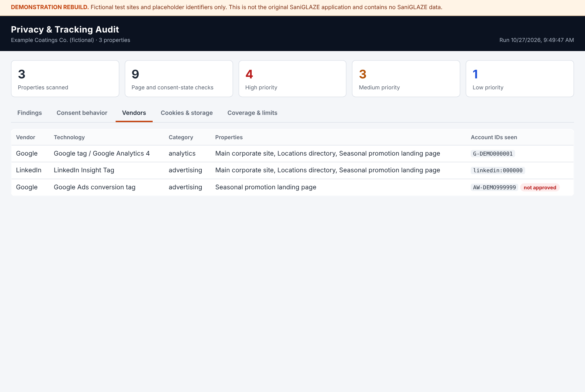
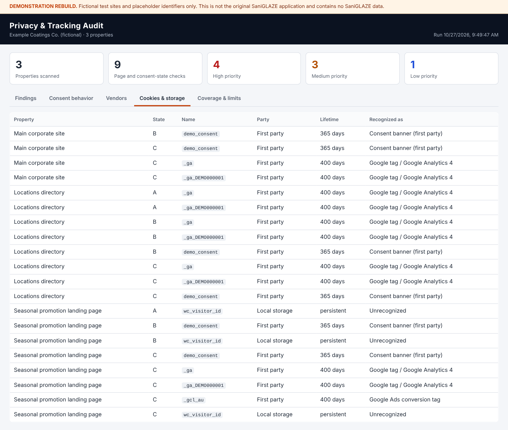
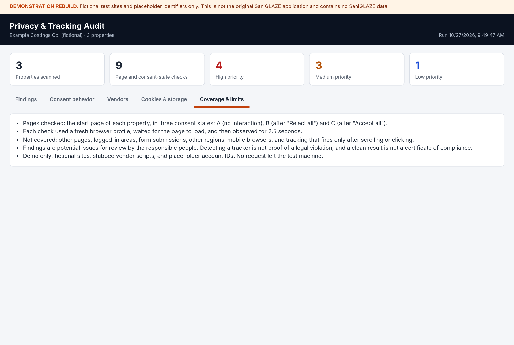
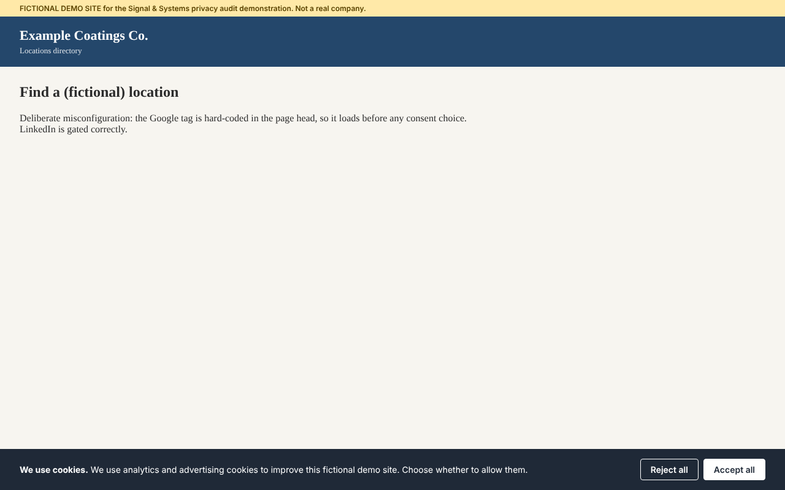

import ProjectHeader from '../../../../components/ProjectHeader.astro';
import SpecBox from '../../../../components/SpecBox.astro';
import Callout from '../../../../components/Callout.astro';
import Changelog from '../../../../components/Changelog.astro';

<ProjectHeader />

<SpecBox
	title="At a glance"
	specs={[
		['Full title', 'Web Privacy Compliance & Tracking Audit Platform'],
		['Category', 'Business Systems · Digital Governance · Risk Identification · AI-Assisted Development'],
		['Project type', 'Internal auditing application · Not publicly accessible'],
		['Built and used', '2026'],
		['Scope', "All of SaniGLAZE International's web properties"],
		['Audit focus', 'Cookies, advertising and analytics trackers (including LinkedIn and Google), other third-party scripts, consent-related behavior'],
		['Method', 'Real-browser scanning, with behavior tested before and after accept and reject choices'],
		['Reporting', 'Interactive, browser-based dashboard used by franchise members and the corporate leadership team'],
		['Changes', 'Read access by default; changes possible only for users with proper credentials, access, and API keys or service tokens'],
		['Outcome', 'Findings led to fixes'],
		['Development approach', 'AI-assisted software development using OpenAI Codex'],
		['Demonstration', 'Separate rebuild against fictional test sites (October 2026); see below'],
		['Last updated', 'October 27, 2026'],
	]}
	source={{ label: 'Project description by William A. Atkins' }}
/>

## Overview

The Web Privacy Compliance & Tracking Audit Platform was a custom auditing application I built and used in 2026. It scanned all of SaniGLAZE International's web properties in a real browser, tested how tracking behaved before and after visitors accepted or rejected cookies, and identified cookies, advertising and analytics trackers, other third-party tracking technologies, and consent-related concerns. Results were presented in an interactive, browser-based dashboard for franchise members and the corporate leadership team, and the findings led to fixes. Users with the proper credentials and API access could also make changes from within the tool.

<Callout type="open" title="Internal tool, public write-up">
This application audited SaniGLAZE International's own web properties. It was never a public tool, and the original application is not publicly available. No website addresses, tag or account identifiers, or audit findings are published here. The [demonstration rebuild](#demonstration-rebuild) further down this page is a separate, new build that runs against fictional test sites.

This case study describes my design and development contributions at a functional level. Proprietary data, credentials, and confidential implementation details are excluded.
</Callout>

<Callout type="unverified" title="Risk identification, not a legal determination">
The application identified potential issues for review. It did not perform a legal review, certify compliance, or establish that any law was violated. Detecting a tracking technology or a consent discrepancy is not, by itself, proof of a legal violation.
</Callout>

## Role and Context

I identified the need for this application and developed it in 2026 for SaniGLAZE International, where I serve as Vice President of Marketing after advancing from Logistics Manager to Sales & Marketing Manager. It was an internal auditing tool for the organization's own web properties, not a product, a public service, or a tool aimed at anyone else's websites.

Marketing leadership put me close to both sides of this problem. Marketing teams are often the ones who add analytics, advertising, and retargeting technologies to a website, and those same technologies are what create privacy and consent obligations. I wanted a systematic way to see what was actually running across the company's web presence, rather than relying on what we believed had been installed.

I defined what the application needed to examine, the scope it needed to cover, and the kinds of findings it needed to surface. I implemented it through an AI-assisted software development workflow using OpenAI Codex, which helped write and modify the code. The problem framing, the audit scope, and the decision to look across the whole corporate web ecosystem rather than one site or one vendor were mine.

## The Problem

Corporate websites accumulate tracking technology over time. Analytics scripts, advertising pixels, cookies, retargeting tags, and other third-party integrations arrive through website updates, marketing campaigns, tag-management containers, content-management plugins, embedded videos and forms, and changes that outside vendors make to their own code. Each addition may be reasonable when it is made. Over months and years, across several web properties and several people, the full picture becomes hard to see.

Without a consistent auditing process, an organization can struggle to answer basic questions:

- Which tracking technologies are present across our websites?
- Which third-party services may receive information about our visitors?
- What cookies and other browser storage are our sites setting?
- Does any tracking appear to start before, or independently of, the consent process we expect?
- Are tracking implementations consistent from one web property to the next?
- Are outdated, unexpected, or no-longer-needed trackers still active?
- Which configurations should go to privacy, compliance, or legal personnel for a closer look?

These questions matter because privacy expectations for websites have tightened. Frameworks such as the EU General Data Protection Regulation and ePrivacy rules, and California's Consumer Privacy Act as amended by the California Privacy Rights Act, set expectations for how organizations disclose tracking and, in some situations, obtain consent for it. Advertising platforms, browsers, and visitors have raised their expectations too. An organization cannot assess its position against any of these expectations until it knows what its websites are actually doing.

This is the problem the application was built to address. The list above describes the questions it was intended to help answer. It is not a list of issues the historical audits found.

## What I Built

I built a custom auditing application that examined all of SaniGLAZE International's web properties for tracking technologies and privacy-related concerns, and put the results in front of the people who needed them.

Rather than checking a single website or looking for a single vendor's code, the application audited the organization's whole web ecosystem. Its scope covered:

- Website cookies and tracking behavior.
- Advertising and marketing trackers.
- LinkedIn tracking technologies, including Insight Tag implementations where present.
- Google tracking and advertising technologies, including Google tag and analytics implementations where present.
- Other third-party tracking scripts and technologies.
- Consent-related behavior, including potential discrepancies between tracking activity and privacy expectations.

Three design decisions shaped how it worked:

- **It looked at what really ran.** The application opened pages in a real browser, so tags loaded by JavaScript and tag managers actually executed, just as they would for a visitor. Reading page code alone would miss most modern tracking.
- **It tested consent, not just presence.** It checked what happened before a visitor made a choice, after the visitor accepted cookies, and after the visitor rejected them. That is how a tag that ignores a rejection, or fires before any choice is made, becomes visible.
- **It reported to the business, not just to a developer.** Findings appeared in an interactive, browser-based dashboard that franchise members and the corporate leadership team used directly.

The application read and inspected by default. It could also make changes, but only for users who had the proper credentials, access, and API keys or service tokens. The audit findings led to fixes across the organization's web properties.

*Functional view drawn only from my description of the application. It shows what the application did, not how it was built. The original code, libraries, and hosting are not documented.*

## Key Capabilities

### Multi-property auditing

- Scanned all of SaniGLAZE International's web properties, rather than a single website.
- Supported comparison of what was present across properties, so that inconsistencies between sites could be seen.

### Real-browser inspection

- Opened pages in a real browser, so JavaScript-loaded tags, tag-manager containers, and consent banners behaved as they do for visitors.
- Examined website cookies and cookie-related behavior.
- Examined other mechanisms associated with visitor tracking, including third-party tracking scripts.

### Advertising and analytics tracker identification

- Identified advertising and marketing tracking technologies across the properties scanned.
- Included LinkedIn tracking technologies, such as LinkedIn Insight Tag implementations where present.
- Included Google tracking and advertising technologies, such as Google tag and analytics implementations where present.
- Included other third-party marketing and analytics trackers.

### Consent-state testing

- Tested tracking behavior before a consent choice, after accepting, and after rejecting.
- Surfaced potential discrepancies between the tracking activity observed and the organization's privacy expectations.

### Interactive dashboard reporting

- Presented audit results in an interactive, browser-based dashboard.
- Used by franchise members and the corporate leadership team.

### Credential-gated changes and corrective action

- Read and inspected by default.
- Allowed changes to be made from within the tool only by users with the proper credentials, access, and API keys or service tokens.
- Audit findings led to fixes across the organization's web properties.

## Audit Questions the Platform Was Designed to Help Answer

These are the audit objectives that shaped the application's scope. The application tested tracking before and after accept and reject choices, which is how the first two questions are answered in practice.

- Do tracking technologies load before a visitor has made a consent decision?
- Does observed tracking behavior appear inconsistent with the consent state a site is configured to honor?
- Which cookies or tracking scripts warrant review against the organization's consent requirements?
- Does tracking behavior differ from one corporate website to another?
- Does a site's consent interface say one thing while its tracking technologies do another?

<Callout type="unverified" title="Objectives, not published findings">
These questions define the purpose of the audit. Results for specific SaniGLAZE properties are not published.
</Callout>

## Background: How Website Tracking Technologies Are Recognized

For readers who don't work with web technology every day, this section explains the kinds of evidence any website tracking audit can rely on. It is general industry background. Beyond real-browser scanning and consent-state testing, the specific detection methods the original application used are not documented.

| Evidence | What it can reveal |
| --- | --- |
| Script sources | Most tracking technologies load code from a recognizable vendor location. A script loaded from a known analytics or advertising domain is a strong signal of which vendor is present. |
| Tag identifiers | Vendors give each customer account an identifier that appears in page code or requests, such as a Google measurement ID or a LinkedIn partner ID. The format often reveals the product, and the value reveals which account receives the data. No real identifiers are shown on this page. |
| Network requests | When a page loads, the browser sends requests to third-party servers. Where those requests go, and when, shows which services may receive visitor information and whether that happens before or after a consent choice. |
| Cookies | Many vendors set cookies with documented, recognizable names. A cookie's name, the domain that sets it, and how long it lasts help distinguish first-party from third-party storage and analytics from advertising use. |
| Other browser storage | Local storage, session storage, and similar mechanisms can hold identifiers the way cookies do, so a complete review looks beyond cookies. |
| Embedded third-party content | Video players, maps, chat widgets, forms, and social media embeds can carry their own tracking, even when no one added a tracker deliberately. |
| Consent signals | Consent management tools record a visitor's choice in cookies or page variables, and some vendors read those signals before deciding what to collect. Comparing the signals with observed activity is how an audit spots behavior that doesn't match the stated consent state. |

No single signal is conclusive. Scripts can be renamed, loaded through tag managers, or routed through first-party domains, and the purpose of a script can't always be determined from the outside. Good auditing combines several signals and leaves the final judgment to a person.

## Architecture and Technical Highlights

The original source code is not available, so the architecture is described at the level that can be confirmed: what the application did and how it was organized around its purpose. The specific languages, libraries, and hosting are not independently documented.

| Design element | How it worked |
| --- | --- |
| Ecosystem scope, not single-site scope | The corporate web presence was treated as a whole. Auditing several properties together is what makes inconsistencies visible, such as a tracker present on one site but not another, or a consent experience that behaves differently from site to site. |
| Vendor-inclusive coverage | The audit was not limited to one tracking provider. LinkedIn and Google technologies were named in scope alongside other third-party trackers, because a real corporate website rarely relies on only one vendor. |
| Real-browser observation | Pages ran in a real browser, so the audit recorded what web properties actually did, including tags loaded by JavaScript, rather than relying on page code or an inventory of what was believed to be installed. |
| Consent-state testing | The same pages were examined before a choice, after acceptance, and after rejection, so behavior could be compared across consent states. |
| Dashboard for the business | Results went to an interactive, browser-based dashboard used by franchise members and corporate leadership, not to a developer-only log. |
| Read by default, write with credentials | The application inspected properties without changing them. Changes from within the tool required the proper credentials, access, and API keys or service tokens. The specific systems it could write to and how access was enforced are not documented here. |
| Confidential details excluded | The specific websites audited, the tag and account identifiers found, individual findings, and configuration details are intentionally left out. |

## Audit Limitations and Professional Judgment

A credible privacy audit is as clear about what it can't show as about what it can. These distinctions governed how the application's findings should be read.

- **Detection is not a legal determination.** Identifying a cookie, a script, or a network request doesn't, by itself, establish whether a website complies with any law. That depends on the jurisdiction, the visitor, the purpose of the processing, the disclosures made, the consent obtained, and other facts a scanner can't see.
- **Observed behavior is not complete coverage.** A scan reports only on the pages, browser conditions, consent states, and user journeys it actually examines. Tracking that appears only after a login, a form submission, in a specific region, or after a particular sequence of clicks may not appear in a scan that didn't perform those steps.
- **A potential risk is not a confirmed violation.** Findings are potential issues that require investigation. Their legal or technical status is established by review, not by detection.
- **Automated findings need human review.** The application's role was to supply evidence and focus attention. Marketing technology owners, web operations, leadership, and privacy, compliance, or legal personnel are the ones positioned to decide what a finding means and what to do about it. Even where the tool could make a change, an authorized person made that decision.
- **Results are a point in time.** Websites and third-party scripts change constantly. A clean result today doesn't guarantee the same result next month, which is why repeatable auditing matters more than a single scan.
- **No certification is implied.** The application was not a certified compliance product, didn't guarantee compliance with any privacy law, and was not represented as a legal review. It was not independently penetration-tested, security-certified, or validated by a legal team.

## Business Impact

**Demonstrated outcome:** the audit findings led to fixes across SaniGLAZE's web properties. Specific fixes, properties, and vendors are not published.

The application was also designed to deliver the operational benefits below, which describe its purpose and intended value.

- **Centralized visibility** into tracking technologies across all of the organization's web properties.
- **A more systematic, repeatable approach** to website privacy auditing, in place of occasional manual checks.
- **Identification of potentially unexpected** third-party trackers.
- **Better visibility** into cookie behavior and consent-related behavior.
- **A basis for prioritizing** technical issues that require further review.
- **One method across many sites,** so multiple corporate websites could be examined the same way.
- **Shared visibility** for franchise members and corporate leadership, because everyone worked from the same dashboard.
- **Improved coordination** between marketing technology, web operations, and privacy stakeholders, because every group could work from the same findings.
- **A more proactive posture** toward potential digital compliance concerns, by finding issues internally rather than waiting for them to surface externally.

<Callout type="unverified" title="Outcome confirmed, numbers not measured">
That the findings led to fixes is my confirmation. No audit counts, issue counts, time savings, cost savings, or risk-reduction measurements are available, and none are claimed.
</Callout>

## What This Project Demonstrates

- **Identifying organizational risk that sits between departments.** Tracking technology is added by marketing, hosted by web operations, and evaluated by privacy and legal stakeholders. I recognized the gap and built a way to close it.
- **Translating regulatory concerns into technical workflows.** Privacy expectations around cookies, trackers, and consent became concrete, inspectable questions an application could help answer.
- **Marketing technology governance.** Treating analytics and advertising tags as assets that need inventory, review, and lifecycle management, not just as campaign tools.
- **Cross-property auditing.** Designing for an ecosystem of websites rather than a single page.
- **Testing behavior, not just inventory.** Real-browser, consent-state testing shows what a site does, not what someone believes was installed.
- **Reporting for the business.** A dashboard that franchise members and leadership could use directly, closing the gap between detection and action.
- **Access-aware design.** Reading was open to the audit; changing anything required proper credentials and API access.
- **AI-assisted software development.** Using OpenAI Codex as a development tool to build a practical internal application, with the problem definition and scope set by me.
- **Sound technical judgment.** Being explicit that detection supports investigation and is neither proof of a violation nor a certificate of compliance.

## My Contribution

- Identified the business need: limited visibility into the tracking technologies, cookies, and consent behavior across the corporate web presence.
- Defined the audit scope across the organization's web ecosystem, including cookies, advertising and analytics trackers, LinkedIn and Google technologies, other third-party scripts, and consent-related behavior.
- Specified real-browser scanning and before-and-after consent testing, so the audit reflected what visitors actually experienced.
- Designed the interactive dashboard for franchise members and the corporate leadership team.
- Limited the ability to make changes to users with the proper credentials, access, and API keys or service tokens.
- Framed the application's output as findings for investigation and corrective action, rather than as legal conclusions, and followed the findings through to fixes.
- Directed and carried out implementation through an AI-assisted development workflow with OpenAI Codex.
- Positioned the results to support corrective action by the people responsible for marketing technology, the websites, and privacy review.

## Technology Stack

Developed in 2026 through an AI-assisted software development workflow using OpenAI Codex. Confirmed at the functional level: real-browser page rendering, a browser-based interactive dashboard, and credential-gated API access for changes. The specific programming language, browser-automation library, data storage, hosting, and the systems its API access reached are not independently documented and are not claimed here.

## Project Status and Verification Notes

- Internal application, built and used in 2026 for SaniGLAZE International's own web properties. It was not publicly accessible.
- This case study is reconstructed from my recollection. The original source code, audit reports, dashboard, and configuration are no longer available to me, and no screenshots, sample reports, or development chat history survive.
- The capabilities above are the ones I can confirm from memory. The application may have included additional features that are not documented here.
- No specific audit findings, website addresses, tag identifiers, or account details are published.
- The application's current operational status is not known.
- The [demonstration rebuild](#demonstration-rebuild) below is new work, built on October 27, 2026 against fictional test sites. It shows the approach; it is not the original application.
- The Proposed Technical Reconstruction section below is a reference design for how this kind of tool could be built. It is not a record of how the original was built.

## Demonstration Rebuild

<Callout type="unverified" title="New build, fictional data">
Because nothing from the original survives, I rebuilt a working demonstration on October 27, 2026 so the approach can be shown. It runs only against three fictional "Example Coatings Co." test sites with placeholder identifiers. It is not the original SaniGLAZE application, it contains no SaniGLAZE data, and its results are not SaniGLAZE results.
</Callout>

**What the demonstration does:**

- Serves three fictional test properties (a main site, a locations directory, and a promotion landing page), each with a cookie banner. The main site is configured correctly. The other two contain deliberate mistakes: a Google tag that loads before any choice, a LinkedIn Insight Tag that ignores a rejection, a leftover advertising tag pointing to an unapproved account, and an unknown widget that stores a visitor ID.
- Opens every property in a real Chromium browser in three consent states: A (no interaction), B (after "Reject all"), and C (after "Accept all"), each in a fresh browser profile.
- Records third-party requests, cookies, and browser storage, matches them against vendor signatures, and applies review rules with High, Medium, and Low priorities.
- Builds an interactive dashboard with findings, a consent behavior matrix, vendor and cookie inventories, and a coverage-and-limits panel. The "Apply fix" button is shown disabled, because in the original, changes required an authorized user with the proper credentials and API access.
- Keeps everything local. Google and LinkedIn scripts are replaced with small stand-ins, the sites use the reserved `.test` domain, and no request reaches a real vendor.

**Demonstration results (fictional sites, run October 27, 2026):** 3 properties, 9 page-and-consent-state checks, and 8 findings (4 High, 3 Medium, 1 Low). The demonstration caught each of the deliberate mistakes and raised no tracking findings on the correctly configured main site. These numbers describe the demonstration only. They are not results from the original application.

[Open the interactive demonstration dashboard](/demos/privacy-audit/) · [Download the demonstration source (ZIP)](/downloads/privacy-audit-demo.zip)

*Findings tab. Each finding shows its evidence, an owner, and a suggested fix. The disabled "Apply fix" button reflects the original's rule that only users with proper credentials and API access could make changes.*

*Consent behavior tab. Red cells show tracking that ran before a choice (A) or after a rejection (B). The correctly configured main site fires only after acceptance (C).*

*Vendors tab. Every recognized technology, where it appears, and which account it reports to. An account not on the approved list is flagged.*

*Cookies and storage tab. Cookies and browser storage keys by property and consent state.*

*Coverage and limits tab. Every report states what it did and did not examine.*

*One of the fictional test sites, shown with its cookie banner before any choice.*

## Proposed Technical Reconstruction — Not Historically Verified

<Callout type="unverified" title="Reference design, not the original code">
Everything in this section is one coherent way the remembered capabilities could be built with an AI-assisted workflow. It is not a description of the original application. The demonstration rebuild above implements parts of it. No language, library, database, host, or tool named here is a historical fact, and nothing here assumes Codex chose a particular stack. It is published to show how I would approach the problem today.
</Callout>

### Evidence ledger

| Status | What falls in it |
| --- | --- |
| **Confirmed** (my description) | Custom application I developed for SaniGLAZE International using OpenAI Codex; built and used in 2026. All of the organization's web properties in scope. Pages opened in a real browser. Behavior tested before a choice, after accepting, and after rejecting. Results in an interactive, browser-based dashboard used by franchise members and corporate leadership. Read access by default; changes possible only for users with proper credentials, access, and API keys or service tokens. Findings led to fixes. No screenshots, reports, or development history survive. Purpose: scan corporate web properties and the broader digital ecosystem for potential privacy, tracking, cookie, and consent-related concerns. Multi-property scope, not one site or one vendor. Scope included cookies and tracking behavior; advertising and marketing trackers; LinkedIn technologies including Insight Tag; Google technologies including Google tag and analytics; other third-party scripts; consent-related behavior. Goal: identify potentially problematic technologies and configurations, provide visibility into privacy risk, and support corrective action. The original program and source code are no longer available. |
| **Inferred** (reasonable, not proven) | It held some list of target properties. It used some recognition rules for LinkedIn, Google, and other vendors. It recorded cookies and outbound requests during each browser session. The dashboard separated or filtered results in some way for different audiences. Its write path used the APIs of whatever platforms held the tags or site settings. |
| **Unverified** (kept out of factual claims) | Whether browser storage was inspected. Number of properties, pages, or domains; crawl depth; scan frequency. Any scoring model or exports. Which platforms the write path reached, and how credentials and permissions were enforced. Language, frameworks, browser-automation library, database, hosting, scheduling, logging, testing. |

### Component-by-component assessment

Each candidate component is rated as **Supported** (by my description), **Inference** (reasonable), **Alternative** (one of several ways to meet a confirmed need), or **New feature** (would need evidence before any claim).

| # | Component | Rating | Notes |
| --- | --- | --- | --- |
| 1 | Website discovery and URL management | Inference | Multi-property scanning requires a target list. Manual entry, sitemaps, or crawling are all possible. |
| 2 | Crawling or page inspection | Supported in principle | The tool scanned web properties. Depth and method are unknown. |
| 3 | Browser automation or page rendering | Supported | Pages opened in a real browser. The library used is not documented. |
| 4 | Cookie and browser-storage inspection | Cookies: Supported. Storage: Alternative | Cookie behavior was in scope. |
| 5 | Recognition of analytics and advertising technologies | Supported | LinkedIn, Google, and other trackers were in scope. The detection method is an Alternative. |
| 6 | Observation of third-party network requests | Alternative | A strong way to attribute data flows to vendors, not established. |
| 7 | Consent-state testing | Supported | Tested before a choice, after accepting, and after rejecting. |
| 8 | Finding classification and risk prioritization | Inference / New feature | Findings were distinguished as potentially problematic. A formal scoring model is not established. |
| 9 | Reporting interface or exportable results | Supported (dashboard) | Interactive, browser-based dashboard for franchise members and corporate leadership. Exports are not established. |
| 10 | Administrative interface | Inference | Credential-gated changes imply some way to manage access, but no admin screen is described. |
| 11 | Credential-gated change path | Supported | Changes possible only with proper credentials, access, and API keys or service tokens. Target systems are not documented. |

### Reference architecture

A scheduled or on-demand audit engine drives a real browser through each designated property under several controlled consent states, records everything the page does, matches the evidence against a library of vendor signatures, applies rules to produce findings, and publishes them to a dashboard. The audit pipeline itself is read-only. Changes go through a separate, credential-gated path (see item 12).

**Plausible technologies and their roles (illustrative only):**

| Role | Plausible option |
| --- | --- |
| Orchestration language | Python, or Node.js with TypeScript. Both are well supported by Codex and by browser-automation tools. |
| Real-browser rendering | Playwright (or Puppeteer or Selenium) driving headless Chromium, so JavaScript, tag managers, and consent banners behave as they do for real visitors. Isolated browser contexts give each test a clean cookie jar. |
| Evidence capture | The Chrome DevTools Protocol, through Playwright or Puppeteer, to capture every request, response, and cookie, including third-party cookies and redirects. |
| Storage of runs and findings | SQLite or PostgreSQL, so results can be compared over time. Flat JSON or CSV would work for a first version. |
| Vendor signature library | YAML or JSON rules kept separate from code so marketing operations staff can read and extend them. Public tracker datasets (such as DuckDuckGo Tracker Radar, the Disconnect list, or WhoTracks.me) could seed it, subject to their licenses. |
| Reporting | An interactive web dashboard (the confirmed format), with HTML, PDF, or CSV exports as optional additions. |
| Change path | Platform APIs that hold the tags and settings, such as a tag-management API, a content-management API, or a consent platform's API, called only with an authorized user's credentials or a scoped service token. Which platforms the original reached is not documented. |
| Scheduling | Cron, a task scheduler, or a CI pipeline to rerun audits on a fixed cadence. |

**Pipeline design:**

1. **Target registry and scope control.** Each designated property has a name, start URL, allowed domains, crawl depth, page cap, and optional key journeys. Scope rules keep the scanner inside properties the organization owns or is authorized to test.
2. **URL discovery.** Seed URLs, sitemap entries, and same-site links found during rendering, deduplicated and capped. A representative sample of each page template is usually more useful than crawling every page.
3. **Rendering.** For each page and consent state: open a fresh browser context, load the page, wait for network activity to settle plus a fixed observation window (many tags fire late or on scroll), optionally scroll, then capture evidence. Use a consistent user agent and a polite request rate.
4. **Consent-state test matrix.** Run each page as **State A, no interaction** (the before-consent baseline), **State B, reject** (choose reject or "necessary only," reload, observe), and **State C, accept** (accept all, reload, observe). Banner handling uses selectors for common consent platforms plus a text-match fallback. A missing banner is itself recorded. Where a site uses the IAB Transparency and Consent Framework or Google Consent Mode, declared consent signals can be compared with observed behavior.
5. **Evidence collection.** Network requests (destination, type, timing relative to load and to the consent action); cookies (name, domain, expiry, Secure, HttpOnly, SameSite, first- or third-party); local and session storage keys (keys and sizes, not values); script and iframe sources; banner presence and action taken; optional screenshot.
6. **Vendor signature matching.** Each signature names a vendor, product, and category (analytics, advertising, social, session replay, tag manager, embedded media, consent management) with script, request, cookie, and variable patterns. Unmatched third-party domains are reported as "unclassified third party" for review, never silently ignored.
7. **Rules and finding classification.** Evidence becomes findings, each with a category, plain-language explanation, triggering evidence, and suggested owner. Every finding is labeled "potential issue for review," and no wording asserts a legal violation.
8. **Prioritization.** A simple, transparent model rather than a precise-looking score (see below). Priority guides review order. It is not a statement of legal risk.
9. **Reporting.** An executive summary with coverage limits on the first page; vendor and cookie inventories by property; a consent behavior matrix for States A, B, and C; a findings list with evidence, owner, and status; CSV and PDF exports.
10. **Run history and change detection.** Each run is stored and compared with the last. The most useful recurring output is the difference: new vendors, removed vendors, new cookies, and findings that reappeared after being resolved.
11. **Administrative interface (enhancement).** Manage targets and scope, maintain the approved-vendor list and signatures, launch scans, review findings, assign owners, and record resolutions, restricted to authorized staff.
12. **Remediation and the credential-gated change path.** Most fixes are made by owners in marketing technology, web operations, or an agency: remove obsolete tags, move tags behind consent triggers, correct tag-manager rules, fix consent signals, update the cookie disclosure, and escalate unclear items to privacy or legal personnel. Where the tool itself makes a change, it does so only for a signed-in user with the right role and a scoped API key or service token, shows a preview of the change, records who approved it and when, and keeps the prior state so the change can be rolled back. A rescan verifies the fix. (The preview, approval record, and rollback are recommendations for a rebuild, not documented features of the original.)

### Example vendor indicators

General public knowledge from vendor documentation and common practice, not the original tool's rules and not SaniGLAZE data. Cookie names and endpoints change, so they should be checked against current vendor documentation before use. Identifier formats are shown with placeholders only.

| Technology | Typical indicators |
| --- | --- |
| Google tag (gtag.js) and Google Analytics 4 | Script from `googletagmanager.com/gtag/js` with an ID in the `G-XXXXXXX` format; collection requests to Google Analytics endpoints such as `/g/collect`; cookies such as `_ga` and `_ga_<container>`. |
| Google Tag Manager | Script from `googletagmanager.com/gtm.js` with a `GTM-XXXXXX` ID. A container, so the tags it loads must be identified separately. |
| Google Ads and Floodlight | `AW-` or `DC-` identifiers; requests to `googleadservices.com`, `googlesyndication.com`, or `doubleclick.net`; conversion-linker cookies such as `_gcl_au`. |
| LinkedIn Insight Tag | A `_linkedin_partner_id` variable, script from `snap.licdn.com`, requests to `px.ads.linkedin.com`; cookies such as `li_sugr`, `bcookie`, `lidc`, `UserMatchHistory`, `AnalyticsSyncHistory`, and `li_fat_id` may appear. |
| Other categories | Social media pixels, session-recording and heat-map tools, chat widgets, video embeds, and form or scheduling widgets, each with their own script domains and cookies. |

### Example rules and priorities

| Priority | Example rule (potential issue for review) |
| --- | --- |
| High | Advertising or analytics request observed in State A, before any consent action, on a property that shows a consent banner. |
| High | Advertising request or cookie observed in State B, after a reject choice. |
| Medium | Tracker present on one property but absent from comparable properties. |
| Medium | Unclassified third-party domain receiving requests. |
| Medium | Tag identifier that doesn't match the organization's known accounts (a possible leftover or agency-owned tag). |
| Medium | Long-lived third-party cookie set by an advertising domain. |
| Medium | Trackers present on a property with no consent banner. |
| Low | Informational items such as first-party analytics cookies, consent-platform cookies, and functional embeds. |
| Low | A tag present on some properties but not others (inconsistent deployment). |

### How a Codex-assisted build could proceed

This is a plausible workflow, not my actual development history.

- **Specification first:** a written brief covering scope, targets, the consent test matrix, and the vendors of concern.
- **Incremental construction:** one page and one state first, then evidence collection, signature matching, rules, and reporting, each step run against a known test page before moving on.
- **Signature tuning:** run against a page with known tags, compare detections with what is actually installed, and correct patterns that miss or over-match.
- **Human verification:** check findings against the browser's own developer tools before treating the tool's results as reliable.

### Privacy and security of the scanner itself (recommendations)

- Scan only properties the organization owns or is authorized to test, at a polite rate.
- Use clean browser profiles with no logged-in sessions, so no real user data is collected.
- Record cookie and storage names and attributes rather than values wherever possible.
- Treat reports, account identifiers, and findings as internal and confidential.
- Keep any credentials in a secrets manager, never in code or reports.

### Verification checklist (for a rebuild or demonstration)

- On a test page with a known Google tag and LinkedIn Insight Tag behind a consent manager, both are detected and no advertising requests appear in the reject state.
- With the consent trigger deliberately misconfigured, the tags firing in State A or B are reported as high-priority potential issues.
- An unknown third-party script is reported as unclassified, not ignored.
- A tag added between two runs appears in the change report.
- The report states which pages and states were tested and which were not.
- No report wording asserts compliance or a legal violation.

### Possible future enhancements (new features, not historical)

- Region-aware scans from EU and California vantage points to see how geo-targeted banners behave.
- Global Privacy Control signal testing.
- Authenticated journey scripts using dedicated test accounts.
- Form-submission tracking checks using fictional test data.
- Comparison of detected cookies against the published cookie policy to flag undisclosed cookies.
- Alerts when a new vendor or high-priority finding appears.

## Related SaniGLAZE Work

- [SaniGLAZE Franchise Media Asset Library](/projects/saniglaze-media-asset-library/): a Codex-built internal application for the same organization, giving franchise members self-service access to corporate marketing assets.
- [SaniGLAZE Video End-Slide Generator](/projects/saniglaze-video-end-slide-tool/): a Codex-built self-service tool for the same franchise network, focused on localized marketing video.
- [SaniGLAZE Opportunity Map](/projects/saniglaze-opportunity-map/) and [SaniGLAZE Trade Show Map](/projects/saniglaze-trade-show-map/): business-systems dashboards for the same organization.
- [SaniCONNECT Private Franchise Collaboration Platform](/projects/saniconnect/): a private WordPress-based community I built and launched in Spring 2024 for the SaniGLAZE franchise network, technicians, sales members, and corporate leadership, with more than 40 members.

## Changelog

<Changelog
	entries={[
		{ date: '2026-10-27', change: 'Status set to Delivered and start date to Spring 2026.', rollback: 'Revert the commit that made this change.' },
		{ date: '2026-10-27', change: 'Added William\'s confirmed answers (built and used in 2026; all properties; real-browser scanning; accept and reject testing; interactive dashboard for franchise members and leadership; credential-gated changes; findings led to fixes), updated the diagram, and added a demonstration rebuild against fictional test sites with an interactive dashboard, screenshots, and source download.', rollback: 'Revert the commit that added the demonstration and confirmed answers.' },
		{ date: '2026-10-27', change: 'Published the Proposed Technical Reconstruction (clearly labeled as not historically verified) after William approved it.', rollback: 'Delete the Proposed Technical Reconstruction section.' },
		{ date: '2026-10-27', change: 'Added a functional flow diagram (what the application did, not how it was built), cross-linked the Media Asset Library page, and softened one line so it no longer asserts what the tool did not do.', rollback: 'Revert the commit that added the diagram.' },
		{ date: '2026-10-27', change: 'Case study first published from William\'s description of the application, following the Signal & Systems documentation standard: confirmed capabilities only, no implementation stack, metrics, website addresses, identifiers, or findings.', rollback: 'Revert the commit that added this page.' },
	]}
/>
